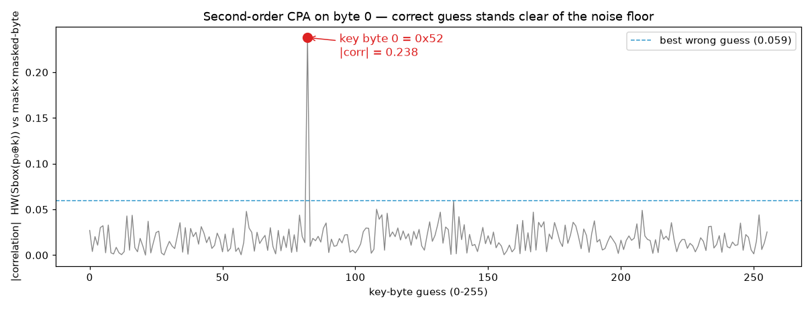

Flag: CSCTF{relay_order_55a10bd8f06393bcc1ae8065}
Category: Crypto (power side-channel, second-order CPA)
Tools used: Python, numpy, cryptography
Challenge: Emanation (CSCTF 2026, Crypto, Medium, 270 pts, author: Michalina Moszyńska)
Brief: Synthetic power traces of a masked, randomly delayed AES-128 first round under known plaintexts. Recover the key and decrypt sealed_order.hex.

Steps:

1. Start point: the handout, emanation.zip
   - What I did: unzipped it and compared its SHA-256 with the brief. It did not match (0937...b6a4, 1,793,415 bytes
     against f1d1...c03f, 1,793,377 bytes), so I loaded the arrays with allow_pickle=False, since a .npy file can
     carry pickled objects that run code on load.
   - What I found: plaintexts.npy (8000 x 16 bytes), traces.npy (8000 x 56 float samples), sealed_order.hex
     (43 bytes) and a README. It describes Hamming-weight leakage plus noise from an AES-128 first round, two
     countermeasures (a random delay and a fresh random byte mask per trace), and the order sealed with AES-128-CTR
     from an all-zero counter block.
   - Thinking: a random delay puts the same operation on a different sample in every trace, so I had to line the
     traces up before any correlation could work.

2. Pivot: the marker spike gives away the delay
   - What I found: every trace has exactly one large spike (about 25, far above every other sample) somewhere in
     samples 0 to 16, at a different spot in each trace.
   - Thinking: a spike that size is a fixed event in the computation, so its position is the random delay itself.
   - What I did: shifted each trace so the spike sits at index 0, which re-aligns all 8000 traces.
   - Result: offsets 3, 5, ..., 35 now hold 17 samples with mean 4 and std about 1.73, which is the Hamming weight
     of a random byte (mean 4, variance 2) plus unit-variance noise. The even offsets are pure noise. That is 17
     leak samples for 16 key bytes.

3. Pivot: a second-order product cancels the mask
   - Thinking: first-order CPA can't work here. Each state byte leaks as HW(Sbox(p ^ k) ^ m) with a fresh random m,
     so one sample on its own says nothing about the key. But the mask also leaks in its own sample as HW(m), and
     the centered product of the mask sample and a masked-byte sample does depend on HW(Sbox(p ^ k)) (negatively,
     for a Hamming-weight model). That is the classic second-order centered-product attack.
   - What I did: to find the mask slot, I tried each of the 17 slots as the mask against every other slot and every
     key byte.
   - What I found: slot 0 scored 3.79 against about 0.87 for every other slot, so slot 0 is HW(m) and slots 1 to 16
     are the 16 masked bytes, in byte order.
   - Result: for each byte the right guess correlates at about 0.24 while the best wrong guess stays below 0.08.
     The key is 52cc11fc4a2ecfc066e3349f4af9fdea.

     

4. Flag: decrypting the sealed order
   - What I did: decrypted sealed_order.hex with AES-128-CTR under the recovered key and an all-zero counter block.
   - Result: CSCTF{relay_order_55a10bd8f06393bcc1ae8065}
   - Thinking: readable plaintext in the flag format checks all 16 key bytes at once, because a single wrong key
     byte would change the whole keystream.

Key insight: Both countermeasures leaked their own secret: the delay showed up as a marker spike to align on, and the mask leaked in its own sample, so a centered product cancelled it. A first-order mask only raises the attack to second order. It stops being cheap only when the shares are not separately observable, or with higher-order masking plus real jitter.
Defensive takeaways: Masking and random delays are hiding controls whose strength depends on implementation details. A side-channel evaluation should test the attacker's best combination (alignment plus higher-order CPA), not just first-order CPA, before claiming resistance.
Reproduce: python -I solve.py path/to/emanation/
Note: The challenge input files are not in this repo, so there is no capture of solve.py re-running.
