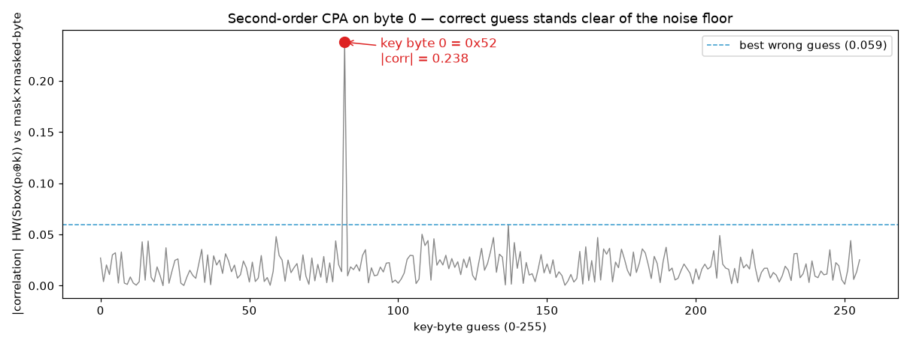

Challenge: Emanation — Crypto / Medium / 270 pts / author: Michalina Moszyńska (CSCTF 2026)
Flag: CSCTF{relay_order_55a10bd8f06393bcc1ae8065}
Category: Side-Channel / Crypto
Tools used: Python (numpy, cryptography), solve.py

Brief: synthetic power traces of a "protected" AES-128 first round (Hamming-weight leakage + noise) under known
plaintexts. Countermeasures: a random delay and a fresh random byte mask per trace. Recover the key and decrypt
sealed_order.hex (AES-128-CTR, all-zero initial counter block).

Steps:
1. Start point: emanation.zip.
   - What I found: plaintexts.npy (8000 x 16 bytes), traces.npy (8000 x 56 float samples), sealed_order.hex (43 bytes),
     and a README describing the leakage model and the two countermeasures.
   - Note: the downloaded zip's SHA-256 (0937...b6a4, 1,793,415 bytes) did not match the value in the brief
     (f1d1...c03f, 1,793,377 bytes). The contents were plain numpy arrays and text, so I loaded them with
     allow_pickle=False (a .npy file can carry pickled objects, which can execute code on load).

2. Pivot: defeating the random delay.
   - What I found: every trace has exactly one large spike (~25, far above every other sample) at a position between
     0 and 16 that changes per trace.
   - Thinking: that spike is a fixed event in the computation, so its position *is* the random delay. Shifting each
     trace so the spike sits at index 0 re-aligns all 8000 traces. After alignment, offsets 3, 5, ..., 35 hold 17
     samples with mean 4 and std ~1.73 - exactly the Hamming weight of a random byte (mean 4, variance 2) plus
     unit-variance noise. The even offsets are pure noise.

3. Pivot: defeating the mask (second-order CPA).
   - Why first-order CPA fails: each state byte leaks as HW(Sbox(p ^ k) ^ m) with a fresh random m, so a single
     sample is statistically independent of the key. Correlating raw samples with any key guess gives nothing.
   - The fix: the mask itself also leaks in one sample, HW(m). Multiplying the centered mask sample by the centered
     masked-byte sample combines both shares; that product *does* depend on HW(Sbox(p ^ k)) (negatively, for a
     Hamming-weight model). This is the classic second-order "centered product" attack.
   - Finding the mask slot: for each slot, I tried it as the mask against every other slot and every key byte.
     Slot 0 scored 3.79 versus ~0.87 for all others, so slot 0 = HW(m) and slots 1..16 = the 16 masked bytes.
   - Result: for each byte, the right key guess correlates at ~0.24 while the best wrong guess stays below 0.08,
     and the slots turned out to be in byte order.
     Key: 52cc11fc4a2ecfc066e3349f4af9fdea

     

4. Pivot: reading the order.
   - What I did: AES-128-CTR decryption of sealed_order.hex with the recovered key and a zero counter block.
   - Result: CSCTF{relay_order_55a10bd8f06393bcc1ae8065}. Readable plaintext in the expected flag format confirms
     all 16 key bytes at once (one wrong byte would garble that block of output).

     _(No reproduction capture: the challenge input files are not in this repo.)_

Reproduce: python -I solve.py path/to/emanation/

Key insight: both countermeasures leaked their own secret. The random delay was visible as a marker spike, so
alignment was trivial, and the mask was processed (and leaked) on its own, so combining its sample with each masked
byte cancelled it out. A first-order mask only raises the attack to second order; it stops being cheap only when
the shares are not separately observable, or with higher-order masking plus real jitter.

Defensive takeaway (GRC angle): masking and random delays are "hiding" controls whose strength depends on
implementation details. A side-channel evaluation should test against the attacker's best combination
(alignment + higher-order CPA), not just first-order CPA, before claiming resistance.
