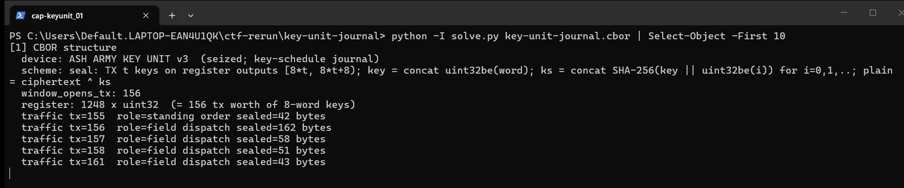
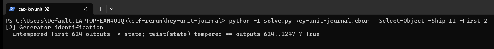
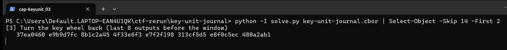
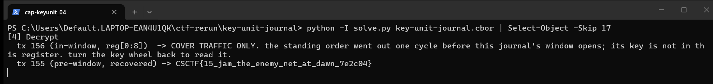

Flag: CSCTF{15_jam_the_enemy_net_at_dawn_7e2c04}
Category: Crypto (MT19937 state recovery)
Tools used: Python, hashlib, struct
Brief: A seized key-unit journal holds sealed dispatches, but the standing order's key predates the recorded output window. Recover the standing order from key-unit-journal.cbor (7,037 bytes, SHA-256 bb14ef0ef3b6c21080a1eef9d34b1a38da4c8407e1dc0dcb29312fb639b2c159).

Steps:

1. Start point: the journal, key-unit-journal.cbor
   - What I did: checked its SHA-256 (it matched) and decoded the CBOR with a small hand-written decoder.
   - What I found: a map with device, scheme, window_opens_tx = 156, register (1248 x uint32) and traffic (5 sealed
     messages: tx 155 "standing order", tx 156, 157, 158 and 161 "field dispatch"). The scheme field spells out the
     cipher:
     - tx t uses register outputs [8t, 8t+8)
     - key = concat uint32be(word)
     - keystream = concat SHA-256(key || uint32be(i)) for i = 0, 1, ...
     - plain = ciphertext ^ keystream
   - Thinking: the window opens at tx 156, so reg[0:8] is the tx 156 key and the tx 155 key is the 8 outputs just
     before the first recorded word. Rebuilding those meant identifying the generator.

     

2. Pivot: the register is a raw MT19937 stream
   - Thinking: 1248 = 2 x 624, and 624 words is exactly one MT19937 state.
   - What I did: untempered the first 624 outputs to rebuild the state, applied one twist and tempered the result.
   - Result: it matched outputs 624..1247 exactly, so the register is plain Mersenne Twister output.

     

3. Pivot: turning the key wheel back one twist
   - What I found: tx 156 decrypts with reg[0:8] to a cover message saying the standing order "went out one cycle
     before this journal's window opens; its key is not in this register. turn the key wheel back to read it."
   - Thinking: that confirmed the scheme and the plan: run one twist backward to get the previous 624-word block P.
   - What I did: inverted the in-place twist, which computes:
     - y_i = top bit of P[i] | low 31 bits of P[i+1]
     - new[i] = new[i-227] ^ (y_i >> 1) ^ (0x9908b0df if y_i is odd, else 0), for i >= 227
   - Result: for i = 623 down to 227, new[i] ^ new[i-227] gives y_i, so P[228..623] comes back in full. Tempering
     P[616..623] gives the 8 outputs just before the window: 37ea0460 e9b9d7fc 8b1c2a45 4f33e6f3 e7f2f198 313cf5d5
     e8f0c5ec 480a2ab1.

     

4. Flag: decrypting the tx 155 standing order
   - What I did: packed the 8 words into the key and XORed the tx 155 ciphertext with the SHA-256 keystream.
   - Result: CSCTF{15_jam_the_enemy_net_at_dawn_7e2c04}
   - Thinking: the routine that reads tx 156 turned tx 155 into clean flag text, which confirms the 8 words.

     

Key insight: Any 624 consecutive MT19937 outputs reveal the whole state, and the twist runs backward as easily as forward, so keys from before the recorded window were exposed too. Deriving key material straight from a non-cryptographic PRNG breaks both forward and backward secrecy.
Defensive takeaways: Derive each message key with a KDF such as HKDF from a secret and a per-message nonce, or draw it from a CSPRNG, never from a raw MT19937 stream.
Reproduce: python -I solve.py key-unit-journal.cbor (standard library only)
Note: The screenshots are Windows Terminal captures of solve.py, one per stage.
