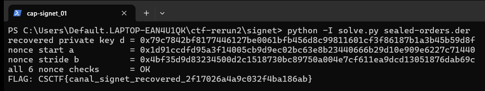

Flag: CSCTF{canal_signet_recovered_2f17026a4a9c032f4ba186ab}
Category: Crypto (ECDSA nonce recovery)
Tools used: Python, hashlib, hmac, cryptography
Challenge: The Signet (CSCTF 2026, Crypto, Easy, 120 pts, author: Terminal43)
Brief: A dispatch signet signed six orders on secp256k1 while its entropy sampler was faulty, then sealed a seventh standing order with a key derived from its private key. Recover the private key and decrypt the sealed order.

Steps:

1. Start point: the handout, sealed-orders.der and case-note.txt
   - What I did: read case-note.txt, which documents the DER layout of sealed-orders.der and the signer's fault.
   - What I found: the bundle holds six SignedOrder records (seq 0..5, each the exact message plus an ECDSA r, s)
     and one SealedOrder (salt, nonce, ciphertext, tag). The note pins down the math:
     - curve secp256k1, hash SHA-256, z_i = int_be(SHA-256(message_i)) mod n
     - seal key = HKDF-SHA256(IKM = d as 32 big-endian bytes, salt = seal.salt, info = "CSCTF26/TheSignet/v1/standing-order", L = 32)
     - seal cipher = AES-256-GCM with seal.nonce, seal.tag and empty AAD
   - Thinking: the note says each nonce was the previous one plus "the same additive stride modulo the curve order".
     So the nonces are k_i = a + i*b (mod n) with an unknown start a and stride b. That is a linear relation, so I
     never have to guess a or b.

2. Pivot: each signature is a linear equation in d
   - What I did: rewrote each signature in terms of the three unknowns d, a and b (all mod n):
     - s_i = k_i^-1 (z_i + r_i d), so k_i = A_i d + B_i with A_i = s_i^-1 r_i and B_i = s_i^-1 z_i
     - setting that equal to a + i*b gives A_i d - a - i*b = -B_i (mod n)
   - Result: Gaussian elimination modulo n on records 0, 1 and 2 (each division a modular inverse) gives the
     private key d = 0x79c7842bf8177446127be0061bfb456d8c99811601cf3f86187b1a3b45b59d8f.
   - Thinking: three equations fix three unknowns, which leaves records 3 to 5 as free checks. Recomputing each
     nonce as s_i^-1 (z_i + r_i d) for all six records gave a + i*b (mod n) every time, so the stride model is the
     true one and not a coincidence.

3. Flag: opening the seal with HKDF and AES-GCM
   - What I did: derived the seal key with HKDF-SHA256 from d as 32 big-endian bytes and the note's salt and info.
     With L = 32 that is a single expand block, HMAC(PRK, info || 0x01). Then I decrypted seal.ciphertext with
     AES-256-GCM using seal.nonce, seal.tag and empty AAD.
   - Result: CSCTF{canal_signet_recovered_2f17026a4a9c032f4ba186ab}
   - Thinking: GCM only accepts the tag under the right key, so a clean decrypt is one more proof that d is right.

     

Key insight: Nonces that step by a fixed stride make every ECDSA signature a linear equation in the private key, start and stride, so three signatures solve for the key and the rest verify it.
Defensive takeaways: ECDSA security rests on unpredictable, independent per-signature nonces. A structured k (reuse, a counter, an LCG, or here a fixed stride) leaks the private key from a handful of signatures, so use deterministic nonces (RFC 6979) or an audited RNG and never sign with a degraded entropy source. Deriving the seal key from the signing key also tied two duties to one secret: breaking the signatures unsealed the data. Keep signing and encryption keys separate.
Reproduce: python -I solve.py sealed-orders.der
Note: The screenshot is a live re-run of solve.py against the challenge's own sealed-orders.der and reproduces the flag above.
