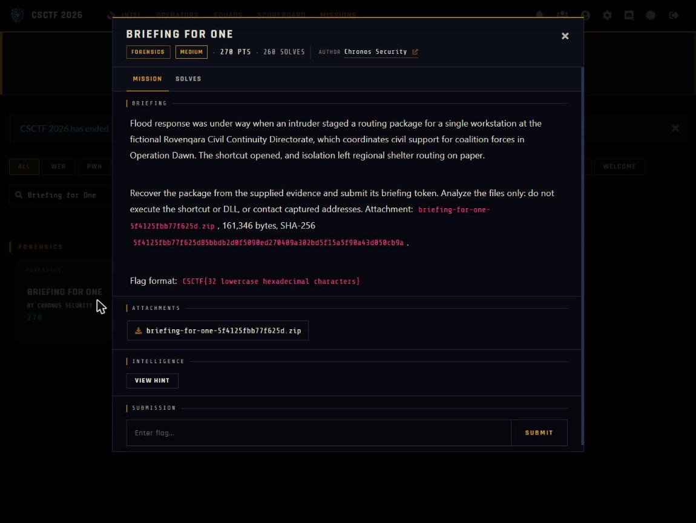

Flag: CSCTF{eab85b3bb8d309ec8f52a3f6271c55ff}
Category: Forensics (offline LNK payload reconstruction)
Tools used: Python (struct, hmac, hashlib, base64, collections), py7zr
Challenge: Briefing for One (CSCTF 2026, Forensics, Medium, 270 pts, author: Chronos Security)
Brief: During flood response an intruder staged a routing package for one workstation at the fictional Rovenqara Civil Continuity Directorate. I had to recover it from briefing.lnk, machine-cryptography.hiv and egress.pcapng and submit its briefing token, analyzing the files only (no running the shortcut or DLL, no contacting captured addresses). Flag format is CSCTF{32 lowercase hex}.

Steps:
1. Start point: the handout zip and its field guide
   - What I did: checked the outer zip's SHA-256 against the challenge text, then verified the five members (briefing.lnk, machine-cryptography.hiv, egress.pcapng, field-guide.md, provenance.json) against SHA256SUMS.
   - What I found: field-guide.md says to work on copies and never open the shortcut, load the DLL or contact a recorded address. It says the hive is a saved Cryptography subkey that a reader presents as its root, and it gives a worked HMAC example vector for checking byte handling.
   - Thinking: the guide spells out what a safe, static reconstruction has to reproduce, so once the hashes matched I treated every later step as data handling only.

     

2. Pivot: the shortcut's command line is the recipe
   - What I did: pulled the UTF-16 command string out of briefing.lnk as data, without opening the shortcut.
   - What I found: a hidden powershell.exe -Command that reads MachineGuid from HKLM\SOFTWARE\Microsoft\Cryptography and derives a password as hex HMAC-SHA256, with key = base64 of eyy//ntonkO5y+zE61CW4ddRSUWiWBgzwe3ra1tENd8= and message = "csctf26/briefing-for-one/v1" || 0x00 || the lower-case GUID.
   - What I found: it then copies \\briefing.rovenqara.test@80\DavWWWRoot\ops\route-update.7z over WebDAV (expected SHA-256 d29a0679...), 7z-extracts it with that password, checks the route-update.dll and route-table.json hashes, and runs rundll32 ApplyRouteTable. The token lives in route-table.json.
   - Thinking: the command line names every input I need (MachineGuid, the HMAC recipe, the archive and its expected hash), so I could rebuild the whole chain offline.
   - Result: three inputs to recover: MachineGuid, the password and the 7z.

3. Exploit: MachineGuid from the hive, then the password
   - What I did: wrote a small regf parser that walks the nk and vk cells from the saved root of machine-cryptography.hiv.
   - What I found: MachineGuid is 080c7be1-f41c-446c-b961-93bd7bc4ea31.
   - What I did: checked my HMAC code against the field guide's example vector (7dad6991...), then ran it on the real GUID to get the password ee731407a271c8aa4b92f93d362591626421d32465aeba3f912ac09c576dc6c0.
   - Thinking: the password is keyed to this workstation's MachineGuid, so the hive came first, and matching the guide's vector proved the byte layout (one 0x00 separator, lower-case GUID, hex output) before I used real inputs.

4. Pivot: carve the 7z out of the WebDAV capture
   - What I did: reassembled the server-to-client TCP streams in egress.pcapng and split them into HTTP responses.
   - What I found: the host-only WebDAV exchange is 1 OPTIONS, 6 PROPFIND (their 207 XML bodies are decoys) and 1 GET for /ops/route-update.7z, whose 5,359-byte body hashes to d29a0679..., the same value the shortcut checks.
   - Thinking: the field guide warns that a DAV XML body, a raw TCP stream and the binary object are different bytes, so the shortcut's own hash was the test: a match means the carved body is byte-exact.

5. Flag: open the archive and read the token
   - What I did: opened the 7z with py7zr and the derived password, giving route-update.dll (230b2e64..., never run) and route-table.json (cc106579...).
   - What I found: route-table.json holds "briefing_token":"CSCTF{eab85b3bb8d309ec8f52a3f6271c55ff}" plus two routes (North Depot to School 4 open, West Depot to Hall 2 divert). The DLL's strings carry the same JSON split around the token value.
   - Thinking: the JSON and the DLL strings are two independent sources agreeing on the token, which is enough to trust it.
   - Result: CSCTF{eab85b3bb8d309ec8f52a3f6271c55ff}

Key insight: The shortcut's own command line held the full recipe, so I rebuilt its MachineGuid-keyed HMAC password and carved its WebDAV 7z from the capture without running anything. The hashes the shortcut embeds prove the reconstruction is byte-exact, and the DLL is never loaded.
Defensive takeaways: Alert on shortcuts that launch hidden PowerShell and on workstations pulling files through DavWWWRoot. Because the archive password is derived from each host's MachineGuid, the payload only opens for its target, so responders need that host's Cryptography key alongside the capture.
Reproduce: python -I solve.py machine-cryptography.hiv egress.pcapng (needs py7zr)
Note: the handout triggers Windows Defender as Trojan:Script/Wacatac.H!ml, a generic ML detection on the inert shortcut and DLL fixture. Work on a copy in a Defender-excluded folder or a VM; nothing here is executed.
