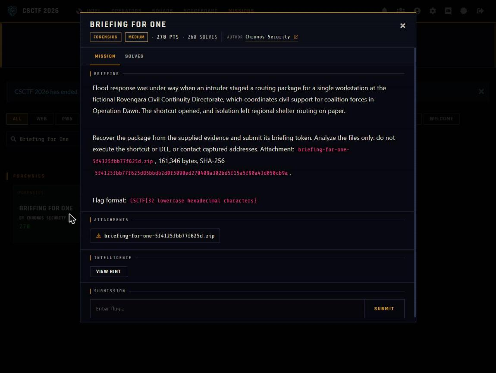

Challenge: Briefing for One - Forensics / Medium / 270 pts / author: Chronos Security (CSCTF 2026)
Flag: CSCTF{eab85b3bb8d309ec8f52a3f6271c55ff}
Category: Forensics (LNK, WebDAV pcap, 7z recovery)
Tools used: Python (struct, hmac, hashlib, base64, collections), py7zr, solve.py

Brief: During flood response an intruder staged a routing package for one workstation at the fictional Rovenqara Civil Continuity Directorate; I had to recover the package from briefing.lnk, machine-cryptography.hiv and egress.pcapng and submit its briefing token, analyzing the files only (never running the shortcut or DLL, never contacting captured addresses). Flag format is CSCTF{32 lowercase hex}.

Steps:
1. Start point: verify and read the field guide
   - What I found: the hash of the outer zip matches the challenge text, and SHA256SUMS verifies all five extracted members (briefing.lnk, machine-cryptography.hiv, egress.pcapng, field-guide.md, provenance.json).
   - What I found: field-guide.md says to work on copies and never run the shortcut or DLL or contact any address. It also gives the exact HKDF byte layout as a self-check vector (verified against the real inputs), and says the saved hive presents the Cryptography subkey as its root.
   - Thinking: the guide tells me what a safe, static reconstruction has to reproduce, so I checked hashes first and treated everything after as data handling only.
   - Result: evidence is trusted and the rules are clear.

     

2. Pivot: read the shortcut as data
   - What I did: pulled the UTF-16 command string out of briefing.lnk without executing it.
   - What I found: it is a hidden powershell.exe -Command that reads MachineGuid from HKLM\SOFTWARE\Microsoft\Cryptography, then derives a password as HMAC-SHA256 (key = base64 of eyy//ntonkO5y+zE61CW4ddRSUWiWBgzwe3ra1tENd8=, message = "csctf26/briefing-for-one/v1" || 0x00 || lower-case guid) written as hex.
   - What I found: it then copies \\briefing.rovenqara.test@80\DavWWWRoot\ops\route-update.7z over WebDAV (expected SHA-256 d29a0679...), 7z-extracts it with that password, checks route-update.dll and route-table.json hashes, and runs rundll32 ApplyRouteTable. The token lives in route-table.json.
   - Thinking: the command line lists every input I need (MachineGuid, the HMAC recipe, the downloaded archive and its expected hash), so I could rebuild the whole chain offline.
   - Result: three inputs to recover: MachineGuid, the password, and the 7z.

3. Exploit: recover each input offline
   - What I did: wrote a small regf parser (nk and vk cells) over machine-cryptography.hiv and got MachineGuid 080c7be1-f41c-446c-b961-93bd7bc4ea31.
   - What I did: ran the HMAC above to get the password ee731407a271c8aa4b92f93d362591626421d32465aeba3f912ac09c576dc6c0. The field guide's example vector is asserted in solve.py, so the byte handling was proven before the real inputs were used.
   - What I found: egress.pcapng is the host-only WebDAV exchange: 1 OPTIONS, 6 PROPFIND (the 207 XML bodies are decoys), and 1 GET for /ops/route-update.7z whose 5,359-byte body hashes to d29a0679..., matching the shortcut's own check.
   - Thinking: the matching hash proves the reassembled TCP response body is byte-exact, so I carved that body from the stream.
   - Result: I have the password and the exact archive.

4. Decrypt: open the archive and read the token
   - What I did: py7zr opened the 7z with the derived password, giving route-update.dll (230b2e64..., never run) and route-table.json (cc106579...).
   - What I found: the JSON contains "briefing_token":"CSCTF{eab85b3bb8d309ec8f52a3f6271c55ff}". The DLL's own strings show the same token-bearing JSON split around the value, which confirms it.
   - What I did: ran python solve.py machine-cryptography.hiv egress.pcapng, which prints MachineGuid, the 7z password, the JSON (routes North Depot to School 4 open, West Depot to Hall 2 divert) and the flag.
   - Thinking: two independent sources (the JSON and the DLL strings) agreeing on the token is enough to trust it.
   - Result: CSCTF{eab85b3bb8d309ec8f52a3f6271c55ff}

Key insight: Everything the malware would do at runtime can be reproduced as pure data handling, with no execution. I parsed the hive for the one input that personalises the key (MachineGuid), recomputed the same HMAC the script computes, carved the exact object the script downloads (validated by the script's own expected hash), and opened the archive. The DLL is never loaded and no captured host is contacted. The object hashes the shortcut embeds are what prove the reconstruction is byte-exact.

Note: the handout triggers Windows Defender as Trojan:Script/Wacatac.H!ml, a generic ML detection on the inert shortcut and DLL fixture. Work on a copy in a Defender-excluded folder or a VM; nothing here is executed.
