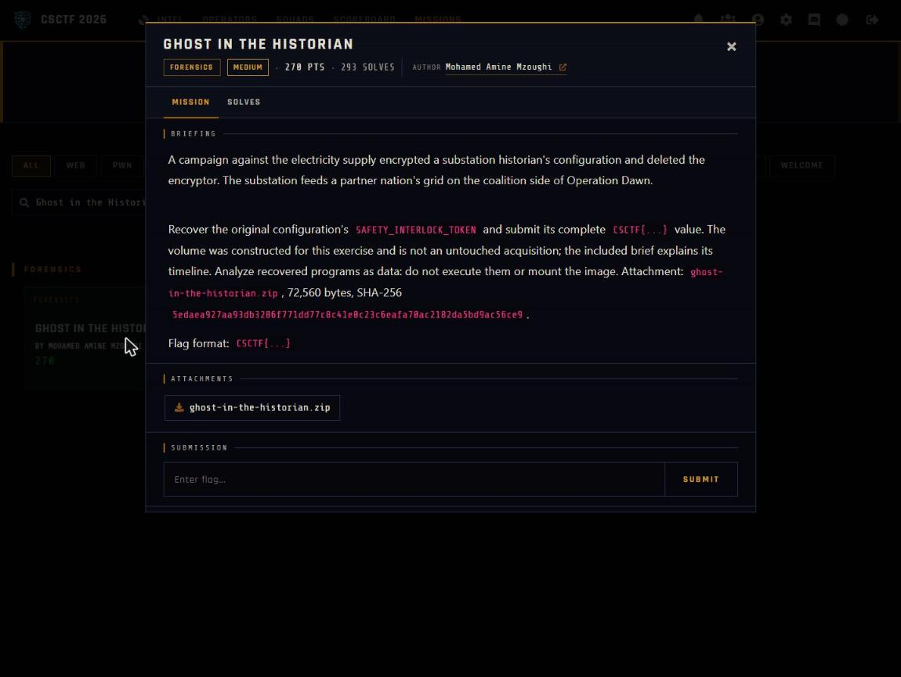

Challenge: Ghost in the Historian - Forensics / Medium / 270 pts / author: Mohamed Amine Mzoughi (CSCTF 2026)
Flag: CSCTF{xorshift_ghost_in_the_historian_d2c19434a637}
Category: Forensics (ext4 carving, xorshift decryptor)
Tools used: WSL debugfs, Python (struct, glob), objdump, solve.py

Brief: A campaign against the electricity supply encrypted a substation historian's configuration and deleted the encryptor; I had to recover the original configuration's SAFETY_INTERLOCK_TOKEN and submit its full CSCTF{...} value, analyzing recovered programs as data and never executing them or mounting the image. The attachment is ghost-in-the-historian.zip (evidence.vmdk descriptor, evidence-flat.vmdk flat extent, README).

Steps:
1. Start point: open the image without mounting it
   - What I found: evidence.vmdk is a monolithicFlat descriptor pointing at evidence-flat.vmdk, which is a raw ext4 filesystem at offset 0 (volume HISTORIAN01, 4096-byte blocks). I read it with debugfs (e2fsprogs), read-only, no mount.
   - What I found: /var/historian holds three encrypted files (node_status.json.enc, grid_topology.cfg.enc, historian_cache.dat.enc). /var/log/historian.log says "historian_enc[2764964]: starting encryption sweep". Three deleted inodes exist but their block pointers are wiped and the journal has nothing to replay.
   - Thinking: the challenge forbids mounting, and deleted inodes with wiped pointers mean the encryptor can only come back by carving raw blocks.
   - Result: I know the files, the encryptor's pid (2764964), and that normal undelete will not work.

     

2. Pivot: carve the deleted encryptor
   - What I did: scanned the image for non-zero blocks (only 32 in the whole 64 MB) and mapped each to its owning inode.
   - What I found: five blocks have no owner. One is the ransom note, four are a 64-bit ELF PIE.
   - What I did: glued those four blocks back together to get the encryptor, never executed and analyzed with objdump as data.
   - Thinking: with only 32 used blocks, the ownerless ones had to be the deleted files, and the ELF header told me which four belonged together.
   - Result: the encryptor binary is recovered.

3. Decrypt: reverse the cipher
   - What I found: the per-word loop uses constant 0x9E3779B1 with rol h,5, a xorshift32 keystream. The seed is (time ^ pid) * 0x9E3779B1 mod 2^32, or 0xA5A5A5A5 when time == pid. For each 4-byte word s = xorshift32(s) (shifts 13, 17, 5), and the 4 little-endian bytes are XORed into the data.
   - What I found: the encryptor keeps the state across files, processes them in scandir (alphabetical) order, utime()s each .enc to the sweep start time, then deletes the original.
   - Thinking: each ciphertext's own mtime is the time in the seed, so the only unknowns are already on disk. All three mtimes are 0x6ABF2F51 (2026-10-02 12:13:05 UTC) and the pid is 2764964 from the log.
   - Dead end: the challenge's ppm/offset flavour does not apply here; the seed is just time ^ pid.
   - Result: seed = (0x6ABF2F51 ^ 2764964) * 0x9E3779B1.

4. Result: decrypt in order and read the token
   - What I did: reproduced the keystream and XORed the three files in alphabetical order with state carried across them.
   - What I found: grid_topology.cfg decrypts to the config (Meridian Grid Authority, Historian Node 07, NODE_ID=MGA-HIST-07, CHECKSUM=pending-resync) containing SAFETY_INTERLOCK_TOKEN=CSCTF{xorshift_ghost_in_the_historian_d2c19434a637}. historian_cache.dat decrypts to two PRESS,OK readings and node_status.json to a nominal status for MGA-HIST-07.
   - What I did: ran python solve.py evidence/ which prints all three decrypted files and the flag. The evidence folder holds the three .enc files and historian.log dumped from the image with debugfs; the full flat vmdk is the original handout and is not copied here for size.
   - Thinking: readable plaintext in all three files confirms the order and seed are right.
   - Result: CSCTF{xorshift_ghost_in_the_historian_d2c19434a637}

Key insight: The cipher is a pure XOR keystream, so decryption is the same routine as encryption and the only unknowns are the seed inputs. The encryptor itself tells you where they come from: it stamps each .enc's mtime with the very time it seeds from, and the pid is printed in the log. The keystream state carrying between files is why the decrypt order has to be the encryptor's scandir order, not the order you happen to list them in.
