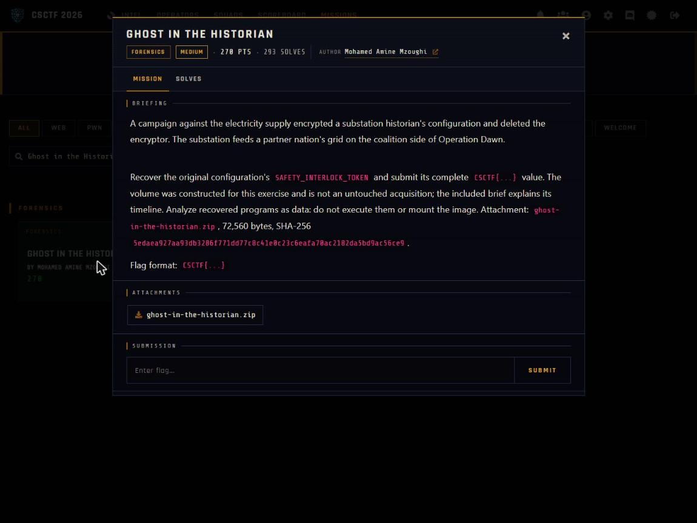

Flag: CSCTF{xorshift_ghost_in_the_historian_d2c19434a637}
Category: Forensics (ext4 carving, xorshift keystream recovery)
Tools used: debugfs (WSL), objdump, Python (struct, glob)
Challenge: Ghost in the Historian (CSCTF 2026, Forensics, Medium, 270 pts, author: Mohamed Amine Mzoughi)
Brief: A campaign against the electricity supply encrypted a substation historian's configuration and deleted the encryptor. I had to recover the original configuration's SAFETY_INTERLOCK_TOKEN, treating recovered programs as data and never executing them or mounting the image. The attachment is ghost-in-the-historian.zip (evidence.vmdk descriptor, evidence-flat.vmdk flat extent, README).

Steps:
1. Start point: open the disk image without mounting it
   - What I did: read evidence.vmdk, a monolithicFlat descriptor pointing at evidence-flat.vmdk, then opened that raw ext4 filesystem (offset 0, volume HISTORIAN01, 4096-byte blocks) read-only with debugfs.
   - What I found: /var/historian holds three encrypted files (node_status.json.enc, grid_topology.cfg.enc, historian_cache.dat.enc), and /var/log/historian.log says "historian_enc[2764964]: starting encryption sweep". Three deleted inodes exist, but their block pointers are wiped and the journal has nothing to replay.
   - Thinking: mounting is forbidden, and wiped block pointers mean normal undelete is out, so the encryptor could only come back by carving raw blocks.
   - Result: I have the encrypted files and the encryptor's pid (2764964).

     

2. Pivot: carve the encryptor from ownerless blocks
   - What I did: scanned the image for non-zero blocks (only 32 in the whole 64 MB) and mapped each one to its owning inode.
   - What I found: five blocks have no owner. One is the ransom note and four are a 64-bit ELF PIE.
   - What I did: joined those four blocks back into the encryptor binary and read it with objdump only, never running it.
   - Thinking: with only 32 used blocks, the ownerless ones had to be the deleted files, and the ELF header told me which four belonged together.

3. Decode: reverse the cipher and its seed
   - What I found: the per-word loop is a xorshift32 keystream (shifts 13, 17, 5) seeded with (time ^ pid) * 0x9E3779B1 mod 2^32, or 0xA5A5A5A5 when time equals pid. Each 4-byte word steps the state and XORs its 4 little-endian bytes into the data.
   - What I found: the encryptor keeps the state across files, walks them in scandir (alphabetical) order, utime()s each .enc to the sweep start time and then deletes the original.
   - Thinking: the utime() call means each ciphertext's own mtime is the time in the seed. All three mtimes are 0x6ABF2F51 (2026-10-02 04:13:05 UTC, the same minute as the log line) and the pid is 2764964 from the log, so both unknowns were already on disk.
   - Dead end: the brief's warning that the image carries two different clocks made me expect a drift or offset correction, but none applies; the seed uses the .enc mtime as-is.
   - Result: seed = (0x6ABF2F51 ^ 2764964) * 0x9E3779B1 mod 2^32.

4. Flag: decrypt in scandir order and read the token
   - What I did: rebuilt the keystream and XORed the three files in alphabetical order, carrying the state from one file to the next.
   - What I found: grid_topology.cfg decrypts to the Meridian Grid Authority Historian Node 07 config (NODE_ID=MGA-HIST-07, CHECKSUM=pending-resync) with SAFETY_INTERLOCK_TOKEN=CSCTF{xorshift_ghost_in_the_historian_d2c19434a637}. historian_cache.dat gives two PRESS,OK readings and node_status.json a nominal status for MGA-HIST-07.
   - Thinking: readable plaintext in all three files confirms both the seed and the order, since a wrong order would garble every file after the first.
   - Result: CSCTF{xorshift_ghost_in_the_historian_d2c19434a637}

Key insight: The deleted encryptor seeds a xorshift32 XOR keystream from time ^ pid, and it stamped that time into every .enc mtime and logged the pid, so the key was sitting on disk. Because the keystream is pure XOR, decryption is the same routine as encryption. The state carries between files, so the decrypt order has to be the encryptor's scandir order, not whatever order a listing returns.
Defensive takeaways: A cipher seeded from time and pid is only as secret as the file metadata and logs, which here gave the key away. Deleting a tool does not remove it either: the ELF survived in unallocated blocks, so imaging before free space is reused is what preserves it.
Reproduce: python -I solve.py evidence (the folder holds the three .enc files and historian.log dumped from the image with debugfs; the flat vmdk is not copied here for size)
