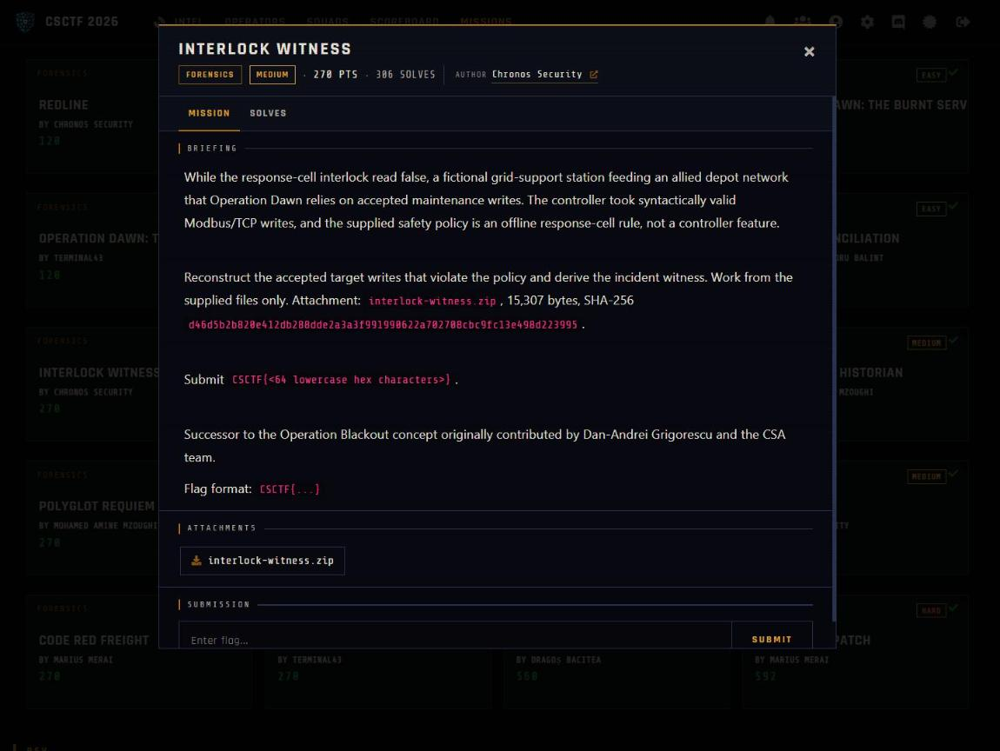

Flag: CSCTF{1198b297c84064fab89d0f3e3e5308791165333c1b64da17185dd51493b6f339}
Category: Forensics (Modbus/TCP policy replay)
Tools used: Python (struct, hashlib, collections)
Challenge: Interlock Witness (CSCTF 2026, Forensics, Medium, 270 pts, author: Chronos Security)
Brief: While a fictional grid-support station's response-cell interlock read false, its controller accepted maintenance writes. I had to reconstruct the accepted target writes that break the supplied offline safety policy and derive the incident witness hash, submitted as CSCTF{64 lowercase hex}. The challenge succeeds the Operation Blackout concept by Dan-Andrei Grigorescu and the CSA team.

Steps:
1. Start point: interlock-witness.zip and its policy docs
   - What I did: verified every member of interlock-witness.zip against SHA256SUMS (interlock.pcapng, register-map.md, interlock-policy.md, witness-format.md, provenance.json), then read the docs.
   - What I found: register-map.md lists zero-based u16 big-endian holding registers: 0x000A maintenance_permit, 0x000B isolation_state, 0x000C protection_armed, 0x0013 trip_limit (0-10000) and 0x0014 restore_delay (0-3600).
   - What I found: interlock-policy.md says one client talks to the controller on TCP 502 (MBAP protocol id 0, unit id 1), one request and response at a time. Its rules:
     - an FC03 read counts only if its response matches the request's transaction, protocol, unit and function and its byte count is 2 x quantity; it updates every mapped word it covers
     - an FC16 write counts only if its normal response echoes the start address and quantity; exception responses never change state
     - an accepted write is applied after its normal response, not on the request
     - a target is FC16, quantity 1, start 0x0013 or 0x0014, and it is unsafe if permit, isolation or armed is not 1 just before its normal response
     - the other 8 accepted FC16 writes are ineligible: 5 set the prerequisite words and 3 are acknowledgements
   - What I found: witness-format.md builds T from each unsafe target's request PDU then response PDU (no MBAP) in normal-response order, sets P to the 20 bytes "INTERLOCK-WITNESS/1" plus a NUL, and makes the flag CSCTF{hex of SHA-256(P || T)}. It includes a non-incident test vector, which solve.py asserts.
   - Thinking: the policy says it is an offline rule, not a controller feature, so the verdict depends entirely on replaying state in exact wire order.

     

2. Pivot: parse the capture without tshark
   - What I did: wrote a stdlib pcapng reader (Section Header byte order, Interface Description link types, Enhanced and Simple Packet Blocks), reassembled each TCP direction by sequence number, then cut the streams into MBAP frames (u16 tid, u16 pid, u16 len, u8 uid, then the PDU).
   - What I found: a single TCP flow 127.0.0.1:59818 to :502, 512 packets, no retransmits or gaps.
   - Thinking: clean reassembly means any later mistake is in my policy logic, not the framing.
   - Result: 124 FC03 reads (all accepted) and 128 FC16 writes (all with normal responses, no exceptions).

3. Exploit: replay the policy in strict wire order
   - What I did: ordered every frame by the packet in which its last byte arrived, so each request is scored against the state as it stood at its response.
   - What I did: let accepted reads update permit, isolation, armed, trip and restore, and applied each accepted write only after its response.
   - What I did: for each quantity-1 FC16 to 0x0013 or 0x0014, recorded (permit, isolation, armed) at that instant.
   - Thinking: the policy's "apply after the normal response" rule is the trap. Applying a write on the request would shift state by one step and misclassify its neighbours.

4. Flag: score the unsafe writes and hash the witness
   - What I found: 16 of the 120 target writes are unsafe, in two bursts. Tids 4 to 18 (even) ran with permit 0 and isolation 0, so trip_limit and restore_delay changed before any permit. Tids 127 to 141 (odd) ran with isolation 0, because tid 125 had reconnected the station and writes continued until tid 142 isolated it again.
   - What I found: the other 8 accepted FC16 writes match the policy's ineligible count exactly: 5 set the prerequisite words (tids 2, 19, 20, 125, 142) and 3 are acknowledgement writes to 0x18, 0x19 and 0x1A (tids 248, 250, 252).
   - Thinking: the policy states its own counts, so matching them proved the pairing logic before I hashed anything.
   - What I did: concatenated the 16 unsafe request and response PDUs into T, prepended P and took SHA-256. The run lists each unsafe write, from tid=4 addr=0x0013 val=040d pre=(0,0,1) to tid=141 addr=0x0014 val=0a9a pre=(1,0,1).
   - Result: CSCTF{1198b297c84064fab89d0f3e3e5308791165333c1b64da17185dd51493b6f339}

Key insight: The policy judges each Modbus write on the state just before its response, so I replayed the capture in wire order and applied each accepted write only after its response. Checking every response against its request (transaction, protocol, unit and function match, FC16 address and quantity echo, FC03 byte count) is what separates a write the controller accepted from one the client merely sent. Reproducing the policy's own counts (8 ineligible writes, 5 of them prerequisite-state) showed the classification was right before the hash was taken.
Defensive takeaways: The controller took every syntactically valid write while the interlock words were false, so the safety rule existed only on paper. Permit and isolation checks belong in the controller or a Modbus-aware filter, and captures need both directions, since only the normal response proves a write landed.
Reproduce: python -I solve.py interlock.pcapng
