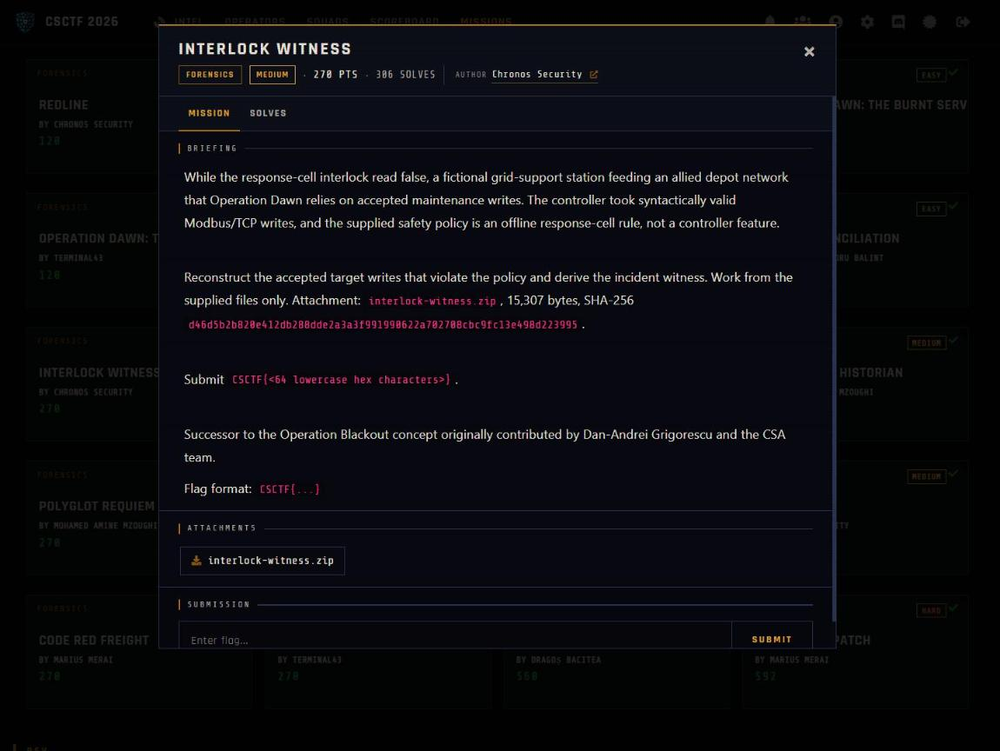

Challenge: Interlock Witness - Forensics / Medium / 270 pts / author: Chronos Security (CSCTF 2026)
Flag: CSCTF{1198b297c84064fab89d0f3e3e5308791165333c1b64da17185dd51493b6f339}
Category: Forensics (Modbus/TCP policy replay)
Tools used: Python (struct, hashlib, collections), solve.py

Brief: While a fictional grid-support station's response-cell interlock read false, it accepted maintenance writes; I had to reconstruct the accepted target writes that violate the supplied offline safety policy and derive the incident witness hash. The challenge is the successor to the Operation Blackout concept contributed by Dan-Andrei Grigorescu and the CSA team. Attachment: interlock-witness.zip (interlock.pcapng, register-map.md, interlock-policy.md, witness-format.md, provenance.json, SHA256SUMS). Submit CSCTF{64 lowercase hex}.

Steps:
1. Start point: read the four supplied docs
   - What I found: register-map.md (zero-based PDU addresses): 0x000A maintenance_permit, 0x000B isolation_state, 0x000C protection_armed, 0x0013 trip_limit (0-10000), 0x0014 restore_delay (0-3600). All are u16 big-endian holding registers.
   - What I found: interlock-policy.md says one maintenance client talks to the controller on TCP 502, MBAP protocol id 0x0000, unit id 0x01, one request/response at a time. An FC03 read is accepted only if its response matches the reversed-flow transaction/protocol/unit/function and byte count is 2*quantity; it updates every mapped word it covers. An FC16 write is accepted only if its normal response echoes start address and quantity (exception responses never change state), and the write is applied AFTER its normal response.
   - What I found: a target transaction is FC16, quantity 1, start 0x0013 or 0x0014. A target is unsafe when, in the moment immediately before its normal response, any of permit==1, isolation==1, armed==1 is false.
   - What I found: witness-format.md says for each unsafe accepted target, in normal-response order, append its request PDU (function code plus data, no MBAP) then its paired normal-response PDU to make T. P is the 20 bytes "INTERLOCK-WITNESS/1" plus a NUL. W = SHA-256(P || T) and the flag is CSCTF{lowercase hex W}. A non-incident vector is given to self-check byte handling (asserted in solve.py). SHA256SUMS verifies every extracted member before I trusted it.
   - Thinking: the policy is not a controller feature, so the verdict depends entirely on replaying state in exact wire order.
   - Result: I know exactly what to score and how to hash it.

     

2. Pivot: parse the capture with no tshark
   - What I did: wrote a stdlib pcapng reader (Section Header byte-order, Interface Description link types, Enhanced/Simple Packet Blocks), then per-direction TCP reassembly by sequence number, then MBAP framing (u16 tid, u16 pid, u16 len, u8 uid, then the PDU).
   - What I found: a single TCP flow 127.0.0.1:59818 to :502, 512 packets, no retransmits or gaps.
   - Thinking: clean reassembly means any mistake later is in my policy logic, not the framing.
   - Result: 124 FC03 reads (all accepted) and 128 FC16 writes (all with normal responses, no exceptions).

3. Exploit: replay the policy in strict wire order
   - What I did: ordered requests and responses by the packet in which each frame's last byte arrives, so every request is scored against the state as it stood at its response.
   - What I did: reads update permit, isolation, armed, trip and restore; each accepted write updates state only AFTER its response, never on the request.
   - What I did: for each quantity-1 FC16 to 0x0013 or 0x0014, recorded whether (permit, isolation, armed) == (1,1,1) at that instant.
   - Thinking: applying a write on the request instead of the response would shift state by one step and misclassify neighbours.
   - Result: a list of target writes with their pre-state.

4. Result: find unsafe writes and compute the witness
   - What I found: 16 of the 120 target writes are unsafe, in two bursts. Tids 4-18 (even): permit=0, isolation=0, so trip_limit and restore_delay changed before the permit was ever granted. Tids 127-141 (odd): isolation=0, because tid 125 had set isolation back to 0 (reconnected) and writes continued until tid 142 isolated the station again.
   - What I found: the other 8 accepted FC16 writes are exactly what the policy calls ineligible: 5 set the three prerequisite words (tids 2, 19, 20, 125, 142) and 3 are acknowledgement writes to 0x18, 0x19 and 0x1A (tids 248, 250, 252).
   - Thinking: the policy states its own counts, so matching them is proof the pairing logic is right before hashing.
   - What I did: concatenated the 16 unsafe writes' request and response PDUs into T, prepended P, took SHA-256. Command: python solve.py interlock.pcapng. It prints each unsafe write (for example tid=4 addr=0x0013 val=040d pre=(0,0,1) and tid=141 addr=0x0014 val=0a9a pre=(1,0,1)) and then the flag.
   - Result: CSCTF{1198b297c84064fab89d0f3e3e5308791165333c1b64da17185dd51493b6f339}

Key insight: The policy judges each write on the state in the instant before its response, so the solver must replay state strictly in request-to-response order and apply an accepted write only after its response, never on the request. Validating each response against its request (matching transaction, protocol, unit, function, FC16 address and quantity echo, FC03 byte count) is what separates "the controller accepted this" from "the client merely sent it", the same split a real response-cell forensic tool makes. The policy states its own counts (8 ineligible writes, 5 of them prerequisite-state), and reproducing those exactly shows the classification is correct, not merely plausible, before the hash is taken.
