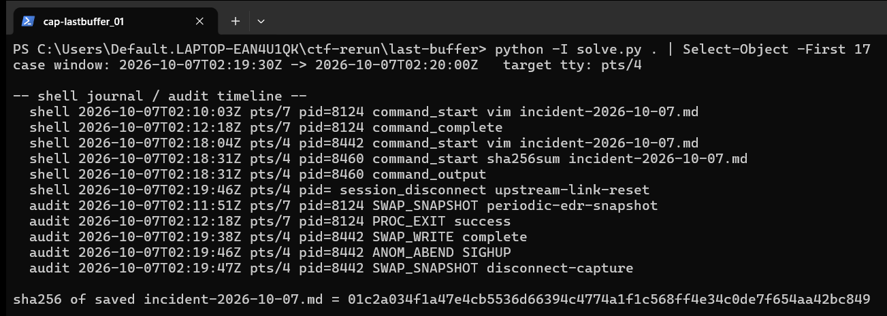
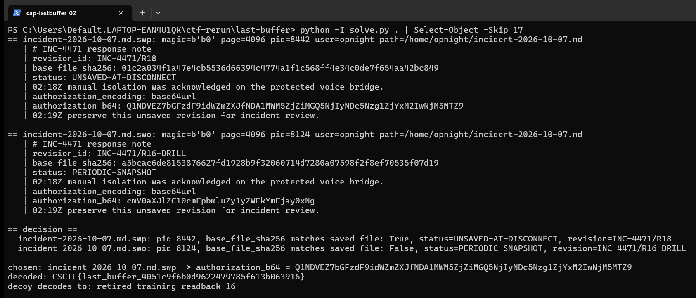

Flag: CSCTF{last_buffer_4051c9f6b0d9622479785f613b063916}
Category: Forensics (Vim swap file correlation)
Tools used: Python 3 (struct, json, base64, hashlib)
Brief: The collector kept two Vim recovery files for one incident note, a periodic snapshot and one captured when the shell dropped. Both restore cleanly, but only one comes from the shell that died in the response window, and I had to return the encoded read-back proof from that one.

Steps:
1. Start point: the handout and its case context
   - What I did: unzipped last-buffer-handout.zip (incident-2026-10-07.md plus its .swp and .swo, shell-journal.jsonl, audit-timeline.jsonl, case-context.json, vim-swap-layout.md) and read case-context.json first.
   - What I found: the crash window is 2026-10-07T02:19:30Z to 02:20:00Z and the target tty is pts/4. The saved note is revision R17 with "status: SAVED".
   - Thinking: the window and the tty are what decide which shell died at the right time, so I needed the logs to match against them.

2. Pivot: correlate the shell and audit timelines
   - What I found: PID 8124 on pts/7 started vim at 02:10:03Z, took a periodic EDR swap snapshot at 02:11:51Z and exited cleanly at 02:12:18Z.
   - What I found: PID 8442 on pts/4 started vim at 02:18:04Z. On the same tty, sha256sum incident-2026-10-07.md ran at 02:18:31Z (output 01c2a034...c849). PID 8442 then logged a swap write at 02:19:38Z, an ANOM_ABEND SIGHUP at 02:19:46Z (upstream-link-reset) and a disconnect-capture snapshot at 02:19:47Z, inside the crash window on the target tty.
   - Thinking: both swap files record the same path, /home/opnight/incident-2026-10-07.md, so the name cannot tell them apart. The PID stored inside each swap file is what ties a file to a process.
   - Result: PID 8442 is the shell that matters.

     

3. Exploit: parse both swap files by hand
   - What I did: Vim was not installed, so I parsed the files from vim-swap-layout.md: block 0 (starts with b0, page size at +12, PID at +24, user at +28, path at +108) and the data blocks (start with ad, line count at +16, four-byte line offsets from +24).
   - What I found: the .swp has PID 8442, revision INC-4471/R18, status UNSAVED-AT-DISCONNECT and base_file_sha256 01c2a034f1a47e4cb5536d66394c4774a1f1c568ff4e34c0de7f654aa42bc849.
   - What I found: the .swo has PID 8124, revision INC-4471/R16-DRILL, status PERIODIC-SNAPSHOT and base_file_sha256 a5bcac6de8153876627fd1928b9f32060714d7280a07598f2f8ef70535f07d19.
   - Thinking: the saved note hashes to 01c2a034...c849, which matches only the .swp's base hash and the output of the pts/4 sha256sum, so two independent sources point at the .swp.
   - Result: the .swp is from the shell that died in the window.

     

4. Flag: decode the read-back proof
   - What I found: the .swp has authorization_b64 Q1NDVEZ7bGFzdF9idWZmZXJfNDA1MWM5ZjZiMGQ5NjIyNDc5Nzg1ZjYxM2IwNjM5MTZ9 and authorization_encoding base64url.
   - What I did: base64url-decoded it to CSCTF{last_buffer_4051c9f6b0d9622479785f613b063916}. The .swo's value decodes to retired-training-readback-16.
   - Thinking: the other file decoding to a retired training string confirms I picked the real one.
   - Result: CSCTF{last_buffer_4051c9f6b0d9622479785f613b063916}

Key insight: Both Vim swap files restored cleanly, so I picked the real one by the PID in its header, which matched the shell that died on pts/4 inside the crash window. The base-file hash, matching what that shell's own sha256sum printed, confirmed it, because the drill revision looks just as plausible by content alone.
Defensive takeaways: Editor swap files keep unsaved text after a session drops, here an authorization proof in plain base64, so collectors should capture them and handle them as sensitive. Tie each recovered file to its writer (PID, tty, time) before trusting what it says.
Reproduce: python -I solve.py path\to\last-buffer-handout
