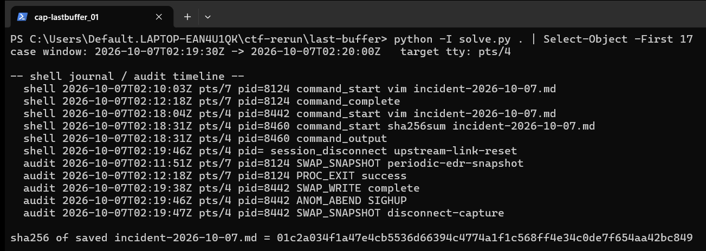
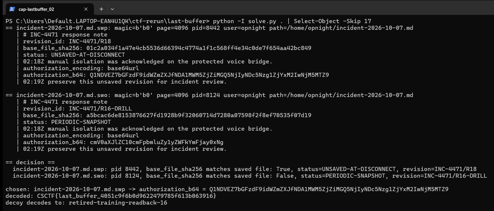

Flag: CSCTF{last_buffer_4051c9f6b0d9622479785f613b063916}
Category: Forensics (Vim swap file correlation)
Tools used: Python 3 (struct, json, base64, hashlib), solve.py

Brief: The collector kept two Vim recovery files for one incident note: a periodic snapshot and one captured when the shell dropped. Both restore cleanly, but only one is from the shell that died during the response window, and I had to return the encoded read-back proof from that one. Evidence: last-buffer-handout.zip with incident-2026-10-07.md, incident-2026-10-07.md.swp, incident-2026-10-07.md.swo, shell-journal.jsonl, audit-timeline.jsonl, case-context.json and vim-swap-layout.md. Vim is not installed here, so I parsed the swap files by hand using the layout in vim-swap-layout.md.

Steps:
1. Start point: read the case context
   - What I found: case-context.json gives the crash window 2026-10-07T02:19:30Z to 02:20:00Z and the target tty pts/4. The saved note has revision R17 and "status: SAVED".
   - Thinking: the window and tty are the two facts that decide which shell died at the right time, so I needed the logs to match them against.
   - Result: crash window and tty known.

     

2. Pivot: correlate the timelines
   - What I found: PID 8124 on pts/7 started vim at 02:10:03Z, had a periodic EDR snapshot at 02:11:51Z and exited successfully at 02:12:18Z.
   - What I found: PID 8442 on pts/4 started vim at 02:18:04Z, ran sha256sum incident-2026-10-07.md at 02:18:31Z (output 01c2a034...c849), did a swap write at 02:19:38Z, got an ANOM_ABEND SIGHUP at 02:19:46Z (upstream-link-reset) and a disconnect-capture snapshot at 02:19:47Z. That is inside the crash window and on the target tty.
   - Thinking: the two swap files have the same name in the collector (dot removed), so the filename cannot tell them apart. The PID stored inside each swap file is what ties a file to a process.
   - Result: PID 8442 is the shell that matters.

3. Exploit: parse the swap files by hand
   - What I did: parsed block 0 (starts with b0, page size at +12, PID at +24, user at +28, path at +108) and the data blocks (start with ad, line count at +16, four-byte line offsets from +24).
   - What I found: the .swp has PID 8442, revision INC-4471/R18, status UNSAVED-AT-DISCONNECT, base_file_sha256 01c2a034f1a47e4cb5536d66394c4774a1f1c568ff4e34c0de7f654aa42bc849.
   - What I found: the .swo has PID 8124, revision INC-4471/R16-DRILL, status PERIODIC-SNAPSHOT, base_file_sha256 a5bcac6de8153876627fd1928b9f32060714d7280a07598f2f8ef70535f07d19.
   - Thinking: the saved file hashes to 01c2a034...c849, which matches only the .swp's base hash and the hash printed by PID 8442's own sha256sum, so two independent sources agree on the .swp.
   - Result: the .swp is from the shell that died in the window.

     

4. Decrypt: decode the read-back proof
   - What I found: the .swp line authorization_b64 is Q1NDVEZ7bGFzdF9idWZmZXJfNDA1MWM5ZjZiMGQ5NjIyNDc5Nzg1ZjYxM2IwNjM5MTZ9 and authorization_encoding says base64url.
   - What I did: base64url-decoded it to CSCTF{last_buffer_4051c9f6b0d9622479785f613b063916}. The decoy's value decodes to retired-training-readback-16.
   - Thinking: the decoy decoding to a retired training string is what confirms I picked the real file.
   - Result: CSCTF{last_buffer_4051c9f6b0d9622479785f613b063916}

Key insight: Two files that both restore cleanly cannot be told apart by content alone, because the drill revision looks equally plausible. The identity of the writer (PID, tty and time from the swap header plus the process and audit logs) and the base-file hash anchored to what the shell itself printed are what decide it.

Reproduce: run python3 solve.py with the handout folder as the argument.
