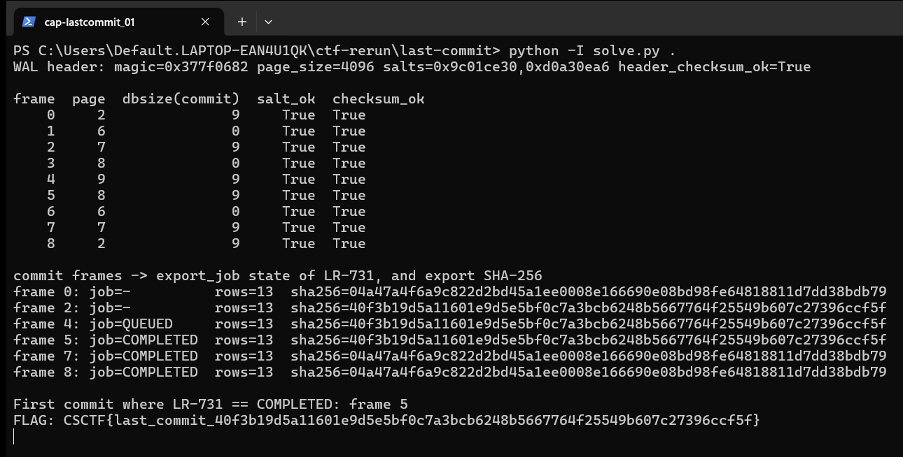

Flag: CSCTF{last_commit_40f3b19d5a11601e9d5e5bf0c7a3bcb6248b5667764f25549b607c27396ccf5f}
Category: Forensics (SQLite WAL reconstruction)
Tools used: Python 3 (struct, sqlite3, hashlib, csv)
Brief: A fictional land registry "looks normal again", but restoration export LR-731 may have carried altered ownership to regional offices. I had to reproduce the exact ownership export the job produced at its transition to COMPLETED and submit its SHA-256 in the format the export profile gives, using no SQLite CLI and no live service.

Steps:
1. Start point: last-commit.zip and its export profile
   - What I did: unzipped last-commit.zip (84,979 bytes, SHA-256 06da868e...85279a1), which holds registry.sqlite, registry.sqlite-wal, delivery.csv, export-profile.md, provenance.json and SHA256SUMS, and read the profile.
   - What I found: the profile fixes the query, loads delivery.csv as a manifest table so rows follow delivery order rather than DB order, fixes the bytes (header, TAB and LF, no BOM, trailing LF) and sets the flag as CSCTF{last_commit_ plus the SHA-256 hex and a closing brace}.
   - What I found: it warns that the current view is not the answer, because the worker reads, stages, flips QUEUED to COMPLETED and commits in one transaction.
   - Thinking: if the current view is not the answer, the answer lives in history, and the WAL is where SQLite keeps it.

2. Pivot: parse the WAL by hand
   - What I did: kept the evidence read-only. The profile says not to open the original DB and WAL pair with SQLite, so I parsed the WAL in Python and only ever opened rebuilt copies.
   - What I found: header magic 0x377f0682, page size 4096, salts 0x9c01ce30 and 0xd0a30ea6, valid header checksum. All 9 frames carry matching salts and a valid cumulative checksum (computed over each frame's first 8 header bytes and its page image, chained from the previous frame).
   - What I found: commit frames are the ones with a non-zero database size: frames 0, 2, 4, 5, 7 and 8. Frames 1, 3 and 6 are page images that belong to the commit after them.
   - Thinking: only a commit frame makes earlier page images part of the database, so I applied pages only when their commit was reached and took every other page from the main DB file.
   - Result: six commit points to rebuild.

3. Exploit: rebuild each commit and hash the export
   - What I did: rebuilt the database as it stood after each commit, loaded delivery.csv as the manifest, ran the profile's query and hashed the exact export bytes.
   - What I found: frames 0 and 2 have no LR-731 job row, frame 4 has it QUEUED, and frames 5, 7 and 8 have it COMPLETED. Frame 0 hashes to 04a47a4f...bdb79, frames 2, 4 and 5 hash to 40f3b19d...ccf5f, and frames 7 and 8 hash back to 04a47a4f...bdb79.
   - What I found: the registry was changed at frame 2, before the job ran, and changed back at frame 7, after it completed, so the clean later view matches the original state at frame 0.
   - Thinking: the profile says the worker flips QUEUED to COMPLETED inside its own commit, so the job's state at each commit tells me which export it delivered.
   - Dead end: the clean later view at frames 7 and 8 looks right but does not show what the job delivered.

     

4. Flag: the export at the first COMPLETED commit
   - What I found: frame 5 is the first commit where LR-731 is COMPLETED. Its export has 13 rows for 12 parcels (one parcel has two holders, which the profile allows).
   - What I did: took the SHA-256 of the complete export (header plus 13 rows, final LF included): 40f3b19d5a11601e9d5e5bf0c7a3bcb6248b5667764f25549b607c27396ccf5f.
   - Thinking: the challenge asks for the export at the job's own transition, so I stopped at the first COMPLETED commit, not the end of the log.
   - Result: CSCTF{last_commit_40f3b19d5a11601e9d5e5bf0c7a3bcb6248b5667764f25549b607c27396ccf5f}

Key insight: The SQLite WAL kept every committed state, so replaying it commit by commit gave the export exactly as it stood when LR-731 flipped to COMPLETED at frame 5. Only a frame with a non-zero database size commits the page images before it, and the replay has to stop at the job's commit, because the tampering was undone two commits later.
Defensive takeaways: A change-and-restore leaves the live database looking clean (frames 7 and 8 hash the same as frame 0), so preserve the -wal file with the database and record a hash of each export at the moment it ships.
Reproduce: python -I solve.py path\to\folder (the folder holding registry.sqlite, registry.sqlite-wal and delivery.csv; SQLite only opens rebuilt copies)
