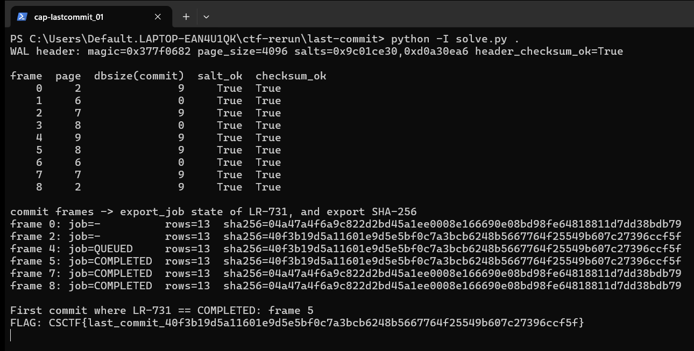

Flag: CSCTF{last_commit_40f3b19d5a11601e9d5e5bf0c7a3bcb6248b5667764f25549b607c27396ccf5f}
Category: Forensics (SQLite WAL reconstruction)
Tools used: Python 3 (struct, sqlite3, hashlib, csv), solve.py

Brief: A fictional land registry "looks normal again", but restoration export LR-731 may have carried altered ownership to regional offices. I had to reproduce the exact ownership export the job produced at its transition to COMPLETED and submit its SHA-256 in the format given by the export profile. Evidence: last-commit.zip (84,979 bytes, SHA-256 06da868e7ceeef1c96651cf1307033f7b37b65e235f8a121ea599166f85279a1) with registry.sqlite, registry.sqlite-wal, delivery.csv, export-profile.md, provenance.json and SHA256SUMS. I used no SQLite CLI and no live service.

Steps:
1. Start point: read the contract in export-profile.md
   - What I found: it fixes the query, the manifest handling (delivery.csv loaded as a manifest table so rows follow delivery order, not DB order), the exact byte format (header, TAB and LF, no BOM, trailing LF) and the flag format CSCTF{last_commit_ followed by the sha256 hex and a closing brace}.
   - What I found: it warns that the current view is not the answer, because the worker reads, stages, flips QUEUED to COMPLETED and commits in one transaction.
   - Thinking: if the current view is not the answer, the answer lives in history, so the WAL is the place to look.
   - Result: I know the query, the byte format and that I need the state at the job's own commit.

     

2. Pivot: parse the WAL by hand
   - What I did: treated the evidence as read-only. The profile says not to open the original DB and WAL pair with SQLite, so I parsed the WAL by hand and only opened rebuilt copies.
   - What I found: WAL header magic 0x377f0682, page size 4096, salts 0x9c01ce30 and 0xd0a30ea6, header checksum valid. 9 frames, every one with matching salts and a valid cumulative checksum (SQLite's checksum run over the 8 header bytes of each frame and its page image, chained from the previous frame).
   - What I found: commit frames are the ones with a non-zero database size field: frames 0, 2, 4, 5, 7, 8. Frames 1, 3, 6 are non-commit page images belonging to the transaction that follows them.
   - Thinking: I applied pages only when their commit frame was reached, because only a commit makes earlier page images part of the database. Pages not replaced by a committed frame come from the main DB file.
   - Result: six commit points to rebuild.

3. Exploit: rebuild after each commit and hash the export
   - What I did: rebuilt the database as it stood after each commit, ran the profile's query against each (with delivery.csv loaded as manifest), and hashed the exact export bytes.
   - What I found: frame 0 has no export_job row and hashes to 04a47a4f...bdb79. Frame 2 has no export_job row and hashes to 40f3b19d...ccf5f. Frame 4 has LR-731 as QUEUED and hashes to 40f3b19d...ccf5f. Frame 5 has LR-731 as COMPLETED and hashes to 40f3b19d...ccf5f, which is the job's commit. Frames 7 and 8 have LR-731 as COMPLETED and hash to 04a47a4f...bdb79.
   - What I found: the registry content changed at frame 2 (before the job ran) and was changed back at frame 7 (after it completed). The later clean view (frames 7 and 8) hashes identically to the original state at frame 0.
   - Dead end: the clean later view cannot be used, because it does not show what the job delivered.
   - Result: the hash that matters is the one at frame 5.

4. Result: the export at the COMPLETED commit
   - What I found: the first commit at which LR-731 is COMPLETED is frame 5. Its export has 13 rows for 12 parcels (one parcel has two holders, as the profile allows).
   - What I did: took the SHA-256 of the complete export (header plus 13 rows, final LF included): 40f3b19d5a11601e9d5e5bf0c7a3bcb6248b5667764f25549b607c27396ccf5f.
   - Thinking: stopping at the first COMPLETED commit, not the end of the log, is what the job's own transition means.
   - Result: CSCTF{last_commit_40f3b19d5a11601e9d5e5bf0c7a3bcb6248b5667764f25549b607c27396ccf5f}

Key insight: A WAL is a history, not just a current state. The database a tool shows you now is the newest committed view, so to answer what a job delivered you must replay committed transactions up to the job's own commit. Respect transaction boundaries (only a non-zero db-size frame commits earlier page images) and stop at the right commit instead of at the end of the log.

Reproduce: run python3 solve.py with the folder holding registry.sqlite, registry.sqlite-wal and delivery.csv as the argument. It prints the frame table, the per-commit hashes and the flag, and never touches the original pair.
