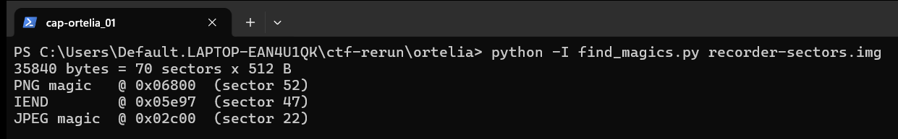
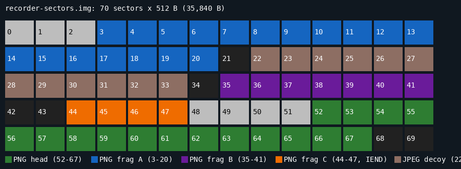
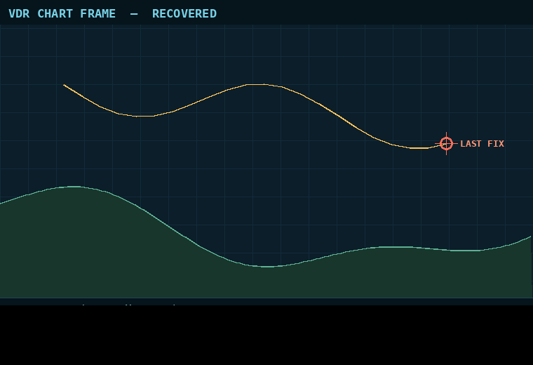
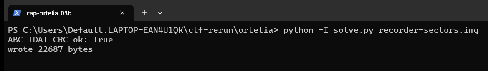
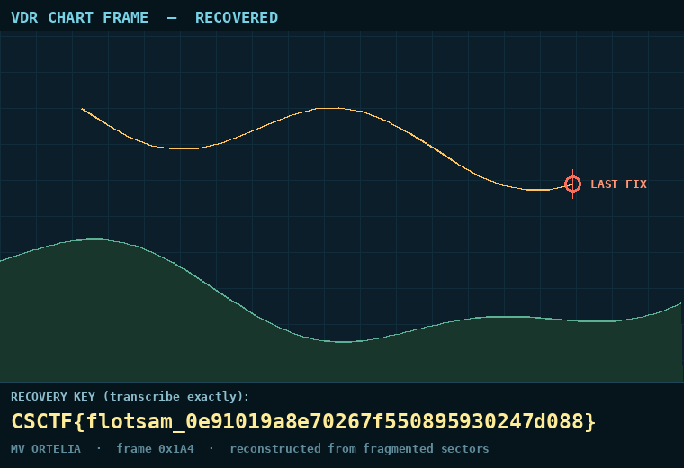

Flag: CSCTF{flotsam_0e91019a8e70267f550895930247d088}
Category: Forensics (fragmented PNG carving)
Tools used: Python (re, struct, zlib, PIL)
Brief: The voyage data recorder from MV Ortelia was read chip-off, so the allocation tables are gone, and somewhere in the dump is a PNG chart frame of the vessel's last fix with a recovery key printed on it. The hint says "A file that opens is not the same as a file that is whole." The target was recorder-sectors.img (35,840 bytes, 70 x 512-byte sectors, no filesystem).

Steps:
1. Start point: map the raw recorder dump
   - What I did: walked recorder-sectors.img, a raw chip-off flash dump with no filesystem, in 512-byte sectors and searched it for file magics with find_magics.py.
   - What I found: the sectors fall into a few kinds:
     - NMEA text ($GPRMC lines) in sectors 0 to 2 and 48 to 51
     - a JPEG header (FF D8 FF E0, JFIF) at sector 22, running through sector 33
     - the PNG magic at 0x6800 (sector 52)
     - all-zero sectors 21, 34, 42, 43, 68 and 69
     - high-entropy data everywhere else
   - What I found: the only IEND is at 0x5E97 (sector 47), before the PNG header.
   - Thinking: an IEND that sits before its own header means the PNG is fragmented, and the JPEG has nothing to do with a PNG chart frame, so I treated it as a decoy.

     

     

2. Dead end: the naive carve opens but is cut off
   - What I did: cut from the PNG header to the end of the data (sectors 52 to 67, 16 sectors, then zeros).
   - What I found: the file opens as 760x520 in a viewer that tolerates truncation, but the bottom is black and the recovery key is missing.
   - What I found: the chunks are IHDR (13 bytes) then a single IDAT of 22,630 bytes. The whole PNG needs 8 + 25 + 22,642 + 12 = 22,687 bytes, which is 45 sectors, but only 16 sit after the header.
   - Thinking: this is exactly the hint's "opens but is not whole" case, and the IDAT length says 29 sectors are somewhere else.

     

3. Pivot: rebuild the fragment chain with the IDAT CRC
   - What I found: the non-zero runs that are not text and not JPEG add up to exactly 29 sectors, with the zero sectors as the gaps between them:
     - fragment A: sectors 3 to 20 (18 sectors)
     - fragment B: sectors 35 to 41 (7 sectors)
     - fragment C: sectors 44 to 47 (4 sectors, ends with the IEND chunk)
   - What I did: put the head (52 to 67) first and C last, tried A and B in both orders, and checked the CRC32 over the IDAT type and data. Head plus A, B, C matches; head plus B, A, C does not.
   - What I did: trimmed the result to 22,687 bytes, since the IEND chunk ends 159 bytes into sector 47.
   - Thinking: C must be last because it holds IEND, and the IDAT CRC32 only matches when every byte is in place, so it settles the middle order.

     

4. Flag: read the key off the rebuilt chart frame
   - What I found: the reassembled PNG shows "VDR CHART FRAME - RECOVERED", a track ending at a LAST FIX marker, and the footer "RECOVERY KEY (transcribe exactly)" with the key below it.
   - Thinking: the CRC had already proved the bytes whole, so the footer the naive carve lost could be read as printed.
   - Result: CSCTF{flotsam_0e91019a8e70267f550895930247d088}

     

Key insight: The chip-off PNG was split into four sector runs, and the IDAT chunk's own length and CRC32 told me how many sectors were missing and which order was right. Carving from the header to the end of the data gives a file that opens but is truncated, and the zero-sector gaps at 21, 34, 42 and 43 were the clue that it was split.
Defensive takeaways: A recovered file that opens is not proof it is whole, so check carved evidence against its own format's lengths and CRCs before relying on it.
Reproduce: python -I solve.py recorder-sectors.img (keeps the fragment order whose IDAT CRC matches and writes recovered_chart_frame.png)
