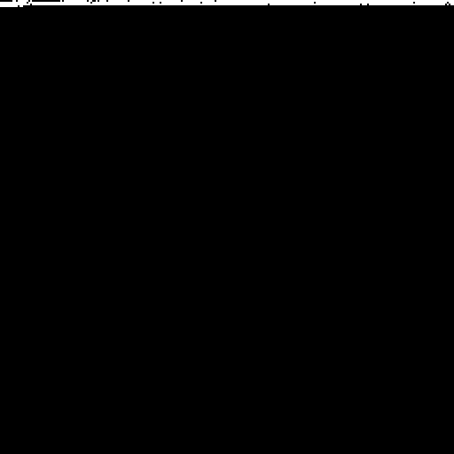
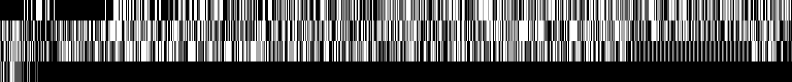
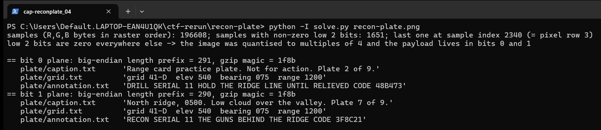

Flag: CSCTF{3F8C21}
Category: Forensics (bit-plane steganography)
Tools used: Python 3 (NumPy, Pillow, zlib, tarfile), solve.py

Brief: Operation Dawn, annex entry 11. A reconnaissance plate recovered from an overrun observation post looks unremarkable, but the annotation we need was "carried out on it", and I had to recover it. Evidence: recon-plate.png (256x256 RGB noise-over-gradient image, 110,412 bytes).

Steps:
1. Start point: check the PNG structure
   - What I found: the chunks are plain (IHDR, one IDAT, IEND) with nothing after IEND and no text chunks. The picture is a noisy gradient (noise sigma about 15), which would hide an ordinary LSB stego.
   - Thinking: with nothing appended and no metadata, the payload has to be in the pixels.
   - Result: the data is in the pixel bits.

     

2. Pivot: bit-plane statistics per channel
   - What I found: bits 2 to 7 look random (about 50% ones) but bits 0 and 1 are almost always zero (about 0.6% ones, identical for R, G and B).
   - Thinking: real noise cannot be limited to the top six bits, so the image was quantised to multiples of 4 on purpose and bits 0 and 1 carry data.
   - Result: two low bit planes carry the payload.

3. Pivot: locate the data
   - What I found: only 1,651 of 196,608 channel bytes have a non-zero low pair, and all of them lie within the first 2,341 channel bytes (pixel rows 0 to 3). The rest of the image has zeros in the low two bits.
   - Thinking: that means the payload is written in raster order, RGB, from the very first byte.
   - Result: the data sits at the start of the stream.

     

     

4. Dead end: decode the two bits as one stream
   - What I did: decoded with the wrong model, 2 bits per byte glued into one stream, and got unstructured bytes.
   - What I found: at the start of the stream, bit 0 and bit 1 are identical for the first 31 samples, differ in one sample, and are identical again until about sample 128 before diverging.
   - Thinking: that pattern means they are TWO independent bit streams (one per plane) with near-identical headers (the length fields differ by 1).
   - Result: each plane has to be read on its own.

5. Decrypt: read each plane separately
   - What I did: read each plane with one bit per channel byte, MSB first. Both give a 4-byte big-endian length (0x123 = 291 for plane 0, 0x122 = 290 for plane 1) followed by a gzip stream (1f 8b). Each gunzips to a tar archive with three files.
   - What I found: plane 0 (LSB) has caption "Range card practice plate. Not for action. Plate 2 of 9.", grid "grid 41-D elev 540 bearing 075 range 1200", annotation "DRILL SERIAL 11 HOLD THE RIDGE LINE UNTIL RELIEVED CODE 48B473".
   - What I found: plane 1 has caption "North ridge, 0500. Low cloud over the valley. Plate 7 of 9.", the same grid, annotation "RECON SERIAL 11 THE GUNS BEHIND THE RIDGE CODE 3F8C21".
   - Result: two candidate codes, 48B473 and 3F8C21.

     

6. Result: choose between the layers
   - What I found: the two layers share the same grid, but the LSB layer calls itself a drill ("practice plate", "Not for action", "DRILL SERIAL 11"), while the bit-1 layer is the operational recon annotation ("RECON SERIAL 11", real-looking caption).
   - Thinking: the task asks for the annotation from a reconnaissance plate for annex entry 11, so the answer is the bit-1 annotation. The 48B473 value is the decoy.
   - Result: code 3F8C21, flag CSCTF{3F8C21}.

Key insight: A naive "extract the LSBs" would have returned only the decoy, so always check the neighbouring bit planes. The hint that the plate was "carried out" was a second, deeper layer, and the telltale was that the two planes started identically but then diverged.

Reproduce: run python3 solve.py recon-plate.png.

Note: the prompt says only "Flag format: CSCTF{...}", so I submitted the code from the real annotation. If the platform rejects CSCTF{3F8C21}, the next candidates are the whole annotation text (RECON SERIAL 11 THE GUNS BEHIND THE RIDGE CODE 3F8C21) or the code in lower case. I could not check the submission against the scoring server, so treat this one as the least certain of the six.
