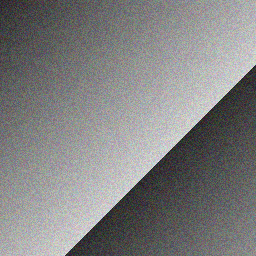
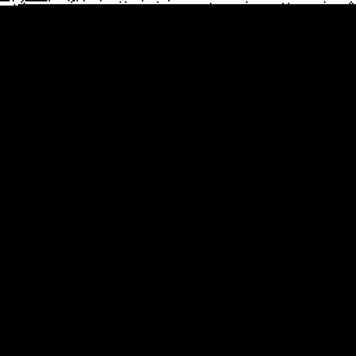
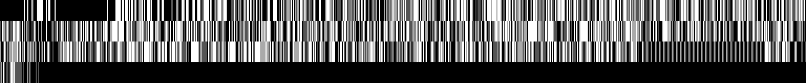
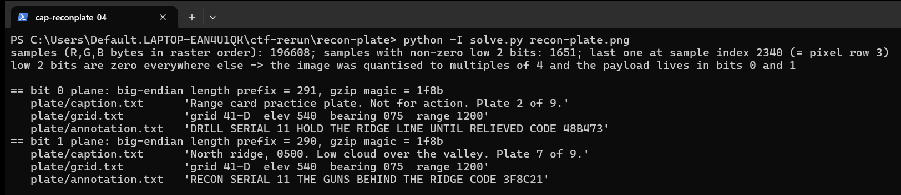

Flag: CSCTF{3F8C21}
Category: Forensics (bit-plane steganography)
Tools used: Python 3 (NumPy, Pillow, zlib, tarfile)
Brief: Operation Dawn, annex entry 11. A reconnaissance plate recovered from an overrun observation post looks unremarkable, but the annotation I needed was "carried out on it", and I had to recover it.

Steps:
1. Start point: check the PNG structure
   - What I did: walked the chunks of recon-plate.png, a 256x256 RGB noise-over-gradient image of 110,412 bytes.
   - What I found: plain chunks (IHDR, one IDAT, IEND), nothing after IEND and no text chunks. The picture is a noisy gradient (noise sigma about 15), which would hide an ordinary LSB change.
   - Thinking: with nothing appended and no metadata, the payload had to be in the pixel values themselves.

     

2. Pivot: bit-plane statistics per channel
   - What I did: counted the share of ones in each of the 8 bit planes for R, G and B.
   - What I found: bits 2 to 7 look random (about 50% ones), but bits 0 and 1 are almost always zero (about 0.6% ones, the same for R, G and B).
   - Thinking: real noise cannot stop at the top six bits, so the image was quantised to multiples of 4 on purpose and bits 0 and 1 carry the data.

3. Pivot: locate the data in raster order
   - What I found: only 1,651 of 196,608 channel bytes have a non-zero low pair, and all of them sit in the first 2,341 channel bytes (pixel rows 0 to 3). Everywhere else the low two bits are zero.
   - Thinking: a payload that fills the first rows and then stops is written in raster order, RGB, from the very first byte.

     

     

4. Dead end: decode the two bits as one stream
   - What I did: read 2 bits per channel byte glued into a single stream and got unstructured bytes.
   - What I found: bit 0 and bit 1 are identical for the first 31 samples, differ in one, and match again until about sample 128 before they diverge.
   - Thinking: that pattern means two independent bit streams, one per plane, with near-identical headers whose length fields differ by 1.
   - Result: each plane has to be read on its own.

5. Decode: read each plane as its own message
   - What I did: read each plane at one bit per channel byte, MSB first. Both start with a 4-byte big-endian length (0x123 = 291 for plane 0, 0x122 = 290 for plane 1) and then a gzip stream (1f 8b), and each gunzips to a tar archive of three files.
   - What I found: plane 0 (the LSB) has the caption "Range card practice plate. Not for action. Plate 2 of 9.", the grid "grid 41-D elev 540 bearing 075 range 1200" and the annotation "DRILL SERIAL 11 HOLD THE RIDGE LINE UNTIL RELIEVED CODE 48B473".
   - What I found: plane 1 has the caption "North ridge, 0500. Low cloud over the valley. Plate 7 of 9.", the same grid and the annotation "RECON SERIAL 11 THE GUNS BEHIND THE RIDGE CODE 3F8C21".
   - Thinking: the gzip magic and sane length prefixes in both planes confirmed the two-stream model before I read any text.
   - Result: two candidate codes, 48B473 and 3F8C21.

     

6. Flag: choose between the two layers
   - What I found: the layers share a grid, but the LSB layer calls itself a drill ("practice plate", "Not for action", "DRILL SERIAL 11"), while the bit-1 layer is the operational one ("RECON SERIAL 11" and a real-looking caption).
   - Thinking: the task asks for the annotation from a reconnaissance plate for annex entry 11, so the answer is the bit-1 annotation and 48B473 is the decoy.
   - Result: CSCTF{3F8C21}

Key insight: Bits 0 and 1 each held a separate gzip and tar message, and the plain LSB layer was a drill decoy, so the real code 3F8C21 only appeared in bit plane 1. The clue was that the two planes started almost identically, then diverged.
Defensive takeaways: Checking only the LSB plane is not enough. Here it held a planted decoy and the real message sat one plane up, and per-plane statistics (bits 0 and 1 almost all zero under heavy noise) gave the hiding away.
Reproduce: python -I solve.py recon-plate.png
Note: the prompt only gave the format CSCTF{...}, so I submitted the code from the real annotation. I could not check it against the scoring server; if CSCTF{3F8C21} were rejected, the next candidates would be the full annotation text or the code in lower case.
