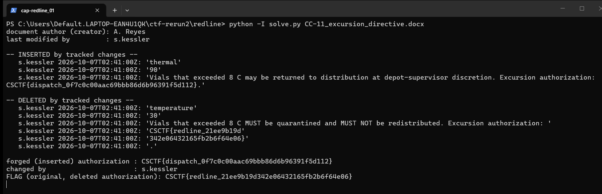

Flag: CSCTF{redline_21ee9b19d342e06432165fb2b6f64e06}
Category: Forensics (DOCX tracked-change recovery)
Tools used: Python (zipfile, re)
Challenge: Redline (CSCTF 2026, Forensics, Easy, 120 pts, author: Chronos Security)
Brief: During a grid-instability night a cold-chain excursion directive (CC-11, Depot 7) went out to depot crews, and a crew lead says their copy "reads wrong." Given the .docx, work out how it differs from what was approved, who changed it, and recover the original excursion authorization.

Steps:

1. Start point: the handout, CC-11_excursion_directive.docx
   - What I did: a .docx is a ZIP of XML parts, so I opened it with Python's zipfile and read docProps/core.xml first.
   - What I found: dc:creator is "A. Reyes", but cp:lastModifiedBy is "s.kessler" (cp:revision 4, modified
     2026-10-07T02:41Z). Someone other than the author touched the file last.
   - Thinking: a directive that "reads wrong" plus a different last editor points at tracked changes. Word keeps
     those inline in word/document.xml as w:ins (insertions) and w:del (deletions), each stamped with w:author and
     w:date.

2. Pivot: s.kessler's tracked changes rewrite the rule
   - What I did: pulled every w:ins and w:del run out of word/document.xml with a regex, keeping author and date.
   - What I found: all nine revisions are by s.kessler at 2026-10-07T02:41Z, and they pair up into one rewrite:
     - "temperature" deleted, "thermal" inserted
     - the Nightwatch page threshold above 8 C: "30" minutes deleted, "90" inserted
     - deleted: "Vials that exceeded 8 C MUST be quarantined and MUST NOT be redistributed."
     - inserted: "Vials that exceeded 8 C may be returned to distribution at depot-supervisor discretion."
   - What I found: word/comments.xml has s.kessler's note: "I am dropping the quarantine hold ... Re-issuing under
     a fresh authorization." So the safety hold was reversed on purpose.
   - Thinking: the "Excursion authorization:" token sits inside the rewritten sentence, so it was swapped too. The
     deleted token is the one A. Reyes approved; the inserted one is what s.kessler re-issued.

3. Flag: rejoin the deleted authorization
   - What I found: the deleted token is split across two w:del runs, "CSCTF{redline_21ee9b19d" and
     "342e06432165fb2b6f64e06}". The inserted token is CSCTF{dispatch_0f7c0c00aac69bbb86d6b96391f5d112}, the decoy
     that reached the crews.
   - Thinking: the challenge asks for the original authorization, and only the deleted runs predate s.kessler's edit.
   - Result: rejoined, the original authorization is CSCTF{redline_21ee9b19d342e06432165fb2b6f64e06}.

     

Key insight: Word keeps deleted text inside document.xml as w:del runs, so the approved authorization was never gone, just marked deleted, while a forged one was inserted in its place by s.kessler.
Defensive takeaways: A .docx shared without flattening carries its full edit history, authors and timestamps. That helps an investigator but leaks for a publisher, so export to PDF or run Document Inspector before release. Safety-critical directives should also be signed or hashed at approval, so an unapproved rewrite by a non-author (quarantine changed to redistribute) is caught instead of shipping to crews.
Reproduce: python -I solve.py CC-11_excursion_directive.docx
Note: the screenshot is a live re-run of solve.py against the challenge's own .docx; it reproduces the documented flag.
