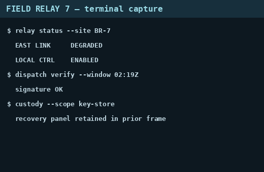
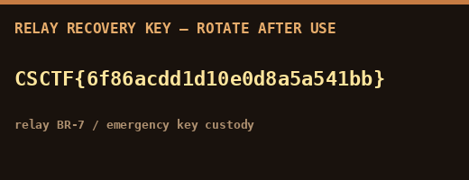
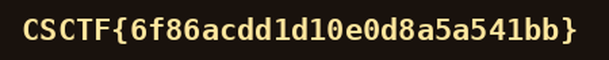
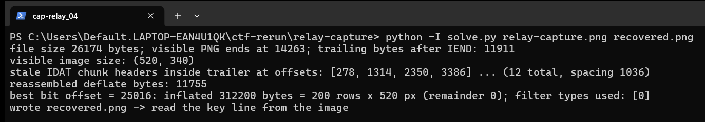

Flag: CSCTF{6f86acdd1d10e0d8a5a541bb}
Category: Forensics (cropped PNG recovery)
Tools used: Python 3 (zlib, struct, Pillow), solve.py

Brief: A duty operator cropped the bottom off a terminal screenshot to remove something sensitive and posted it. The visible image is fine but the file is not, and I had to recover what was cropped away and read the station recovery key. Evidence: relay-capture.png (520x340 screenshot, 26,174 bytes). This is an "acropalypse"-style cropped image recovery.

Steps:
1. Start point: read the visible capture
   - What I found: the terminal capture ends with "recovery panel retained in prior frame".
   - Thinking: that line is a hint that the removed content is still in the file.
   - Result: worth walking the file structure.

     

2. Pivot: walk the PNG chunks
   - What I found: IEND is at byte 14,263 but the file is 26,174 bytes, so 11,911 bytes follow IEND. They contain twelve more IDAT chunk headers at a regular 1,036-byte spacing (1,024 data bytes plus 12 bytes of length, type and CRC).
   - Thinking: that is the end of the ORIGINAL file: the editor saved the shorter cropped image over the original without truncating it.
   - Result: the old compressed image data is still behind IEND.

3. Exploit: rebuild one raw deflate stream
   - What I did: joined the partial first chunk body with every later chunk body, with the 12-byte chunk framing removed (11,755 bytes; the last 4 are the old zlib Adler-32).
   - What I found: the stream begins in the middle of a deflate block, so there is no valid zlib header.
   - Result: a raw deflate stream with unknown start alignment.

4. Pivot: find the bit offset
   - What I did: tried every bit offset (0 to 94,000), raw-inflating with a 32 KiB zero preset dictionary.
   - Dead end: almost every offset fails or produces only a few bytes.
   - What I found: bit offset 25016 inflates cleanly to 312,200 bytes, which is exactly 200 rows x (1 filter byte + 520*3) with every filter byte 0.
   - Thinking: that exact row arithmetic with all-zero filter bytes is the tell-tale of a correct sync.
   - Result: the lost pixel data is recovered.

5. Result: read the key
   - What I did: reassembled the 200 scanlines into a 520x200 RGB image. It is the cropped-away panel: "RELAY RECOVERY KEY - ROTATE AFTER USE", the key line, and "relay BR-7 / emergency key custody".
   - What I did: zoomed the key line to confirm every character: CSCTF{6f86acdd1d10e0d8a5a541bb}.
   - Result: the flag.

     

     

     

Key insight: Cropping changes what a viewer shows, not what the file contains. Overwriting a larger image with a smaller one without truncating leaves the old compressed data behind IEND, and because the deflate stream can be resynchronised at the bit level, much of the lost image can be rebuilt. The operator should rotate this key; the panel itself says so.

Reproduce: run python3 solve.py relay-capture.png recovered.png, then open recovered.png.
