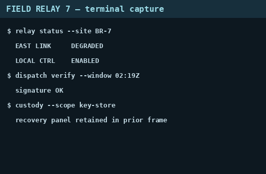
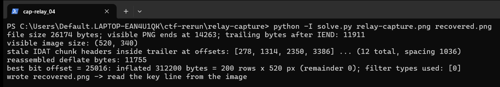
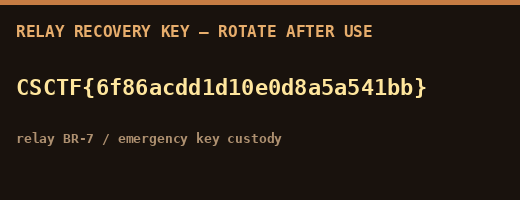
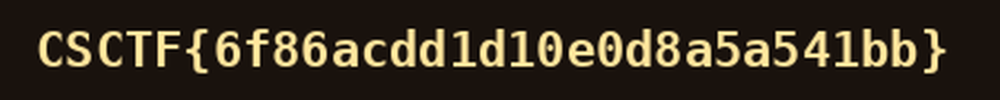

Flag: CSCTF{6f86acdd1d10e0d8a5a541bb}
Category: Forensics (cropped PNG recovery)
Tools used: Python (zlib, struct, Pillow)
Brief: A duty operator cropped the bottom off a terminal screenshot to remove something sensitive and posted it. The visible image is fine but the file is not, and I had to recover what was cropped away and read the station recovery key. Evidence: relay-capture.png (520x340 screenshot, 26,174 bytes). This is an "acropalypse"-style cropped image recovery.

Steps:

1. Start point: the handout, relay-capture.png
   - What I found: a 520x340 terminal capture from FIELD RELAY 7 whose last line is "recovery panel retained in prior frame".
   - Thinking: that line hints the cropped-away content is still inside the file, so the next move is to walk the PNG structure instead of the pixels.

     

2. Pivot: 11,911 bytes after IEND
   - What I found: the visible PNG ends at byte 14,263 but the file is 26,174 bytes, so 11,911 bytes follow IEND. They contain twelve more IDAT chunk headers at a regular 1,036-byte spacing (1,024 data bytes plus 12 bytes of length, type and CRC).
   - Thinking: that is the tail of the original, larger file. The editor saved the shorter cropped image over it without truncating.
   - Result: the old compressed image data is still behind IEND.

3. Exploit: rebuild one raw deflate stream
   - What I did: joined the partial first chunk body with every later chunk body, with the 12-byte chunk framing removed (11,755 bytes; the last 4 are the old zlib Adler-32).
   - What I found: the stream begins in the middle of a deflate block, so there is no valid zlib header.
   - Thinking: IDAT chunks are only slices of one zlib stream, so with the framing gone the bytes are deflate data again. The cut just means I don't know where the first block starts.
   - Result: a raw deflate stream with unknown start alignment.

4. Pivot: find the bit offset
   - What I did: tried every bit offset (0 to 94,000), raw-inflating with a 32 KiB zero preset dictionary.
   - Dead end: almost every offset fails or produces only a few bytes.
   - What I found: bit offset 25016 inflates cleanly to 312,200 bytes, which is exactly 200 rows x (1 filter byte + 520*3) with every filter byte 0.
   - Thinking: an output that divides exactly into 520-pixel RGB rows, with all-zero filter bytes, is the tell of a correct sync.
   - Result: the lost pixel data is recovered.

     

5. Flag: read the key from the recovered rows
   - What I did: reassembled the 200 scanlines into a 520x200 RGB image.
   - What I found: it is the cropped-away panel: "RELAY RECOVERY KEY - ROTATE AFTER USE", the key line, and "relay BR-7 / emergency key custody".
   - Thinking: the line under the panel title is the recovery key the challenge asked for, so I zoomed it 3x to confirm every character.
   - Result: the recovery key is the flag, CSCTF{6f86acdd1d10e0d8a5a541bb}.

     

     

Key insight: The editor saved the cropped PNG over the original without truncating it, so the old compressed rows sat after IEND and inflated again once I found the right bit offset.
Defensive takeaways: Cropping changes what a viewer shows, not what the file contains. Export a redacted screenshot as a new file and check that nothing follows IEND before posting it. The exposed key should be rotated, as its own panel says.
Reproduce: python -I solve.py relay-capture.png recovered.png, then open recovered.png.
