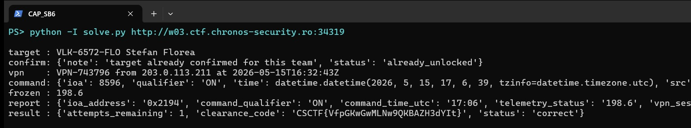

Challenge: Silent Breaker - Forensics / Medium / 270 pts / author: Dan-Andrei Grigorescu (CSCTF 2026)
Flag: CSCTF{kRhITdO1yxQx7IUYgLrlUWF6}
Category: Forensics (IEC-104 and SS7 correlation)
Tools used: curl, tshark, Python (stdlib only), solve.py

Brief: A substation breaker tripped. Evidence: a telecom signalling-events feed (Velkarion Mobile), a staff roster, an IEC-104 pcap from the substation and the historian's breaker-current log. I had to name the compromised employee, their OT-VPN session, the breaker command (IOA, ON/OFF, wire time) and the forged historian current, then submit the containment report. Each instance launch is a different case, so values below are for my case only.

Steps:
1. Start point: read the case index and the report contract
   - What I did: fetched GET /files/ (case index) and README.md.
   - What I found: five files (README, description, roster.json, iec104_capture.pcap, hmi_monitoring.log) and the rules: /confirm-target has only 2 attempts, /submit has 5, and there is no per-field feedback.
   - Thinking: with so few attempts and no feedback, every answer had to be justified from evidence before submitting, not guessed.
   - Result: the plan is to build each field from evidence first.

2. Pivot: who was targeted (signalling feed and roster)
   - What I found: all 8 events in GET /events come from GT-1288-Q78, outside the legitimate range GT-0000 to GT-0999. That rogue peer sent SendRoutingInfoForSM (SRI-SM) for every roster MSISDN, which is mass reconnaissance.
   - Thinking: SRI-SM is the SS7 query that returns the serving MSC and IMSI for SMS delivery. It is the first step of SMS interception, which is how an attacker steals SMS one-time passwords. Only one person on the roster has ot_vpn_access=true: Mara Petrescu (VLK-4558-PET). The others are noise (one decoy shares her surname).
   - What I did: /query/subscriber confirmed her MSISDN was known and watchlisted, then /confirm-target accepted her.
   - Result: target is Mara Petrescu, VLK-4558-PET.

3. Pivot: the VPN session (GET /query/vpn-window, unlocked by step 2)
   - What I found: VPN-277455 for VLK-4558-PET from 203.0.113.166. RADIUS shows Access-Request 04:28:46, "Enter OTP" challenge 04:28:47, Access-Accept 04:28:52.
   - Thinking: the SRI-SM for her number was at 04:26:32. Two minutes later the OTP challenge passed in 5 seconds. That timing fits an intercepted SMS OTP: the attacker had her password and read the code off the hijacked SMS.
   - Result: session VPN-277455.

4. Pivot: the breaker command (pcap)
   - What I found: one TCP session 192.0.2.10:51000 to 198.51.100.10:2404 (2404 is IEC-104). The RTU sends M_ME_NC_1 (type 13, short float) every 10 s for IOA 11453 = 0x2cbd, steady around 430 A. At 05:02:51.000 the master side sends type 45 C_SC_NA_1 (single command), cause 6 (activation), IOA 0x2cbd, SCO=0x01, and the RTU answers with cause 7 (activation confirmation) 15 ms later.
   - Thinking: the contract asks for the wire time, not the VPN start time (04:28), which is the trap in that field.
   - Result: IOA 0x2cbd, qualifier ON (SCO bit 0 = 1), wire time 05:02 UTC.

5. Pivot: the forged telemetry (historian vs pcap)
   - What I found: the historian shows 312.3 A from 05:02:00 to 05:04:50, flagged QUALITY=SUSPECT from the third identical reading. Over the same window the pcap shows the RTU still reporting about 430 A, with a normal 1.5 A jitter either way.
   - Thinking: a real RTU value never repeats exactly 18 times, and the wire disagrees with the historian by about 118 A (more than the 5 A review threshold, and inside the 150 to 550 A range). So the operator screen was fed a held or replayed value around the moment of the command, hiding the change from the operator.
   - Result: telemetry_status 312.3.

6. Result: submit the containment report
   - What I did: submitted {"ioa_address":"0x2cbd","command_qualifier":"ON","command_time_utc":"05:02","telemetry_status":"312.3","vpn_session_id":"VPN-277455"}.
   - What I found: status correct, clearance_code CSCTF{kRhITdO1yxQx7IUYgLrlUWF6}.
   - Thinking: solve.py automates this for a fresh case: it picks the target, confirms, reads the VPN window, parses the pcap with a small stdlib IEC-104 parser, cross-checks the historian against live RTU values and submits. A built-in check feeds the parser a synthetic C_SC_NA_1 packet first. Command: python -I solve.py http://HOST:PORT
   - Result: solve.py correlates the four evidence sources, submits the containment report, and receives the clearance code.

     

Key insight: No single source tells the whole story. The telecom feed gives the who (a rogue SS7 peer harvesting SMS routing for the one OT-VPN user), RADIUS gives the how (OTP passed 2 minutes later), the pcap gives the what (an unauthorised single command on the breaker IOA) and the historian gives the cover-up (a frozen value while the wire kept moving). Each step needed the previous step's output to be trusted.

Defensive takeaways: SMS OTP is not a strong second factor for OT remote access, because SS7 SRI-SM and location abuse can redirect it, so use FIDO2 or app-based push with number matching for anything that reaches control networks (IEC 62443 SR 1.1 RE 2, and NIST SP 800-63B classes SMS OTP as restricted). Telcos should filter SS7 at the interconnect (GSMA FS.11 category 1 and 2 filtering), since a foreign GT sending SRI-SM for a whole subscriber list is a textbook signature. IEC-104 has no authentication, so allow-list which master IPs may send command ASDUs (types 45 to 64), alert on any command activation outside a change window, or deploy IEC 62351-5 secure authentication. Finally, do not trust a single telemetry path: compare historian and HMI values against raw wire data (passive OT IDS) and alert on flatlined analog values, since real sensors always jitter.

Note: the screenshot is a live reproduction on a freshly fetched instance. Each launch is a new case, so the clearance code shown differs from the flag recorded at the top.
