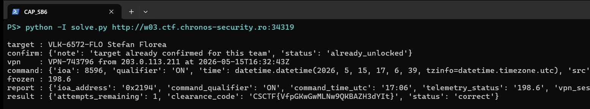

Flag: CSCTF{kRhITdO1yxQx7IUYgLrlUWF6}
Category: Forensics (IEC-104 and SS7 correlation)
Tools used: curl, tshark, Python (urllib, struct, re)
Challenge: Silent Breaker (CSCTF 2026, Forensics, Medium, 270 pts, author: Dan-Andrei Grigorescu)
Brief: A substation breaker tripped, and the evidence is a telecom signalling-events feed (Velkarion Mobile), a staff roster, an IEC-104 pcap from the substation and the historian's breaker-current log. I had to name the compromised employee, their OT-VPN session, the breaker command (IOA, ON/OFF, wire time) and the forged historian current, then submit the containment report. Each launch is a different case, so the values below are for my case only.

Steps:

1. Start point: the case index and report rules
   - What I did: fetched GET /files/ (the case index) and README.md from the challenge instance's HTTP API.
   - What I found: five files (README, description, roster.json, iec104_capture.pcap, hmi_monitoring.log) and the rules: /confirm-target has only 2 attempts, /submit has 5, and there is no per-field feedback.
   - Thinking: with so few attempts and no feedback, every field had to be justified from evidence before submitting, not guessed.

2. Pivot: a rogue SS7 peer probing the roster
   - What I found: all 8 events in GET /events come from GT-1288-Q78, outside the legitimate range GT-0000 to GT-0999. That rogue peer sent SendRoutingInfoForSM (SRI-SM) for every roster MSISDN, which is mass reconnaissance.
   - Thinking: SRI-SM is the SS7 query that returns the serving MSC and IMSI for SMS delivery, the first step of SMS interception and of stealing SMS one-time passwords. So the target is whoever on the roster has an SMS OTP worth stealing.
   - What I found: only one person has ot_vpn_access=true: Mara Petrescu (VLK-4558-PET). The others are noise (one decoy shares her surname).
   - What I did: /query/subscriber confirmed her MSISDN was known and watchlisted, then /confirm-target accepted her.
   - Result: target is Mara Petrescu, VLK-4558-PET.

3. Pivot: her OT-VPN session
   - What I did: queried GET /query/vpn-window, which the confirmation in step 2 unlocked.
   - What I found: VPN-277455 for VLK-4558-PET from 203.0.113.166. RADIUS shows Access-Request 04:28:46, "Enter OTP" challenge 04:28:47, Access-Accept 04:28:52.
   - Thinking: the SRI-SM for her number was at 04:26:32. Two minutes later the OTP challenge passed in 5 seconds. That timing fits an intercepted SMS OTP: the attacker had her password and read the code off the hijacked SMS.
   - Result: session VPN-277455.

4. Pivot: the breaker command in the pcap
   - What I found: one TCP session 192.0.2.10:51000 to 198.51.100.10:2404 (2404 is IEC-104). The RTU sends M_ME_NC_1 (type 13, short float) every 10 s for IOA 11453 = 0x2cbd, steady around 430 A. At 05:02:51.000 the master side sends type 45 C_SC_NA_1 (single command), cause 6 (activation), IOA 0x2cbd, SCO=0x01, and the RTU answers with cause 7 (activation confirmation) 15 ms later.
   - Thinking: that is the only command in the capture, on the same IOA as the breaker current. The contract asks for its wire time, not the VPN start time (04:28), which is the trap in that field.
   - Result: IOA 0x2cbd, qualifier ON (SCO bit 0 = 1), wire time 05:02 UTC.

5. Pivot: the historian's frozen current
   - What I found: the historian shows 312.3 A from 05:02:00 to 05:04:50, flagged QUALITY=SUSPECT from the third identical reading. Over the same window the pcap shows the RTU still reporting about 430 A, with a normal 1.5 A jitter either way.
   - Thinking: a real RTU value never repeats exactly 18 times, and the wire disagrees with the historian by about 118 A (more than the 5 A review threshold, and inside the 150 to 550 A range). So the operator screen was fed a held or replayed value around the moment of the command, hiding the change from the operator.
   - Result: telemetry_status 312.3.

6. Flag: submit the containment report
   - What I did: submitted {"ioa_address":"0x2cbd","command_qualifier":"ON","command_time_utc":"05:02","telemetry_status":"312.3","vpn_session_id":"VPN-277455"}.
   - Thinking: every field now came from evidence (target from the SS7 feed, session from RADIUS, command from the pcap, frozen value from the historian against the wire), so it was safe to spend a /submit attempt.
   - Result: status correct, clearance_code CSCTF{kRhITdO1yxQx7IUYgLrlUWF6}.

     

Key insight: A rogue SS7 peer harvested SMS routing to intercept the one OT-VPN user's OTP, then an IEC-104 single command tripped the breaker while the historian showed a frozen current. No single source tells the whole story: the telecom feed gives the who, RADIUS the how, the pcap the what and the historian the cover-up, and each step needed the previous step's output to be trusted.
Defensive takeaways: SMS OTP is not a strong second factor for OT remote access, because SS7 SRI-SM and location abuse can redirect it, so use FIDO2 or app-based push with number matching for anything that reaches control networks (IEC 62443 SR 1.1 RE 2, and NIST SP 800-63B classes SMS OTP as restricted). Telcos should filter SS7 at the interconnect (GSMA FS.11 category 1 and 2 filtering), since a foreign GT sending SRI-SM for a whole subscriber list is a textbook signature. IEC-104 has no authentication, so allow-list which master IPs may send command ASDUs (types 45 to 64), alert on any command activation outside a change window, or deploy IEC 62351-5 secure authentication. Finally, compare historian and HMI values against raw wire data (passive OT IDS) and alert on flatlined analog values, since real sensors always jitter.
Reproduce: python -I solve.py http://HOST:PORT (it self-checks its IEC-104 parser on a synthetic C_SC_NA_1 packet, then solves and submits a fresh case end to end).
Note: the screenshot is a live reproduction on a freshly fetched instance. Each launch is a new case, so the clearance code shown differs from the flag recorded at the top.
