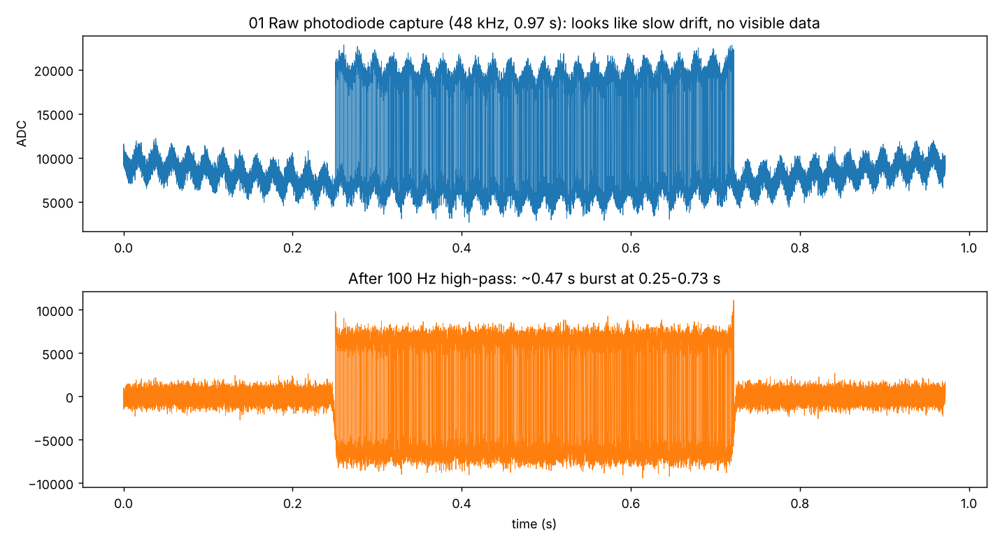
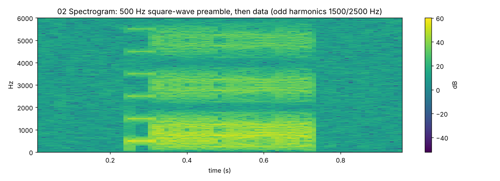
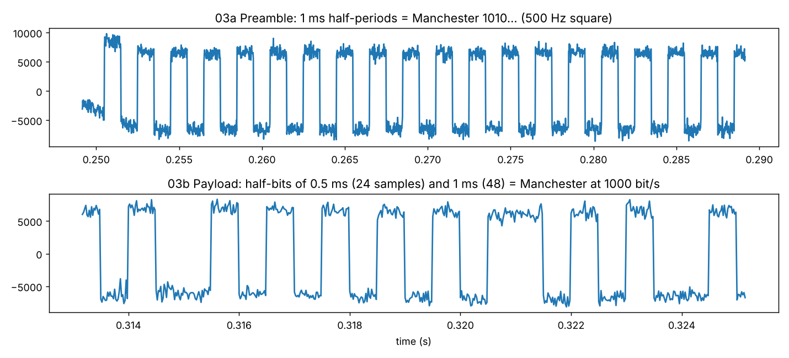
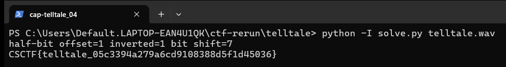

Flag: CSCTF{telltale_05c3394a279a6cd9108388d5f1d45036}
Category: Forensics (optical LED covert channel)
Tools used: Python (wave, numpy, scipy, matplotlib)
Brief: A berth-allocation console sits in a secure room with no network, its chassis status LED looks steadily lit, and someone clamped a photodiode over that LED for just under a second, sampling at 48 kHz. Anything switching faster than about 60 Hz blurs into steady light, so the LED is the unwatched output, and the task is to recover what it exfiltrates. Handout: telltale.wav (48 kHz, mono, 16-bit, 46656 samples = 0.972 s).

Steps:

1. Start point: the handout, telltale.wav
   - What I found: 0.972 s of unipolar photodiode data (all samples positive, mean about 10400) on a slowly drifting
     baseline. The spectrum is dominated by 1-5 Hz drift and 50 Hz mains (ambient light), but also shows strong
     lines at 500 Hz and 750 Hz and odd harmonics (1500/2500 Hz).
   - Thinking: odd harmonics point to a square-wave source rather than sine tones, so something is switching the LED
     well above where the ambient light lives.

2. Pivot: a 100 Hz high-pass exposes the burst
   - What I did: ran a 100 Hz high-pass (scipy butter and filtfilt) to remove the drift and mains.
   - What I found: a clean burst from about 0.25 s to 0.73 s (about 0.47 s, samples 11960-34690); outside it there
     is only noise. Its spectrogram shows a pure 500 Hz tone with odd harmonics first, then a spread of 500-1250 Hz
     energy.
   - Thinking: one steady tone followed by spread energy is what a preamble plus a bit stream looks like, not
     several tones, so the next move is the time domain.

     

     

3. Pivot: the line code is Manchester at 1000 bit/s
   - What I did: measured the zero-crossing run lengths inside the burst.
   - What I found: runs are only ever 48 or 24 samples (1 ms or 0.5 ms at 48 kHz). The first 64 runs are all 48
     samples, a 500 Hz square wave; after that 24 and 48 mix.
   - Thinking: in Manchester coding, alternating bits 1,0,1,0 give exactly that square wave, so the start is a
     clock-sync preamble. A mix of 0.5 ms and 1 ms runs after it is Manchester data with 0.5 ms half-bits, which is
     1000 bit/s.

     

4. Flag: decode the half-bits
   - What I did: sampled the signal sign at the centre of every 24-sample half-bit after the first edge, paired the
     half-bits, and tried both half-bit offsets, both polarities and all 8 bit shifts.
   - What I found: half-bit offset 1 with inverted polarity ("01" = 1, "10" = 0) decodes cleanly. The other three
     offset and polarity combinations give "X" (invalid Manchester pairs) or garbage.
   - Thinking: Manchester only allows the pairs 01 and 10, so the alignment with no invalid pairs is the right one.
     With a bit shift of 7 its bytes read as ASCII.
   - Result: CSCTF{telltale_05c3394a279a6cd9108388d5f1d45036}

     

Key insight: The status LED was Manchester-keyed at 1000 bit/s, far too fast for the eye to see, so a photodiode sampled at 48 kHz could read the exfiltrated flag straight off it. A steady-looking status LED is not a quiet output.
Defensive takeaways: Cover or remove status LEDs on air-gapped machines, or drive them from a fixed low-pass or lit-state signal that firmware on the host cannot modulate.
Reproduce: python -I solve.py telltale.wav (needs numpy and scipy)
