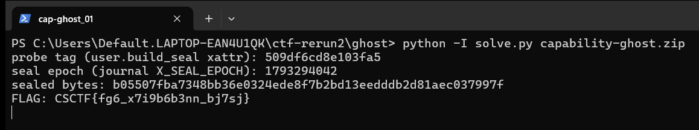

Flag: CSCTF{fg6_x7i9b6b3nn_bj7sj}
Category: Forensics (PAX xattrs and journal triage)
Tools used: Python (zipfile, tarfile, re, hmac, hashlib), strings
Challenge: The Capability Ghost (CSCTF 2026, Forensics, Easy, 120 pts, author: Mohamed Amine Mzoughi)
Brief: A build runner for rail-signalling software was tampered with, and responders kept its filesystem archive (with stored xattrs) and its systemd journal. Recover the sealed recovery marker, reading the records as data only: no running the binaries and no restoring capabilities.

Steps:

1. Start point: the handout, capability-ghost.zip
   - What I found: the zip holds runner-fs.tar.gz, runner.journal, a responders' README and a manifest. The tar
     carries PAX extended attributes, and /root/.bash_history is the whole story in miniature:
     - setcap cap_dac_read_search+ep /usr/local/bin/hc-probe
     - TAG=$(head -c8 /dev/urandom | xxd -p)
     - setfattr -n user.build_seal -v "0x$TAG" /usr/local/bin/hc-probe
     - EPOCH=$(date +%s)
     - /usr/local/bin/hc-probe --seal "$TAG" "$EPOCH" /etc/solunet/signaling-cfg /etc/solunet/signaling-cfg.sealed
     - shred -u /etc/solunet/signaling-cfg
   - Thinking: the plaintext config was shredded, so the marker only survives inside signaling-cfg.sealed (27
     bytes). To unseal it I need the TAG, the EPOCH and hc-probe's sealing algorithm. The capability theme
     (CAP_DAC_READ_SEARCH on hc-probe) is a decoy about how the file was read; the key material is the TAG and EPOCH.

2. Pivot: the TAG in the tar's PAX xattr
   - What I did: read the stored xattrs straight from the tar's PAX headers with tarfile, with no extraction and no
     root.
   - What I found: on /usr/local/bin/hc-probe, PAX record SCHILY.xattr.user.build_seal holds 8 raw bytes,
     509df6cd8e103fa5. The security.capability xattr is there too but is not key material.
   - Thinking: the history wrote the TAG onto hc-probe with setfattr as "0x$TAG", and the archive stored xattrs, so
     this value is the TAG.

3. Pivot: the EPOCH in a journal field
   - What I did: scanned runner.journal (a real systemd journal format, readable as data) for the hc-probe event.
   - What I found: that event carries a custom field X_SEAL_EPOCH=1793294042, with MESSAGE "health probe sealed
     result written".
   - Thinking: the history took EPOCH from date +%s just before sealing, and the challenge text warns that the seal
     epoch is not the entry's own timestamp, so I took X_SEAL_EPOCH exactly.

4. Flag: the cipher in hc-probe's help text
   - What I did: carved hc-probe out of the tar and read its strings instead of running it.
   - What I found: its help text documents the cipher and says --seal and --unseal are the same XOR operation:
     - key = HMAC-SHA256(key = raw_bytes(tag_hex), msg = ascii_decimal_string(seal_epoch))
     - out[i] = in[i] XOR key[i mod 32]
   - Thinking: with the algorithm spelled out, I can rebuild the keystream in Python without executing the binary,
     which the brief ruled out anyway.
   - What I did: HMAC-SHA256 keyed with bytes.fromhex(TAG) over b"1793294042", then XOR of that 32-byte keystream,
     repeating, over the 27 sealed bytes.
   - Result: the plaintext marker is CSCTF{fg6_x7i9b6b3nn_bj7sj}.

     

Key insight: The seal key sat in plain metadata, the TAG in a PAX user xattr and the EPOCH in a journal field, and hc-probe's own help text spelled out the cipher, so the marker unseals statically without root.
Defensive takeaways: Extended attributes and journal custom fields travel with archives and images, so treat them as evidence and as a place secrets leak: a shredded plaintext was still recoverable because its key lived in xattrs and logs. Deriving a seal key from a short tag plus a timestamp, both recorded next to the ciphertext, is not protection. Keys belong in a KMS or HSM, not in file metadata and logs beside the data they protect.
Reproduce: python -I solve.py capability-ghost.zip
Note: the screenshot is a live re-run of solve.py against the challenge's own capability-ghost.zip; it reproduces the documented flag.
