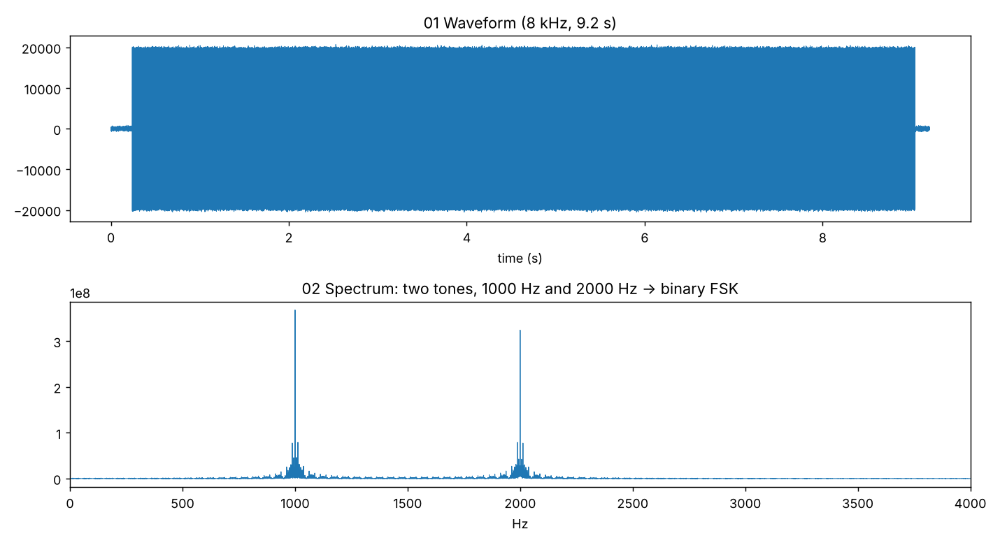
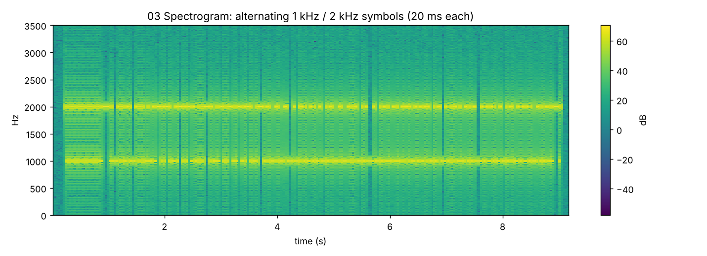
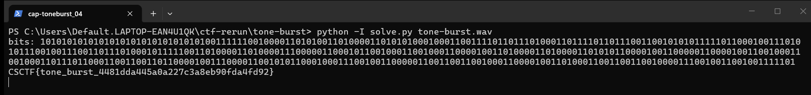

Flag: CSCTF{tone_burst_4481dda445a0a227c3a8eb90fda4fd92}
Category: Forensics (audio FSK decoding)
Tools used: Python (wave, numpy, matplotlib)
Brief: Handout: tone-burst.wav (8 kHz, mono, 16-bit, 73600 samples = 9.2 s), uploaded by mistake while I was solving Telltale, whose real file is telltale.wav. It still decodes to a valid CSCTF{...} flag, so I wrote it up here. It is not the file the berth-allocation LED description refers to: this one is 8 kHz audio, not a 48 kHz photodiode capture.

Steps:

1. Start point: the handout, tone-burst.wav
   - What I did: plotted the waveform and took an FFT of the whole 9.2 s file.
   - What I found: the spectrum has exactly two strong tones, 1000 Hz and 2000 Hz, and the waveform is one long
     burst of signal.
   - Thinking: two tones and nothing else, switching over time, means binary FSK, so the next move is to find the
     symbol timing.

     

2. Pivot: the framing is 50 baud
   - What I found: the signal starts at sample 1921 (about 0.24 s), and the tone alternates every 20 ms (160
     samples), which is 50 baud.
   - Thinking: a fixed 160-sample symbol means I can cut the burst into windows and decide each one on its own.

     

3. Pivot: demodulate the tones
   - What I did: for each 160-sample window, compared the energy at 2000 Hz against 1000 Hz with a single-bin DFT
     per tone, reading 2 kHz as 1 and 1 kHz as 0.
   - What I found: the bit stream starts with 32 bits of alternating 1010 (a clock-sync preamble), then 01111110
     (0x7E), then the payload.
   - Thinking: 0x7E after a sync preamble is an HDLC-style frame flag, so the payload's byte boundary starts right
     after it and I don't have to guess the alignment.

4. Flag: decode the payload
   - What I did: read the bits after 0x7E as 8-bit ASCII, MSB first.
   - Thinking: the first bytes came out as CSCTF{, which confirms both the bit mapping and the byte alignment.
   - Result: CSCTF{tone_burst_4481dda445a0a227c3a8eb90fda4fd92}

     

Key insight: The audio is 50-baud binary FSK (2 kHz = 1, 1 kHz = 0), and a 32-bit 1010 preamble plus an HDLC-style 0x7E flag marks exactly where the ASCII payload starts. Looking for the sync pattern first beats guessing the byte alignment.
Reproduce: python -I solve.py tone-burst.wav
