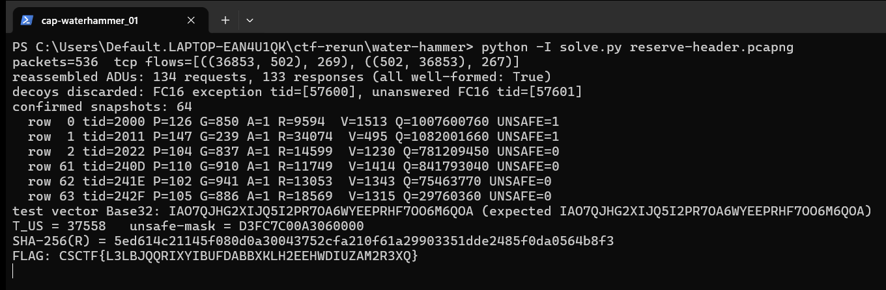

Flag: CSCTF{L3LBJQQRIXYIBUFDABBXKLH2EEHWDIUZAM2R3XQ}
Category: Forensics (Modbus/TCP capture reconciliation)
Tools used: Python 3 standard library only (own pcapng + TCP reassembly + Modbus parser). Capture parsed, never replayed.

Brief: The evidence zip water-hammer-reconciliation.zip held reserve-header.pcapng, station-profile.txt and capture-manifest.txt. I had to reconstruct the complete CONFIRMED Modbus/TCP control history of a fictional water-reserve header and submit the reconciliation identifier the profile defines. A write acknowledgement alone is not a confirmed snapshot, because the profile requires a matched FC3 readback.

Steps:
1. Start point: Read station-profile.txt
   - What I found: scope is client 192.0.2.10:<ephemeral> -> 192.0.2.20:502, unit 17. Registers (0-based): 0x1000 pump target, 0x1001 gate permille, 0x1002 armed, 0x1003 ramp_us.
   - What I found: a candidate is an FC16 request with start >= 0x1000, quantity 1..4, correct MBAP length and byte count. It confirms only if (a) it has exactly one normal, matching echo response, (b) the very next client ADU is FC3 03 1000 0004, and (c) that FC3 has a unique normal 8-byte response.
   - Thinking: the profile defines "confirmed" strictly, so the rule had to be coded exactly as written before touching the capture. Exactly 64 snapshots are expected, which gives me a way to check myself.
   - Result: a clear confirmation rule and a target count of 64.

2. Pivot: Reassemble the TCP stream
   - What I did: parsed the pcapng by hand (Enhanced Packet Blocks) and found one TCP connection (536 packets, 269 client-to-server, 267 server-to-client). I reassembled each direction by sequence number and de-duplicated retransmissions.
   - Thinking: the profile says TCP segment boundaries and timestamps do not matter, so framing Modbus per packet would create false events. Reassembly has to come first.
   - Result: 134 client ADUs and 133 server ADUs, all well-formed (protocol ID 0, Length = remaining bytes). Events are ordered by the capture position of the packet that completes each ADU.

3. Exploit: Apply the confirmation rule
   - What I did: ran every FC16 request through the three-part rule.
   - Dead end: decoys discarded. FC16 exception transaction 57600 (0xE100), because an exception never confirms. Unanswered FC16 request transaction 57601 (0xE101), the final write. Plain FC3 reads outside a write then readback sequence.
   - Thinking: each snapshot's registers (P, G, A, R) must come from the FC3 readback, not the write, since only the readback shows what the controller held. The report's tid is the FC16 response's transaction ID, not the FC3's.
   - Result: 64 snapshots remain, tids from 0x2000 to 0x242F.

4. Pivot: Safety screen with exact integers
   - What I did: computed E = floor(P*G/1000); V = floor(E*1e6/70686); Q = 998*1065*|V - V_prev|; T_US = floor(2*20000*1e6/1065000) = 37558; UNSAFE = 1 iff A=1 and R < T_US and Q > 9000*100000. V_-1 comes from the initial tuple (80,500,0,60000).
   - Thinking: before trusting my arithmetic and encoder, I ran them against the profile's public synthetic vector. It reproduces Base32 IAO7QJHG2XIJQ5I2PR7OA6WYEEPRHF7OO6M6QOA exactly.
   - Result: unsafe mask M (bit 63 = row 0) is D3FC7C00A3060000.

5. Result: Build the report and the flag
   - What I did: built the canonical report R with LF endings and no final LF: header line water-hammer-reconciliation-v2, the initial tuple, n=64, 64 lines of the form i=..;tid=....;p=..;g=..;a=..;r=.., then unsafe-mask=D3FC7C00A3060000.
   - Thinking: the identifier is a hash of the exact bytes, so one stray newline would change the flag. That is why I validated the encoder on the synthetic vector first.
   - Result: SHA-256(R) = 5ed614c21145f080d0a30043752cfa210f61a29903351dde2485f0da0564b8f3. Base32 (RFC 4648, no padding) of the first 24 bytes is L3LBJQQRIXYIBUFDABBXKLH2EEHWDIUZAM2R3XQ (39 characters).
   - To reproduce: python3 solve.py reserve-header.pcapng

     

Key insight: An acknowledgement is not state. Only a write that is acknowledged and then read back with matching values tells you what the controller actually held, and the ordering rules (response before the immediately next request, unique matches, no reuse) separate real control history from decoys. Doing TCP reassembly first, then framing, keeps packet boundaries from creating false events.

Defensive takeaways: when reconstructing ICS history from captures, treat a write acknowledgement as a claim, not proof of state, and require a readback before reporting what a controller held. Log and alert on Modbus exception responses and unanswered writes, since they are exactly what an attacker or a flaky device leaves behind. Capture at the stream level and keep reassembly deterministic so evidence holds up in an incident review.
