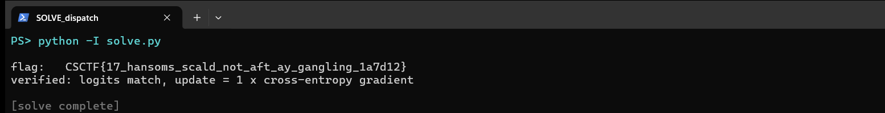

Challenge: Dispatch Authenticator - AI Security / federated learning (CSCTF 2026)
Flag: CSCTF{17_hansoms_scald_not_aft_ay_gangling_1a7d12}
Category: AI Security (federated learning gradient leakage)
Tools used: Python, NumPy

Brief: Units train a shared dispatch authenticator together (federated learning) and send their learning update back to command after each round. I intercepted one unit's update, computed on a single genuine dispatch, plus the shared model and that unit's logits, and had to recover the dispatch. Handout: dispatch-authenticator.npz (SHA-256 e4b4be4c...0877e7, verified before use).

Steps:
1. Start point: what is in the archive
   - What I found: I loaded it with allow_pickle=False so a malicious file can't run code on load. It is a 2-layer network, 50 inputs to 64 ReLU to 8 classes (global_W1, b1, W2, b2). The intercepted gradient has the same shapes (update_W1, b1, W2, b2), plus the logits and the label (0).
   - Thinking: a 50-number input is small enough to be the dispatch text itself, one number per character.
   - Result: the target is the input x of a one-sample network.

2. Pivot: the math of the first layer's gradient
   - What I found: for one training example x, the first layer computes z = W1 x + b1. Backpropagation gives dL/dW1 = delta * x^T and dL/db1 = delta, where delta is the error signal reaching each hidden unit. Every row i of the weight gradient is the input x scaled by delta_i, and the bias gradient is delta_i.
   - Thinking: so x = update_W1[i] / update_b1[i] for any unit i whose bias gradient is non-zero. No optimisation is needed, just a division. The framing that neither the model nor the logits gives it up is a red herring, because the update alone leaks the input exactly.
   - Result: a plan to recover x with one division per row.

3. Pivot: recover x
   - What I did: divided each weight-gradient row by its bias gradient. 30 of the 64 hidden units had a zero gradient (dead ReLUs, which carry nothing). The other 34 rows all gave the same vector to 5e-17.
   - Thinking: the values were multiples of 1/255, so multiplying by 255 should give ASCII codes.
   - Result: the codes 67 83 67 84 70 123 ... 125 decode to CSCTF{17_hansoms_scald_not_aft_ay_gangling_1a7d12}.

     

4. Pivot: prove it is the real dispatch
   - What I did: ran two checks. First, the shared model on the recovered x. Second, the true cross-entropy gradient for label 0 at those logits.
   - Thinking: a coincidence would not reproduce the intercepted numbers exactly.
   - Result: the model reproduces the intercepted logits exactly, and the true gradient equals update_b2 with scale 1, so the update is a plain gradient with no noise or clipping.

Key insight: In federated learning, "we only share gradients, not data" is not a privacy guarantee. With a batch of one, a fully-connected first layer with a bias leaks its input exactly, since x = dW/db. Bigger models need an optimisation attack (Deep Leakage from Gradients, Zhu et al. 2019) instead of a division, but the leak is the same.

Defensive takeaways: Use secure aggregation so the server only ever sees the sum of many units' updates, never one unit's raw gradient. Larger local batches and multiple local steps blur the per-example signal the attack relies on, and differential privacy (DP-SGD, with per-example gradient clipping plus calibrated noise) gives a provable bound on what any single update can reveal. This handout had none of these, which is why one division recovers the plaintext. From a GRC angle, treat model gradients and updates as sensitive data flows in a DPIA, not as harmless math.

Reproduce: python -I solve.py dispatch-authenticator.npz prints the flag and runs both checks, and the --demo option runs a self-check of the gradient-leak identity.
