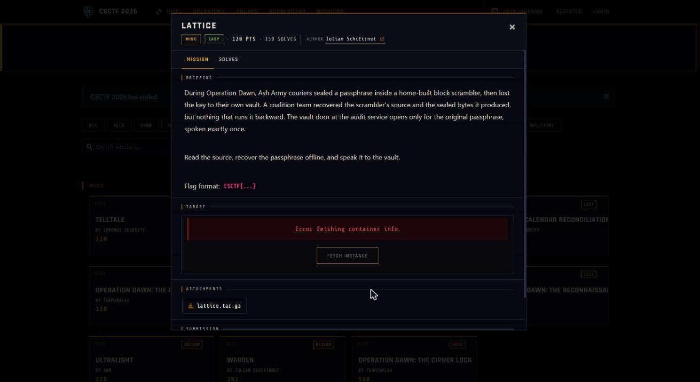

Challenge: Lattice - Misc / Easy / 120 pts / author: Iulian Schifirnet (CSCTF 2026)
Flag: CSCTF{GbXMJr6N5TnzluJZOtZuL2id}
Category: Misc (inverting a home-built block cipher)
Tools used: Python (stdlib only), solve.py

Brief: Ash Army couriers sealed a passphrase inside a home-built block scrambler (lattice.py) and shipped the source plus the sealed bytes (TARGET = encrypt(SECRET)) but no decrypt routine, so writing the inverse is the whole challenge. The vault service at w03.ctf.chronos-security.ro:34097 opens only for the original passphrase, spoken exactly once.

Steps:
1. Start point: read the source, every step reverses
   - What I found: the cipher uses 8-byte blocks, 16 rounds, ECB, big-endian, PKCS#7 padding. The S-box is a Fisher-Yates permutation of 0..255 driven by a 32-bit LCG (mult 0x19660D, add 0x3C6EF35F, seed 0x1A2B3C4D). The round keys are 16x8 bytes from the same LCG family (seed 0xCAFEB0BA). Per round r: even rounds ADD the round key (mod 256), odd rounds XOR it, then every byte goes through the S-box, then the whole 64-bit block rotates left by (7*r + 11) % 63 + 1.
   - Thinking: each piece has a clean inverse. Add-key undoes with subtract-key, xor-key is self-inverse, the S-box is a permutation so I can build INV[SBOX[i]] = i, and rotl64 undoes with rotr64. Nothing depends on a hidden key, because the LCG seeds and constants are in the source, so the S-box and round keys can be rebuilt byte for byte offline.
   - Result: the whole cipher is invertible from public material.

     

2. Pivot: build the inverse block
   - What I did: for r from 15 down to 0 I undo the forward order in reverse. First rotate right by rot_amount(r), then substitute each byte through INV_SBOX, then if r is even subtract rk[r] mod 256, otherwise XOR with rk[r].
   - Thinking: undoing in the reverse order of the forward steps is what makes the rounds cancel, so rotate first, then S-box, then the key step.
   - Result: TARGET is 48 bytes, which is 6 ECB blocks. I decrypt each block, concatenate, and strip the PKCS#7 padding (last byte is the pad length).

3. Result: recover and verify
   - What I found: decrypting TARGET gives the passphrase unl0ck-th3-l4tt1ce-pre1mage-3f9a7c2e1b8d4a60 followed by four bytes of 0x04, which is valid PKCS#7.
   - Thinking: the handout ships a checker, so I used it to confirm before touching the live service.
   - Result: python3 lattice.py with that passphrase prints "match".

4. Exploit: speak it to the vault
   - What I did: connected with a socket to w03.ctf.chronos-security.ro port 34097 and sent the passphrase once at the secret prompt.
   - Result: the vault answered "The lattice yields: CSCTF{GbXMJr6N5TnzluJZOtZuL2id}".

Key insight: Leaving out the decrypt routine is not a protection. A cipher built only from invertible primitives, with key material that can be reproduced from the published source and seeds, has zero confidentiality, because the inverse is a mechanical reversal of each round. The "preimage" framing is a red herring: this is a cipher keyed only on paper, so recovering SECRET is plain decryption, not a hash preimage.

Defensive takeaways: Security has to rest on a secret key with real entropy, never on the algorithm or on omitting the inverse, so assume the adversary has the source (Kerckhoffs). Rolling your own cipher is fine for learning but never for protecting real data, where a vetted AEAD such as AES-GCM or ChaCha20-Poly1305 with a random key and nonce is the answer, and ECB additionally leaks block-level structure even when the key is secret. A key schedule derived from an LCG seeded by constants in the binary is deterministic and public, so it is not a key at all.

Reproduce: run python -I solve.py to print the recovered passphrase (TARGET is embedded), or python -I solve.py --send HOST PORT to also speak it to the vault and print the flag.
