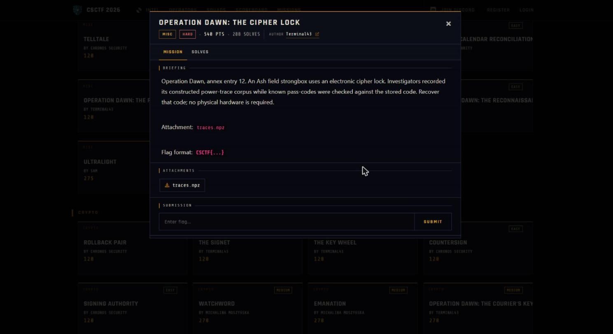

Challenge: Operation Dawn - The Cipher Lock - Misc / Hard / 540 pts / author: Terminal43 (CSCTF 2026)
Flag: CSCTF{12_the_depot_is_unguarded_at_noon_7d3e90}
Category: Misc (power analysis on AES S-box)
Tools used: Python (numpy), solve.py

Brief: Operation Dawn, annex entry 12: an Ash field strongbox uses an electronic cipher lock, and investigators recorded a constructed power-trace corpus while known pass-codes were checked against the stored code. I had to recover the stored code from traces.npz, with no hardware needed (288 solves).

Steps:
1. Start point: what is in the archive
   - What I found: I loaded traces.npz with allow_pickle=False, because a numpy archive can carry pickled objects that run code on load. It holds three arrays: traces (1500 x 87 floats, one power trace per guess attempt with 87 time samples each), plaintexts (1500 x 47 bytes, the known pass-code entered on each attempt) and sbox (256 bytes, where sbox[0] is 0x63, so it is the standard AES S-box).
   - Thinking: 47 entered bytes per attempt means 47 bytes of stored code to find. This is a per-byte secret, so the attack is 47 independent single-byte CPAs, not a 128-bit key schedule.
   - Result: the problem is 47 small searches of 256 candidates each.

     

2. Pivot: the leakage model
   - What I did: assumed the lock validates each position by computing sbox[entered_byte XOR stored_byte], the classic AES first-round target.
   - Thinking: a CMOS circuit's power draw tracks the Hamming weight of the byte it handles, so one sample in each trace should correlate with HW(sbox[pt ^ stored]). Only the stored byte is unknown, which is 256 options per position.
   - Result: a usable model for every position.

3. Exploit: correlation power analysis, one byte at a time
   - What I did: for position p and each candidate stored value g in 0..255, I built the model column HW(sbox[plaintexts[i,p] ^ g]) over all 1500 traces and computed the Pearson correlation against each of the 87 time samples. The guess with the highest absolute correlation is the real stored byte.
   - Thinking: a wrong guess has no relation to the real leakage, so only the true byte should stand out from the noise.
   - Result: the correct guess peaks at r of about 0.29 to 0.38 at the leaking sample, while every wrong guess stays near the noise floor (absolute r below about 0.1). The separation is clean on all 47 positions.

4. Result: read the code
   - What I found: the 47 recovered bytes are all printable ASCII and spell CSCTF{12_the_depot_is_unguarded_at_noon_7d3e90}.
   - Thinking: printable bytes forming a valid CSCTF{...} string is the pass/fail check, since one wrong byte would show up as garbage at its position. The 12 also matches annex entry 12 in the briefing.
   - Result: flag recovered.

Key insight: A comparison that runs the secret through an S-box leaks the secret's Hamming weight in power, one byte at a time. Because each code byte is checked independently, the search is 47 x 256 guesses, not 256^47. Known entered codes plus recorded traces are all an attacker needs, and the "no hardware required" note means the corpus already contains the leakage, so this is a pure data attack.

Defensive takeaways: A cipher lock that compares secrets with data-dependent power draw is bypassable by anyone who can record traces under known inputs. Countermeasures are masking (randomise the intermediate so a single sample is independent of the secret), constant-power and constant-time comparison, and hiding (jitter, shuffling), but each must be evaluated against an attacker doing alignment plus higher-order CPA, not just the naive attack. A device that leaks per byte also enables incremental guessing, so the comparison must never short-circuit or vary with the secret.

Reproduce: python -I solve.py path/to/traces.npz loads the arrays, runs a 256-candidate CPA per byte against the AES S-box Hamming-weight model, prints each recovered byte with its peak correlation, then the full code.
