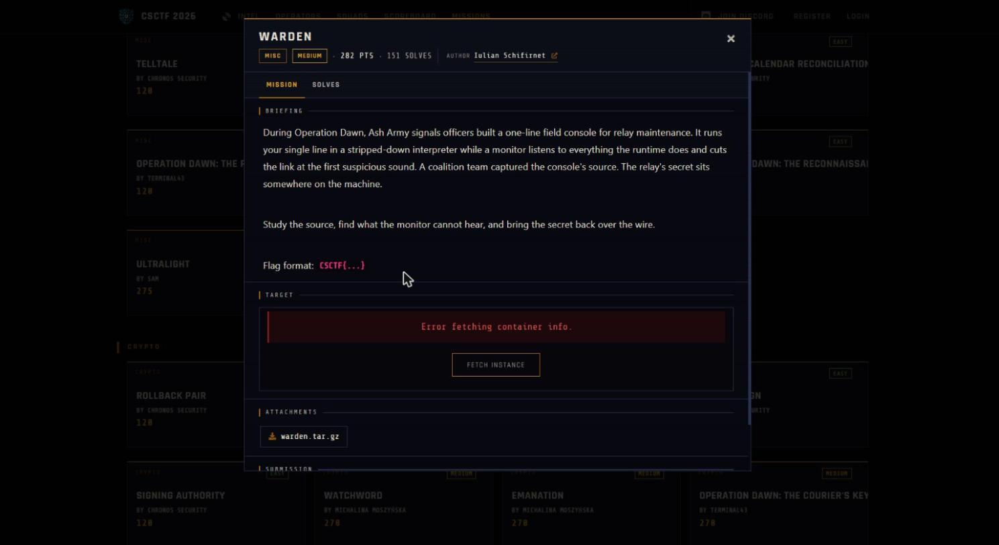

Challenge: Warden - Misc / Medium / 282 pts / author: Iulian Schifirnet (CSCTF 2026)
Flag: CSCTF{KsGjqClMT9Atn52ScQTFU1ha}
Category: Misc (CPython audit hook sandbox escape)
Tools used: Python (stdlib: socket), the provided jail.py source, solve.py

Brief: During Operation Dawn, Ash Army signals officers built a one-line field console for relay maintenance (host w05.ctf.chronos-security.ro:33751). It runs one line of Python in a stripped-down interpreter while a monitor listens to what the runtime does and cuts the link at the first suspicious sound. I had the console's source (jail.py) and had to find what the monitor cannot hear and bring the relay's secret back over the wire.

Steps:
1. Start point: read jail.py and pin down what the monitor hears
   - What I found: the line runs with empty builtins behind two gates. A static check requires one line, at most 4096 characters, that parses and contains no import statements. Then a CPython audit hook is installed that exits the process on any audit event except attribute reads and exactly one exec. The exit and write functions are captured by value in the closure, and audit hooks cannot be unregistered, so the sandboxed code has nothing to grab to remove it.
   - Thinking: the one allowed exec is consumed by the jail's own exec call, which fires before my line runs, so I get no exec, eval, compile, import, open or subprocess of my own. The compile also happens before the hook is installed because compile is itself audited, a hint that the hook is the only real lock.
   - Result: the hook is the lock, so the question is what it cannot hear.

     

2. Pivot: the hook only runs when an audit event is raised
   - What I found: CPython raises audit events only for a fixed set of interesting operations (open, import, compile, exec, os.system, subprocess, socket and similar). Pure Python computation raises nothing: attribute access, method calls, list, dict and string operations, formatting.
   - Thinking: if an operation raises no event, the hook is never called and the operation just runs, so silent means allowed. A file open would be fatal, so the secret must be reachable without opening a file, meaning an environment variable or something already in memory.
   - Result: the escape only has to stay off the audited operations.

3. Pivot: reach the already-loaded os module through the object graph
   - What I did: with empty builtins there are no names to start from, only literals, so I walked from a plain object up to its base class and listed every loaded class, then picked a class from the os module that is always defined once os is imported. Its initializer's globals are the os module's namespace, so they already hold the environment and the write function.
   - Thinking: this needs no import event and no open event, only attribute reads (which the warden allows) and ordinary dict and string operations (which raise nothing).
   - Result: a path from literals to the environment and a write function without a single audited call.

4. Exploit: dump the environment to the wire
   - What I did: sent one line that formats the environment variables as text and writes them to stdout using that captured write function, with no builtins used anywhere. A local check against a copy of jail.py with a planted flag in the environment printed the whole environment with no warden message, so every operation was silent. The exact one-liner is in solve.py.
   - Result: against the live console it worked on the first attempt, and the environment held the secret: FLAG=CSCTF{KsGjqClMT9Atn52ScQTFU1ha}. The offline demo ends with "demo OK: gadget read the environment silently". Reproduction needs the live challenge server, which is now unavailable.

Key insight: An audit hook is a deny-list over a fixed set of instrumented operations, not a capability sandbox. It hears opens, imports, execs and subprocess spawns, but it is deaf to operations that need no OS interaction, such as attribute access, reading the environment and writing to a file descriptor. The whole exploit lives in that blind spot: walk the class graph to the already-loaded os module and read the secret straight out of the environment. Emptying builtins and allowing only attribute reads looks locked down but leaves the whole silent-computation surface open.

Defensive takeaways: Audit hooks are for detection and telemetry, not isolation, so confine untrusted code with an OS boundary (a separate process with seccomp or landlock, a container, or a WASM runtime) rather than an in-process hook that shares the interpreter with the code it contains. Do not keep secrets where sandboxed code can read them with zero audited calls, since environment variables, module globals and the object graph are all reachable without open, import or exec. Emptying builtins removes convenience, not reach, because the class graph still exposes every loaded class and its globals, and if a hook must be the control it has to treat reaching os, sys or subprocess through attribute access as the event to block.

Reproduce: python solve.py w05.ctf.chronos-security.ro 33751 sends the line and prints the environment dump with the flag, and python solve.py --demo runs an offline in-process self-check against a planted environment variable.
