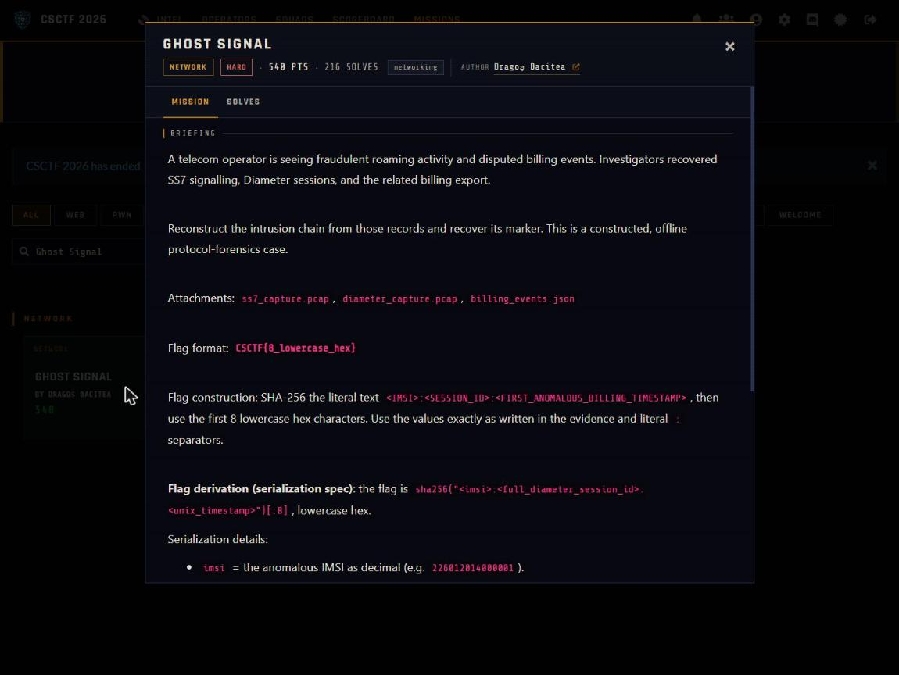

Challenge: Ghost Signal - Network / Hard / 540 pts / author: Dragoș Bacitea (CSCTF 2026)
Flag: CSCTF{28358943}
Category: Network (SS7 Diameter billing correlation)
Tools used: Python (stdlib: json, re, hashlib, collections), solve.py

Brief: A telecom operator sees fraudulent roaming activity and disputed billing events, and investigators recovered SS7 signalling, Diameter sessions and the billing export (ss7_capture.pcap, diameter_capture.pcap, billing_events.json). I had to reconstruct the intrusion chain offline and recover its marker. The flag is the first 8 lowercase hex of SHA-256 of IMSI:SESSION_ID:FIRST_ANOMALOUS_BILLING_TIMESTAMP, values exactly as written.

Steps:
1. Start point: catalogue the three files
   - What I found: ss7_capture.pcap holds SS7 MAP messages over M3UA (the 2G/3G roaming signalling layer). diameter_capture.pcap holds Diameter requests and answers between the CSCFs and the HSS (the LTE/IMS side). billing_events.json is the OCS billing export (provider eastern-tele.ro).
   - Thinking: the flag needs an IMSI, a session ID and a timestamp, and three artifacts each probably hold one piece, so the plan is to find a value that appears in all three.
   - Result: three sources to cross-reference.

     

2. Pivot: find the one hidden identity
   - What I found: in the billing export every normal subscriber has a 16-digit IMSI (2260120140002xxx), but one IMSI is only 15 digits: 226012014000001. Every event carrying an anomaly field belongs to it, all within a single session hss.eastern-tele.ro;1723740150;49211 (zero_charge_on_roaming writes and an unusual_routing_path pivot).
   - Thinking: the malformed IMSI is the odd one out, so it is the attacker's thread to pull.
   - Result: candidate IMSI and session ID.

3. Pivot: trace the identity through both captures
   - What I did: SS7 MAP stores the IMSI as TBCD (nibble-swapped, f-padded), so I decoded the length-8 IMSI fields. In Diameter I searched the same IMSI.
   - Thinking: confirming the IMSI in both captures before trusting the billing record proves the thread.
   - Result: 226012014000001 appears in 5 SS7 messages, so first contact is on the SS7 side. It appears in 4 Diameter messages in the same session 49211, where the request comes from cscf.rogue.evil-domain.net and the answer redirects to a pivot CSCF with diameter://intercept-49211.evil-domain.net.

4. Result: build the marker
   - What I did: the billing events are not stored in time order, so I sorted by timestamp. The first anomalous event is at 1723740150. I hashed 226012014000001:hss.eastern-tele.ro;1723740150;49211:1723740150 and took the first 8 hex, 28358943.
   - Thinking: sorting matters because the marker depends on the earliest anomalous timestamp, not the first one in the file.
   - Result: running python -I solve.py prints IMSI 226012014000001 (SS7 x5, Diameter x4), the session, the first anomalous timestamp 1723740150 and CSCTF{28358943}.

Key insight: The whole case is a cross-reference exercise, because the attacker's IMSI is deliberately the only malformed 15-digit one and the single value present in all three artifacts. Confirming it in SS7 (TBCD-decoded) and Diameter before trusting the billing record proves the thread, and sorting the out-of-order billing events pins the first anomalous timestamp the marker depends on.

Defensive takeaways: Fraud like this only shows up when signalling and billing data are correlated, so operators should join SS7, Diameter and charging records on subscriber identity and alert on malformed identifiers, zero-charge roaming writes and requests from unexpected CSCF domains. Filtering at the signalling edge for rogue peers and unusual routing paths would stop the pivot before billing is affected.
