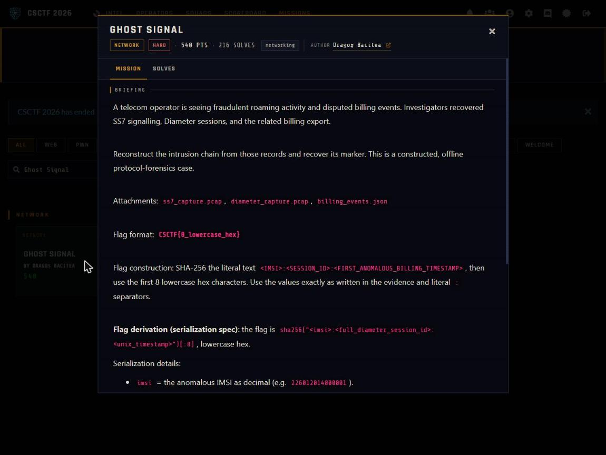

Flag: CSCTF{28358943}
Category: Network (SS7 Diameter billing correlation)
Tools used: Python (standard library)
Challenge: Ghost Signal (CSCTF 2026, Network, Hard, 540 pts, author: Dragoș Bacitea)
Brief: A telecom operator saw fraudulent roaming and disputed billing, and investigators recovered SS7 signalling, Diameter sessions and the billing export. The flag is the first 8 lowercase hex of SHA-256 of IMSI:SESSION_ID:FIRST_ANOMALOUS_BILLING_TIMESTAMP, values exactly as written.

Steps:

1. Start point: the three evidence files
   - What I did: opened ss7_capture.pcap, diameter_capture.pcap and billing_events.json to see what each layer holds.
   - What I found: the SS7 capture holds MAP messages over M3UA (the 2G/3G roaming signalling). The Diameter capture holds requests and answers between the CSCFs and the HSS (the LTE/IMS side). billing_events.json is the OCS export for eastern-tele.ro, 40 events, and its metadata says to "filter by the IMSI and session corroborated by the signalling captures".
   - Thinking: the marker needs an IMSI, a session ID and a timestamp, and the billing note ties them to the captures, so I looked for the one identity that threads all three files.

     

2. Pivot: one 15-digit IMSI owns every anomaly
   - What I found: every normal subscriber in the billing export has a 16-digit IMSI (2260120140002xxx), but one is only 15 digits: 226012014000001. Every event with an anomaly field belongs to it, all in session hss.eastern-tele.ro;1723740150;49211: five zero_charge_on_roaming CCR-I events and five unusual_routing_path CCA events.
   - Thinking: the malformed IMSI is the odd one out and carries every anomaly, so it is the attacker's thread. The billing note says to trust it only once the signalling corroborates it, so both pcaps came next.

3. Pivot: the same IMSI in SS7 and Diameter
   - What I did: SS7 MAP stores the IMSI as TBCD (nibble-swapped, f-padded), so I decoded every length-8 IMSI field. In the Diameter capture I searched for the IMSI as plain digits.
   - Result: 226012014000001 appears in 5 SS7 messages and in 4 Diameter messages in session 49211. There the request comes from cscf.rogue.evil-domain.net and the answer redirects to a pivot CSCF with diameter://intercept-49211.evil-domain.net.
   - Thinking: with the identity confirmed in both captures, the billing record could be trusted for the session ID and the timestamp.

4. Flag: building the marker
   - What I did: sorted the billing events by timestamp, took the earliest anomalous one (1723740150), hashed 226012014000001:hss.eastern-tele.ro;1723740150;49211:1723740150 with SHA-256 and kept the first 8 hex.
   - Thinking: the export is not stored in time order, so I sorted instead of trusting file order. Here the earliest anomalous event also came first in the file, but nothing guaranteed that.
   - Result: CSCTF{28358943}. python -I solve.py prints the IMSI (SS7 x5, Diameter x4), the session, the timestamp 1723740150 and this flag.

Key insight: The attacker's IMSI was the only malformed 15-digit one and the one value present in SS7, Diameter and billing, so cross-referencing the three files exposed the chain. Confirming it in both captures before trusting the billing record proves the thread, and sorting the billing events pins the first anomalous timestamp.
Defensive takeaways: Fraud like this only shows up when signalling and billing data are correlated, so operators should join SS7, Diameter and charging records on subscriber identity and alert on malformed identifiers, zero-charge roaming writes and requests from unexpected CSCF domains. Filtering rogue peers and unusual routing paths at the signalling edge would stop the pivot before billing is affected.
Reproduce: python -I solve.py billing_events.json ss7_capture.pcap diameter_capture.pcap
