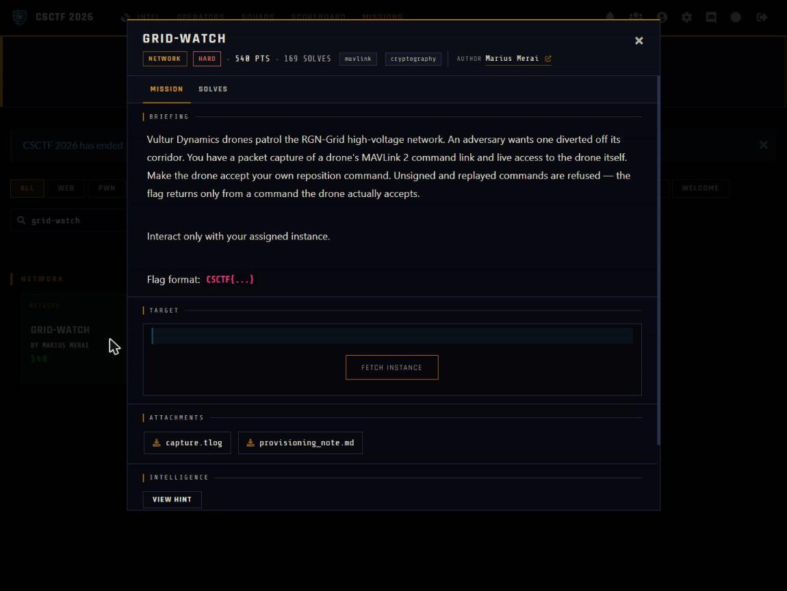

Challenge: Grid-Watch - Network / Hard / 540 pts / author: Marius Merai (CSCTF 2026)
Flag: CSCTF{0u8Tr4pMpvDktHKI2MiMNIOi}
Category: Network (MAVLink 2 signing key re-provisioning)
Tools used: pymavlink, Python (stdlib: hmac, hashlib, fractions, socket), solve.py

Brief: Vultur Dynamics drones patrol the RGN-Grid high-voltage network and an adversary wants one diverted off its corridor. I had a packet capture of a drone's MAVLink 2 command link (capture.tlog), a provisioning_note.md, and live access to my own instance (for example w01.ctf.chronos-security.ro:37370). Unsigned and replayed commands are refused, and the flag returns only from a command the drone actually accepts.

Steps:
1. Start point: read the provisioning note and the capture
   - What I found: the note says command and telemetry use MAVLink 2 signing, and the per-airframe session key is not on the link. Signing timestamps are 10 us ticks from the airframe RTC since the unit's commissioning epoch (not the 2015 MAVLink epoch), with a per-unit offset and ppm drift to calibrate. Keys may be re-provisioned in the field with a SETUP_SIGNING authenticated by the unit's provisioning key: prov_key = HKDF-SHA256(ikm = serial_ascii || commissioning_epoch as uint64 little-endian seconds, salt = session_nonce announced at connect, info = "CX-PROV/v1", L = 32). After re-provisioning the order is set GUIDED, arm, then command.
   - Thinking: the note gives the whole recipe, so the question becomes whether every input to the HKDF can be recovered from the evidence. capture.tlog is one signed MAVLink 2 flow, and a STATUSTEXT in it gives the serial CX-FALCON-9951.
   - Result: serial known, nonce comes at connect, epoch still missing.

     

2. Pivot: calibrate the RTC and recover the commissioning epoch
   - What I did: each signed frame's trailer holds a 48-bit tick, so I paired every tick with the tlog's wall-clock time and fitted a line.
   - Dead end: a float least-squares fit over about 2.3e12 ticks loses precision and gave a wrong epoch at first.
   - Thinking: the epoch has to be byte-exact for the HKDF, so I switched to exact arithmetic.
   - Result: an exact two-point line fits all points to microseconds, with ppm of about -17 and epoch = 1733965123. As a cross-check, extrapolating the live tick with that epoch lands on the present day.

3. Pivot: derive the provisioning key and re-provision in one connection
   - What I did: on connect the unit announces "PROV NONCE <hex>". I computed prov_key = HKDF-SHA256(serial || epoch as little-endian u64, salt = bytes.fromhex(nonce), info = "CX-PROV/v1") and sent the authenticated SETUP_SIGNING. The server confirmed "signing re-provisioned: new key active".
   - Dead end: pymavlink validates incoming frames against the signing key too, so the drone's own replies looked like BAD_DATA until I decoded them with a separate non-validating parser.
   - Thinking: the signing timestamp must stay ahead of the drone's live tick or the signed frame is dropped as stale, so solve.py reads a live tick and adds a margin.
   - Result: the new key is active and my frames are accepted as signed.

4. Exploit: fly it
   - What I did: signed with the newly installed key and sent DO_SET_MODE GUIDED(4), then COMPONENT_ARM_DISARM(1), then DO_REPOSITION. The drone only accepts DO_REPOSITION as a COMMAND_LONG, since COMMAND_INT and SET_POSITION_TARGET_GLOBAL_INT are refused.
   - Result: the accepted reposition (COMMAND_ACK result 0) returns the flag over STATUSTEXT: CSCTF{0u8Tr4pMpvDktHKI2MiMNIOi}. I ran it as python solve.py tcp:ASSIGNED_HOST:PORT. Reproduction needs the live challenge server, which is now unavailable.

Key insight: The link refuses unsigned and replayed commands, but the note hands over the exact HKDF that builds the provisioning key, and every input to it is recoverable from the evidence: the serial from a STATUSTEXT, the epoch by calibrating the RTC ticks, and the nonce from the connect banner. Re-signing is legitimate per the protocol, so the only real work is getting the epoch byte-exact (hence the exact-arithmetic calibration) and keeping signing timestamps current so each frame is accepted.

Defensive takeaways: A provisioning key derived only from values that leak over the link or sit in logs (a serial number, a commissioning date, a nonce announced in the clear) is not a secret, so field re-keying needs a key that never appears in the capture, such as a per-unit random key loaded out of band or an authenticated key exchange. Treat recorded telemetry as containing the inputs to any key derivation, and monitor for unexpected SETUP_SIGNING messages and new signing keys appearing on an airframe.
