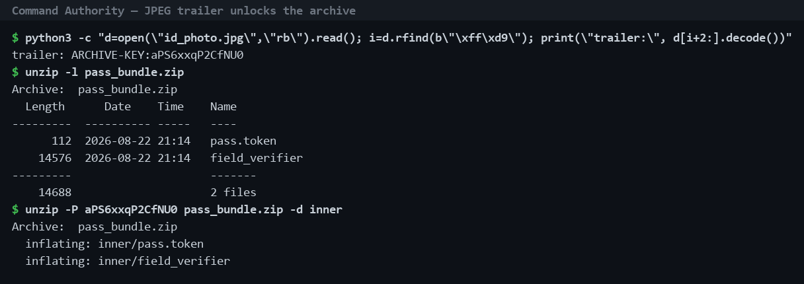
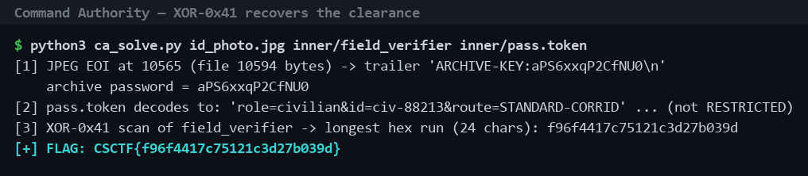

# Command Authority — offline clearance verifier

**Flag:** `CSCTF{f96f4417c75121c3d27b039d}`  
**Category:** Reverse engineering / archive forensics  
**Artifacts:** `command-authority-evidence.zip` (`id_photo.jpg`, `pass_bundle.zip`)  
**Tools:** `unzip`, Python byte inspection / Base64, `strings`, `objdump`

## Objective

Recover the restricted clearance value accepted by the offline verifier. The evidence packet contains a personnel image and a password-protected archive.

## Steps

1. **Inspect the JPEG for appended data.** The JPEG ends at its normal EOI marker (`FF D9`) before the physical end of file. Bytes after the marker contain the ASCII marker `ARCHIVE-KEY:` followed by the archive password. This is appended metadata, not visible image content.

2. **Unlock the nested archive.** Use the recovered key to extract `pass_bundle.zip`. It contains `pass.token` and a stripped x86-64 ELF named `field_verifier`.

3. **Inspect the verifier.** The program's usage string is `field_verifier <token_file_b64>`. Static strings reveal the accepted route distinction (`RESTRICTED` versus `STANDARD-CORRIDOR`) and the success message. The supplied token decodes to a standard-corridor civilian record, so it is not the restricted clearance.

4. **Recover the restricted clearance constant.** Inspect the verifier's embedded comparison data. The encoded byte sequence is XOR-obfuscated with `0x41`. XOR each byte with `0x41` to recover the exact 24-character clearance value: `f96f4417c75121c3d27b039d`. The required submission wraps that value in the challenge flag format.

## Result

**Flag:** `CSCTF{f96f4417c75121c3d27b039d}`

## Key insight

The JPEG's displayed pixels are not the whole file: data can be appended after the JPEG end marker. The nested archive then provides the verifier, while static analysis of its embedded comparison reveals the restricted clearance value.

## Screenshots

Captures of the real solve, reproduced by `solve.py` against the supplied artifacts (rerun to verify). The personnel photo itself is intentionally not reproduced.

Pivot 1 — the JPEG trailer reveals the archive password and the bundle extracts:

Pivot 2 — an XOR-0x41 scan of `field_verifier` recovers the 24-character restricted clearance:

