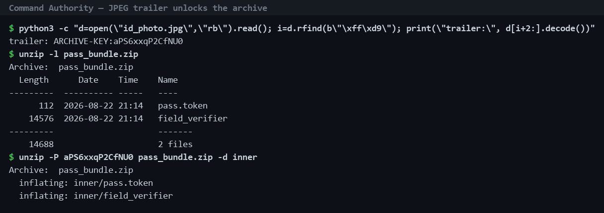
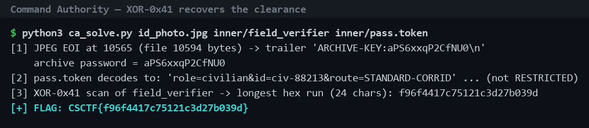

Flag: CSCTF{f96f4417c75121c3d27b039d}
Category: Reverse Engineering (JPEG trailer, XOR-obfuscated constant)
Tools used: unzip, Python, strings, objdump
Challenge: Command Authority - offline clearance verifier
Brief: Recover the restricted clearance value accepted by the offline verifier. The evidence packet command-authority-evidence.zip contains a personnel image (id_photo.jpg) and a password-protected archive (pass_bundle.zip).

Steps:

1. Start point: id_photo.jpg and pass_bundle.zip
   - What I did: opened the evidence packet command-authority-evidence.zip, which held a personnel image (id_photo.jpg) and a password-protected archive (pass_bundle.zip), then checked the JPEG for appended data.
   - What I found: the JPEG ends at its normal EOI marker (FF D9) before the physical end of file. Bytes after the marker contain the ASCII marker ARCHIVE-KEY: followed by the archive password. This is appended metadata, not visible image content.
   - Thinking: the zip was password protected and nothing else in the packet gave a password, so the only other file, the photo, had to carry it.

2. Pivot: the trailer key opens pass_bundle.zip
   - What I did: used the recovered key to extract pass_bundle.zip. It contains pass.token and a stripped x86-64 ELF named field_verifier.
   - Thinking: the key came from the image trailer, so the extracted verifier and token were the real target of the challenge.

     

3. Pivot: the verifier compares against a hidden value
   - What I found: the program's usage string is field_verifier <token_file_b64>. Static strings reveal the accepted route distinction (RESTRICTED versus STANDARD-CORRIDOR) and the success message. The supplied token decodes to a standard-corridor civilian record, so it is not the restricted clearance.
   - Thinking: the given token only takes the standard route, so the restricted clearance had to be stored inside the verifier itself.

4. Flag: XOR 0x41 over the comparison data
   - What I did: inspected the verifier's embedded comparison data. The encoded byte sequence is XOR-obfuscated with 0x41. I XORed each byte with 0x41 to recover the exact 24-character clearance value, f96f4417c75121c3d27b039d. The required submission wraps that value in the challenge flag format.
   - Thinking: the recovered bytes were a clean run of lowercase hex, which is what a clearance value should look like, so the key 0x41 was right.
   - Result: CSCTF{f96f4417c75121c3d27b039d}

     

Key insight: Data appended after the JPEG end marker held the archive password, and the verifier's restricted clearance was stored XORed with 0x41, so one XOR scan recovered it without running the program. The nested archive provided the verifier, and static analysis of its embedded comparison data revealed the value.
Reproduce: python -I solve.py id_photo.jpg field_verifier pass.token
Note: The captures are of the real solve, reproduced by solve.py against the supplied artifacts. The personnel photo itself is intentionally not reproduced.
