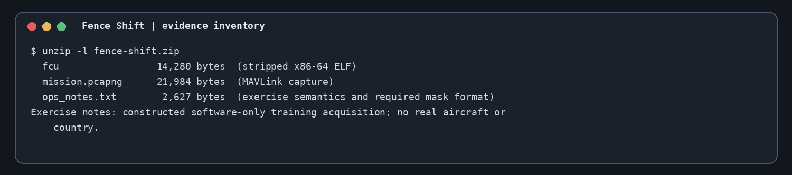
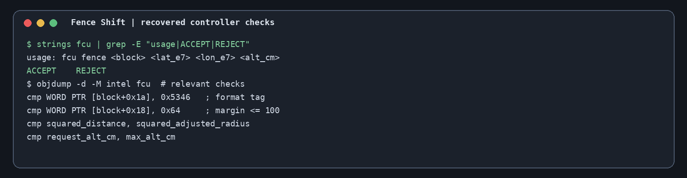
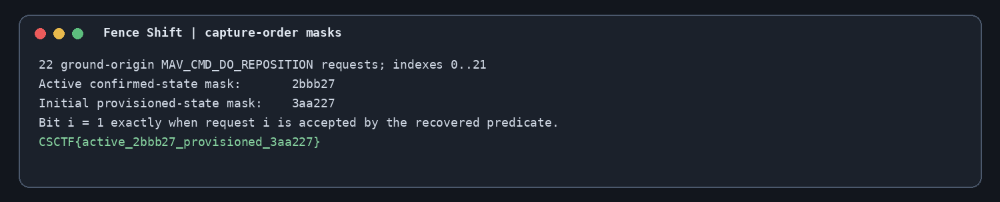

Challenge: Fence Shift — offline flight-controller analysis
Flag: CSCTF{active_2bbb27_provisioned_3aa227}
Category: Reverse Engineering (PCAP analysis)
Tools used: unzip, strings, objdump, Python packet parsing / mask evaluation
Brief: the evidence packet fence-shift.zip holds fcu, mission.pcapng, and ops_notes.txt. Recover the exact acceptance predicate implemented by the supplied flight-controller executable, then evaluate all 22 captured MAV_CMD_DO_REPOSITION requests twice: once with the confirmed active fence state immediately before each request, and once with the initial provisioned state. The challenge notes specify that request numbering is zero-based and mask bit i corresponds to request i.

Steps:
1. Inspect the evidence packet.
   - What I did: extracted fcu, mission.pcapng, and ops_notes.txt. The notes define the aircraft, route-manager, and
     ground-station MAVLink roles; distinguish the route manager's queue acknowledgement from the controller's later
     decision; and specify that only a matching aircraft-origin PARAM_VALUE confirms a ground-origin PARAM_SET.

     

2. Recover the controller interface and packed structure.
   - What I found: strings identifies the interface `fcu fence <block> <lat_e7> <lon_e7> <alt_cm>`. Disassembly shows
     the controller reads exactly 0x1c (28) bytes, checks the trailing format tag 0x5346, and rejects a radius margin
     above 100. The parameter block is decoded as six 32-bit fields followed by two 16-bit fields; the request
     coordinates and altitude are parsed as signed integers. The binary converts centimetre offsets into coordinate
     units, applies the percentage radius margin, compares squared horizontal distance against squared adjusted
     radius, and separately enforces the maximum altitude.

     

3. Reconstruct the two timelines.
   - What I did: use the initial aircraft-origin PARAM_VALUE burst as the provisioned state. Apply each later
     ground-origin PARAM_SET only at the point where its matching aircraft-origin PARAM_VALUE confirms it. Do not
     treat the route manager's immediate queued acknowledgement as a geofence acceptance. The provisioned centre is
     the initial aircraft GLOBAL_POSITION_INT fix. Captured MSL altitude is integral metres, so each value is
     converted to centimetres as alt_cm = z * 100.

4. Evaluate requests in capture order.
   - What I did: for each of the 22 ground-origin reposition requests, evaluate the recovered predicate against
     (a) the confirmed active state at that instant and (b) the unchanged initial provisioned state. Set bit i when
     the controller predicate accepts request i.
   - Result: active-state mask 2bbb27, initial provisioned-state mask 3aa227 (bit order: request 0 is the
     least-significant bit; masks are rendered as six lowercase hexadecimal digits). Flag:
     CSCTF{active_2bbb27_provisioned_3aa227}.

     

Key insight: a queue acknowledgement is not proof that the aircraft moved or that the flight controller accepted the reposition. The state timeline must be driven by the aircraft's matching parameter confirmation, and the exact controller predicate must be recovered from the binary rather than inferred from the route manager's response.
Note: the screenshots are terminal-style evidence panels made for this write-up from the supplied notes and recovered binary analysis; they are not screenshots of a live aircraft or a real operation.
