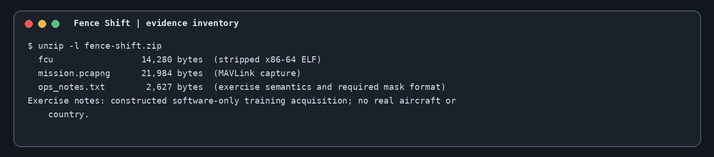
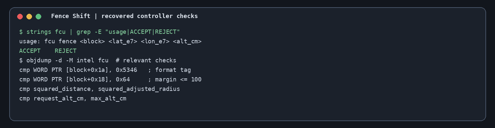
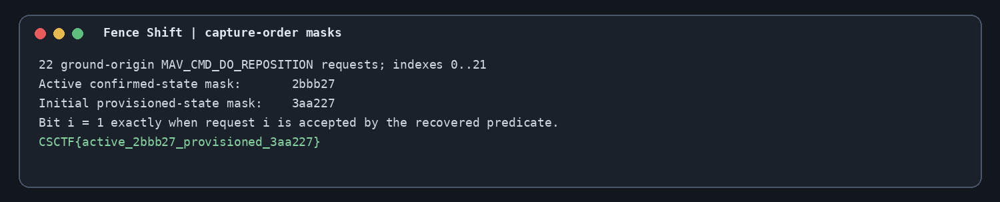

Flag: CSCTF{active_2bbb27_provisioned_3aa227}
Category: Reverse Engineering (controller predicate from binary)
Tools used: unzip, strings, objdump, Python
Challenge: Fence Shift - offline flight-controller analysis
Brief: The evidence packet fence-shift.zip holds fcu, mission.pcapng and ops_notes.txt. I had to recover the exact acceptance predicate implemented by the flight-controller executable, then evaluate all 22 captured MAV_CMD_DO_REPOSITION requests twice, once with the confirmed active fence state before each request and once with the initial provisioned state. The notes say request numbering is zero-based and mask bit i corresponds to request i.

Steps:

1. Start point: fence-shift.zip and ops_notes.txt
   - What I did: extracted fcu, mission.pcapng and ops_notes.txt from the evidence packet fence-shift.zip, then read the notes.
   - What I found: the notes define the aircraft, route-manager and ground-station MAVLink roles. They distinguish the route manager's queue acknowledgement from the controller's later decision, and say only a matching aircraft-origin PARAM_VALUE confirms a ground-origin PARAM_SET.
   - Thinking: the notes separate a queue acknowledgement from the controller's real decision, so I needed the controller's own predicate from fcu instead of trusting the capture's replies.

     

2. Pivot: recover the controller interface and checks
   - What I found: strings identifies the interface fcu fence <block> <lat_e7> <lon_e7> <alt_cm>. Disassembly shows the controller reads exactly 0x1c (28) bytes, checks the trailing format tag 0x5346, and rejects a radius margin above 100.
   - What I found: the parameter block is decoded as six 32-bit fields followed by two 16-bit fields, and the request coordinates and altitude are parsed as signed integers. The binary converts centimetre offsets into coordinate units, applies the percentage radius margin, compares squared horizontal distance against squared adjusted radius, and separately enforces the maximum altitude.
   - Thinking: the squared-distance and altitude comparisons are the accept or reject decision, so reproducing them offline would let me score every captured request.

     

3. Pivot: rebuild the fence state timeline
   - What I did: used the initial aircraft-origin PARAM_VALUE burst as the provisioned state.
   - What I did: applied each later ground-origin PARAM_SET only at the point where its matching aircraft-origin PARAM_VALUE confirms it, and did not treat the route manager's immediate queued acknowledgement as a geofence acceptance.
   - What I found: the provisioned centre is the initial aircraft GLOBAL_POSITION_INT fix. Captured MSL altitude is integral metres, so each value is converted to centimetres as alt_cm = z * 100.
   - Thinking: the notes say only a matching PARAM_VALUE confirms a PARAM_SET, so that is the only event that should change the active state.

4. Flag: evaluate the 22 requests twice
   - What I did: for each of the 22 ground-origin reposition requests in capture order, evaluated the recovered predicate against the confirmed active state at that instant and against the unchanged initial provisioned state. I set bit i when the predicate accepts request i.
   - Thinking: the challenge asks for both states, so one pass per state gives the two masks, with request 0 as the least-significant bit and six lowercase hexadecimal digits each.
   - Result: active-state mask 2bbb27, initial provisioned-state mask 3aa227. Flag: CSCTF{active_2bbb27_provisioned_3aa227}

     

Key insight: A queue acknowledgement is not proof the controller accepted the reposition, so I drove the state timeline from the aircraft's matching parameter confirmation and took the predicate from the binary. The exact controller predicate has to be recovered from the binary rather than inferred from the route manager's response.
Note: The screenshots are terminal-style evidence panels made for this write-up from the supplied notes and recovered binary analysis. They are not screenshots of a live aircraft or a real operation.
