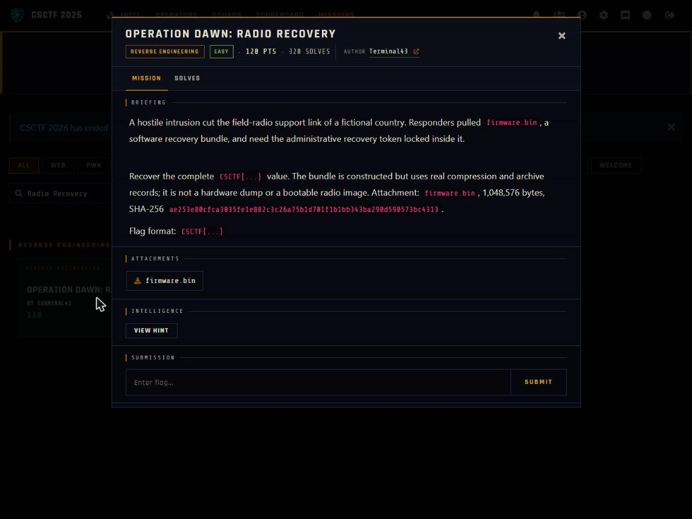

Flag: CSCTF{05_train_kestrel_d48e1f}
Category: Reverse Engineering (zlib preset-dictionary firmware)
Tools used: Python (struct, zlib, binascii)
Challenge: Operation Dawn - Radio Recovery (CSCTF 2026, Reverse Engineering, Easy, 120 pts, author: Terminal43)
Brief: A hostile intrusion cut the field-radio support link of a fictional country, and responders pulled firmware.bin, a software recovery bundle. I had to recover the administrative recovery token locked inside it as the complete CSCTF{...} value. The bundle is constructed but uses real compression and archive records; it is not a hardware dump or a bootable radio image.

Steps:

1. Start point: firmware.bin, the DWFW container
   - What I did: opened firmware.bin (1,048,576 bytes, SHA-256 ae253e80...4313), the only attachment, and parsed its header.
   - What I found: it starts with DWFW, then a u16 version and a u16 entry count of 4, then 20-byte entries (name[8], u32 offset, u32 size, u32 crc32). All four CRCs verify: loader (U-Boot SPL string), ubootenv (16 KiB), msgcat (258 bytes of boot strings) and rootfs (633 bytes). The rest of the 1 MB is 0xFF (empty flash).
   - Thinking: the brief says the bundle uses real archive records, so I parsed the container first and used the CRCs to confirm each blob was intact before going deeper.

     

2. Pivot: msgcat is the zlib preset dictionary
   - What I found: rootfs begins 78 f9, a zlib stream with the preset-dictionary bit set, and its 4-byte dictid equals the adler32 of msgcat.
   - What I did: inflated rootfs with zdict set to msgcat (633 to 2560 bytes), which gave a newc cpio archive.
   - Thinking: a preset-dictionary header names the dictionary by checksum, and msgcat matched, so the odd 258-byte blob was the missing piece.

3. Pivot: the cpio holds the token and the key rule
   - What I found: the cpio holds etc/config/radio with admin_token=7f71b81e...7bed (30 bytes of hex) and etc/init.d/S40admin, which shows how the real key is built at boot.
   - What I found: the rule is mac = ethaddr with the colons removed, and key = each token byte XOR the corresponding mac byte, with the 6-byte mac repeating.
   - Thinking: the token alone is not the flag, and the boot script says it is masked by the ethaddr, so I needed the right MAC next.

4. Pivot: choose the active U-Boot env copy
   - What I found: ubootenv is a backup-style U-Boot environment of two 8 KiB copies, each crc(4), flag(1), then NUL-separated vars. Both CRCs are valid. The newer copy (flag 7, recovery=ready) sets ethaddr=3c:22:fb:4a:1d:90, which is what fw_printenv reads at runtime.
   - Dead end: the stale copy's 00:11:22:33:44:55 just yields garbage, which confirms the active env is the one to use.
   - Thinking: two valid copies meant two candidate MACs, so the flag byte and the recovery state decided which one the radio really uses.

5. Flag: XOR the token with the active MAC
   - What I did: XORed the token with 3c22fb4a1d90 repeating.
   - Thinking: the output was a clean CSCTF{...} string, so no further decoding was needed.
   - Result: CSCTF{05_train_kestrel_d48e1f}

Key insight: Each layer named its successor, so the msgcat adler32 dictid unlocked rootfs and the newer env copy's MAC XORed with the token gave the flag. The DWFW CRCs showed the four blobs were intact, the init script spelled out the XOR, and the env's flag byte plus recovery state told me which of the two MACs was live.
Reproduce: python -I solve.py firmware.bin
Note: solve.py parses the DWFW container, inflates the rootfs with the msgcat preset dictionary, reads the cpio token and XOR rule, and XORs the token with the active env MAC.
