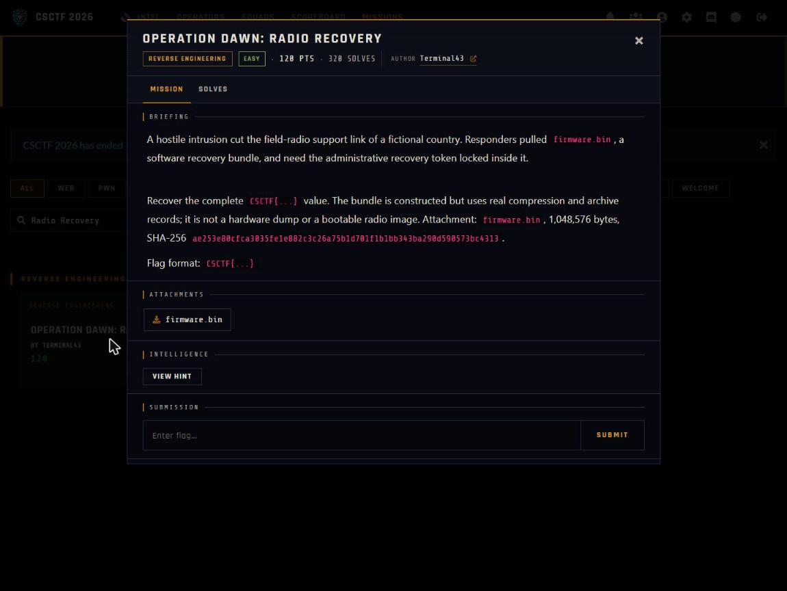

Challenge: Operation Dawn - Radio Recovery — Reverse Engineering / Easy / 120 pts / author: Terminal43 (CSCTF 2026)
Flag: CSCTF{05_train_kestrel_d48e1f}
Category: Reverse Engineering (zlib preset-dictionary firmware)
Tools used: Python (stdlib: struct, zlib, binascii), solve.py
Brief: Operation Dawn: Radio Recovery. A hostile intrusion cut the field-radio support link of a fictional country. Responders pulled firmware.bin, a software recovery bundle, and need the administrative recovery token locked inside it. Recover the complete CSCTF{...} value. The bundle is constructed but uses real compression and archive records; it is not a hardware dump or a bootable radio image. Attachment: firmware.bin (1,048,576 bytes, SHA-256 ae253e80...4313).

Steps:
1. Parse the container.
   - firmware.bin starts with "DWFW": u16 version, u16 entry count = 4, then 20-byte entries (name[8], u32 offset, u32
     size, u32 crc32). All four CRCs verify: loader (U-Boot SPL string), ubootenv (16 KiB), msgcat (258 bytes of boot
     strings), rootfs (633 bytes). The rest of the 1 MB is 0xFF (empty flash).

     

2. Inflate the rootfs with the right dictionary.
   - rootfs begins `78 f9 ...` -- a zlib stream with the preset-dictionary bit set; the 4-byte dictid equals adler32 of
     msgcat. So msgcat is the zlib preset dictionary. Inflate rootfs with zdict=msgcat (633 -> 2560 bytes) -> a newc cpio
     archive.

3. Read the archive and the key-derivation rule.
   - The cpio holds etc/config/radio with `admin_token=7f71b81e...7bed` (30 bytes hex) and etc/init.d/S40admin, which
     shows how the real key is built at boot: mac = ethaddr with the colons removed; key = each token byte XOR the
     corresponding mac byte, the 6-byte mac repeating.

4. Pick the active env and XOR.
   - ubootenv is a backup-style U-Boot environment: two 8 KiB copies, each `crc(4) | flag(1) | NUL-separated vars`. Both
     CRCs are valid; the newer copy (flag 7, recovery=ready) sets ethaddr=3c:22:fb:4a:1d:90, which is what fw_printenv
     reads at runtime. XOR the token with that MAC repeating -> CSCTF{05_train_kestrel_d48e1f}. (The stale copy's
     00:11:22:33:44:55 just yields garbage, confirming you must use the active env.)
   - Result: `python -I solve.py firmware.bin` prints ethaddr = 3c:22:fb:4a:1d:90 and the recovered key
     CSCTF{05_train_kestrel_d48e1f}.

Key insight: each layer names its own successor: the DWFW CRCs tell you the four blobs are intact, the zlib dictid points at msgcat as the dictionary, the init script spells out the XOR, and the env's flag byte + recovery state tell you which of the two MACs is live. Following those pointers instead of guessing is what turns the token into the real recovery key.
Reproduce: python -I solve.py firmware.bin (parses the DWFW container, inflates the rootfs with the msgcat preset dictionary, reads the cpio token and XOR rule, and XORs the token with the active env MAC; prints the recovery key)
