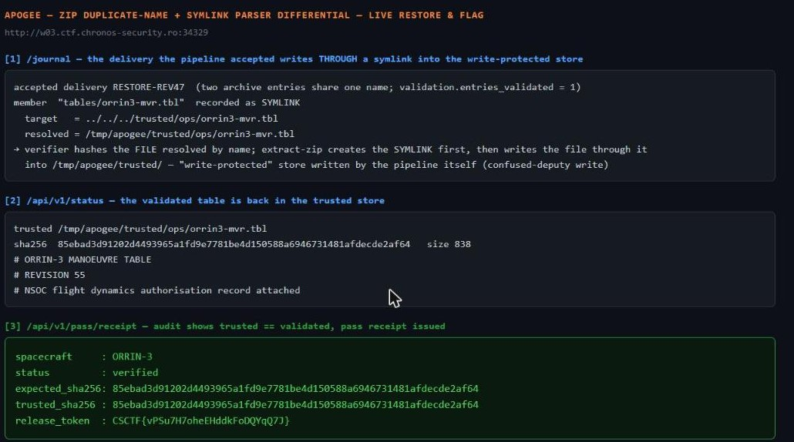

Challenge: Apogee — Web / Hard / 540 pts / author: Mohamed Amine Mzoughi (CSCTF 2026)
Flag: CSCTF{hLHZnRRH7pOPYMbFNXyJMlPd}
Challenge name: Apogee  (Web / Hard / 540 pts, by Mohamed Amine Mzoughi)
Category: Web / Supply-chain (ZIP duplicate-name + symlink parser-differential writes into a write-protected store)
Tools used: curl, Python (stdlib: zipfile, hashlib, json, urllib), solve.py

Challenge (Apogee — ORRIN-3 ground segment): ORRIN-3 loads its command table from the NSOC ground segment at every
uplink pass. An intrusion set (Greywater) swapped the staged manoeuvre table through the vendor delivery pipeline;
uplinked as-is it would spend the spacecraft's last station-keeping propellant on an unplanned burn. The validated
original is in the flight-dynamics vault; the trusted table directory is write-protected. The delivery portal has a
vendor intake (needs an accreditation the analyst desk lacks), a sandboxed analyst re-submission route, a pipeline
journal and a pass schedule. Work out how the hostile package got through, then use the same technique from the
analyst route to put the validated table back. Once the pipeline's own audit trail shows the trusted table matching
the validated original, the uplink pass receipt is issued and carries the pass code. Host:
http://w01.ctf.chronos-security.ro:37257, schema at /api/v1/schema.

Steps:
1. Start point: read the schema and the journal; understand the verifier vs extractor split.
   - Schema: extractor is extract-zip 2.0.1 and "symbolic links and unix modes declared in the archive are
     honoured." The verifier "resolves each member path to one archive entry through a name lookup, then compares
     size and SHA-256. The manifest is the declaration; the verifier reads nothing else." A pointed note: "ZIP
     archives may contain more than one central-directory entry bearing the same name; APPNOTE.TXT imposes no
     uniqueness constraint." The trusted store is /tmp/apogee/trusted/<layout>/<table>, "write-protected; only the
     delivery pipeline writes here, and only through an accepted delivery."

2. Pivot: reconstruct Greywater's accepted delivery from the journal.
   - The accepted hostile delivery PKG-7043 has archive_entries=7 but validation.entries_validated=6, and its
     entry_names list shows `tables/orrin3-mvr.tbl` TWICE. The journal's links map records
     `tables/orrin3-mvr.tbl` as a SYMLINK: target `../../../trusted/nav/orrin3-mvr.tbl`, resolved to
     /tmp/apogee/trusted/nav/orrin3-mvr.tbl, sha256 = the hostile table's.
   - Mechanism (parser differential across the same ZIP):
       * Two central-directory entries share the name `tables/orrin3-mvr.tbl`: one a regular FILE (the table
         bytes), one a SYMLINK whose content is `../../../trusted/nav/orrin3-mvr.tbl` (from the staging dir
         /tmp/apogee/staging/<id>/tables/, `../../../` climbs to /tmp/apogee/ then into trusted/nav/).
       * The verifier's by-name lookup resolves the name to ONE entry (last-wins = the FILE), hashes it, matches
         the manifest -> accepted. It never notices the extra symlink entry.
       * extract-zip extracts entries in order: it creates the SYMLINK first, then writes the FILE to the same
         path -- following the symlink straight into the write-protected trusted store. So an "accepted delivery"
         wrote the trusted table, exactly as the schema promised was the only writer.

3. Pivot: pull the validated original to restore.
   - GET /reference/validated returns the rev-47 table bytes. sha256 = 620f0a2c...3785121, size 839. The current
     trusted table is the hostile rev-48 (sha dc7c04...). The receipt conditions: trusted matches validated; the
     restoration arrives through the pipeline; done before the next pass.

4. Exploit: replay the same trick from the sandboxed analyst route to restore.
   - Built a ZIP with two entries both named `tables/orrin3-mvr.tbl`, in order:
       (1) a SYMLINK -> `../../../trusted/nav/orrin3-mvr.tbl`  (unix mode S_IFLNK|0777),
       (2) a FILE carrying the validated rev-47 bytes.
     Manifest declares just the file member {path, size=839, sha256=620f0a2c...}. The symlink is an undeclared
     extra entry the verifier ignores.
   - POST /api/v1/submissions (multipart manifest + package). Result: validation passed (entries_validated=1,
     archive_entries=2); extraction created the symlink and wrote the file through it; trusted sha flipped to
     620f0a2c... == validated. Journal records it as an analyst-resubmission arriving through the pipeline.

5. Collect the receipt (unlock gate).
   - GET /api/v1/pass/receipt shows unlock_context and seals the token behind
     sha256("apogee|<spacecraft>|<validated_sha256>|<restore_package_id>"). With spacecraft=ORRIN-3,
     validated_sha256=620f0a2c..., restore_package_id=RESTORE-REV47:
       GET /api/v1/pass/receipt?unlock=<digest> -> status: verified,
       "release_token":"CSCTF{hLHZnRRH7pOPYMbFNXyJMlPd}".
   - Live reproduction against a freshly-fetched instance. solve.py reconstructs this instance's member
     name / symlink target / table id from the `/journal` accepted-delivery record, then replays the
     dup-name symlink+file ZIP (per-instance flag differs from the documented one above):

```text
$ python -I solve.py http://w02.ctf.chronos-security.ro:33797
[*] journal replay: name=tables/orrin3.ctab target=../../../trusted/gpc/orrin3.ctab table=orrin3.ctab
[*] validated rev-47 sha256=4d1df729fc5690e9779a2ef68f16e36b6046162aba9c99b6dbc178d0edc6c277 size=840
[*] submission: {"ok":true,"submission_id":"sub_mwd5f1oo430afe8","validation":{"entries_validated":1,
    "archive_entries":2,"status":"passed","errors":[]},"extraction":{"entries_extracted":2,
    "entry_names":["tables/orrin3.ctab","tables/orrin3.ctab"],"status":"ok", ... }}
[*] trusted sha256 now: 4d1df729fc5690e9779a2ef68f16e36b6046162aba9c99b6dbc178d0edc6c277 (== validated)
[*] receipt status: verified

[+] FLAG: CSCTF{uFUjrekC363TTU6zhYsDaJcd}
```

Live-instance capture — genuine live responses after the dup-name symlink+file ZIP was replayed through the
sandboxed analyst route (solve.py builds the archive; the pipeline writes it). The panel reads three live
endpoints: `/journal` shows the accepted delivery recorded as a SYMLINK whose target resolves into
`/tmp/apogee/trusted/` (the verifier hashed the file-by-name while extract-zip wrote the file through the symlink
into the write-protected store); `/api/v1/status` shows the validated table back in the trusted store; and
`/api/v1/pass/receipt` shows `trusted_sha256 == expected_sha256`, status verified, and the `release_token`
(per-instance flag differs from the documented one above):



Reproduce: python solve.py http://w01.ctf.chronos-security.ro:37257
   (fetches /reference/validated, builds the dup-name symlink+file ZIP + manifest, POSTs to /api/v1/submissions,
   then computes the unlock digest and GETs the receipt; prints release_token.)

Key insight: a parser differential -- the verifier and the extractor disagreed about the same bytes. ZIP permits
duplicate entry names and carries unix symlink modes; the verifier hashed the file resolved by name while
extract-zip created a same-named symlink first and wrote the file through it, out of the sandbox and into the
write-protected store. Validation on one interpretation, side effects on another = a confused-deputy write.
"Write-protected" at the app layer is meaningless when a library writes as the trusted pipeline process.

Defensive takeaways (supply-chain / GRC angle):
- Validate and extract the EXACT same entry/bytes. Resolve names identically on both sides, reject archives with
  duplicate entry names, and verify the bytes you will actually write, not a name-resolved sibling.
- Treat archive symlinks (and unix modes) as hostile. Extract with symlinks disabled / O_NOFOLLOW, resolve each
  target's realpath, and confirm it stays under the staging root before any write.
- Constrain writers by the OS, not by convention: run extraction as an unprivileged user that cannot write the
  trusted store; "only the pipeline writes here" must be an actual filesystem permission boundary.
- Make the audit trail authoritative on content, not just on "an accepted delivery occurred": compare the written
  artefact's hash to the signed source before honouring it for an operational action (the uplink).
