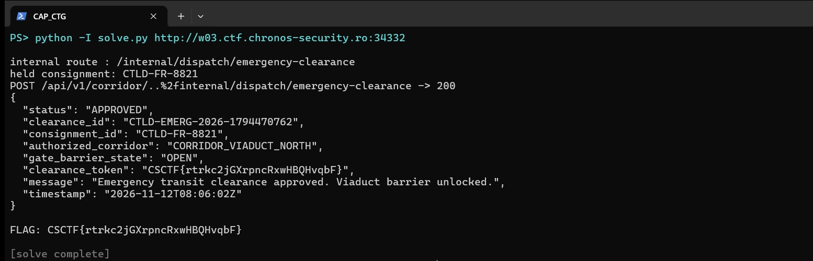

Challenge: Corridor Transit Gate — Web / Medium / 299 pts / author: Chronos Security (CSCTF 2026)
Flag: CSCTF{SmFMvFWfOKdQuYDPakuaJWtd}
Category: Web / API (API gateway broken access control)
Tools used: curl, Python (stdlib only), solve.py

Brief: a freight-corridor portal held convoy CTLD-FR-8821 at the Northern Viaduct (measured 46,200 kg vs a
40,000 kg structural limit). The public clearance endpoint rejects it; the only way to release the barrier is an
"emergency dispatch override" that lives under /api/v1/internal/*, which the edge gateway blocks for external
clients. The challenge is to reach that internal endpoint anyway — an API-gateway ACL bypass.

Steps:
1. Start point: the host and a downloaded OpenAPI spec (api_specification.json).
   - What I found: public routes for corridor status/assess, consignments, telemetry, and clearance/request.
     GET /api/v1/consignments shows CTLD-FR-8821 as HELD_AXLE_WEIGHT_DISCREPANCY at CP-04. The docket says the
     measured 46,200 kg exceeds the 40,000 kg viaduct limit, so the public POST /api/v1/clearance/request returns
     403 ERR_AXLE_WEIGHT_DISCREPANCY: "Clearance must be authorized via internal dispatch controller."

2. Pivot: where is the override? It is not in the public spec.
   - What I found: the portal docket page /portal/consignment/CTLD-FR-8821 has a "Supervisor Dispatch Override"
     button wired by a JS chunk at /static/assets/js/chunks/chunk-dispatch-admin.9c4d.js. That chunk hard-codes the
     hidden route and payload: POST /api/v1/internal/dispatch/emergency-clearance with
     {"consignment_id","reason"}, and the success response carries a clearance_token.
   - The catch: the edge gateway (Server: CTLD-Gateway, Go-ReverseProxy) returns 403
     GW_ACL_INTERNAL_ROUTE_PROHIBITED for anything under /api/v1/internal/*, "restricted to authorized intranet
     nodes." So a legit supervisor on the intranet can click the button; an external client cannot.

3. Pivot: profiling the gateway ACL (what did NOT work).
   - Source spoofing: X-Forwarded-For / X-Real-IP / X-Client-IP / True-Client-IP / CF-Connecting-IP (loopback and
     private ranges), trusted Host/node headers — all 403.
   - Rewrite headers: X-Original-URL / X-Rewrite-URL on an allowed path — ignored.
   - Provenance: X-Requested-With: XMLHttpRequest, Origin, Referer of the docket — all 403.
   - Hidden JSON fields on the public clearance (emergency/override/force/role/...) — ignored; it only checks the
     measured weight.
   - Boundary probing showed the ACL rejects the decoded path segment "internal" (e.g. intern%61l -> 403), and the
     backend does NOT decode %2f into a path separator (corridor%2fstatus -> 404).

4. Pivot: path-normalization discrepancy between gateway and backend (the bypass).
   - The gateway rejects a literal "/internal/" segment but leaves %2f encoded; the Go backend decodes "..%2f" to
     "../" and then collapses the dot-segment. So putting an encoded parent-ref before "internal", behind a real
     decoy sibling, is seen by the gateway as a path under /api/v1/corridor/ (allowed) and by the backend as the
     internal route:
         POST /api/v1/corridor/..%2finternal/dispatch/emergency-clearance
   - Why the obvious variants failed: literal "x/../internal/..." gets collapsed by the gateway too (403);
     "%2finternal" (encoding the slash) is kept encoded by the backend and doesn't route (404). Only the mix
     "..%2f" — encoded enough to dodge the gateway, decodable enough for the backend — hits both targets.

5. Result: 200 APPROVED, gate_barrier_state OPEN, clearance_token CSCTF{SmFMvFWfOKdQuYDPakuaJWtd}.

Reproduce: python -I solve.py http://HOST:PORT
  (Reads the hidden route from the JS chunk, finds the held consignment, and sends the mangled-path POST. A
  built-in check asserts the path-mangling function. Idempotent: re-running returns "already authorized".)

Key insight: the gateway and the backend disagree on what a path means. The gateway's allow/deny ran on a
slightly different normalization of the URL than the backend's router used to dispatch it. "..%2f" is the sweet
spot: the gateway doesn't decode %2f (so it never sees the /internal/ segment and allows the request), but the
backend does decode and collapse it (so it routes straight to the emergency-override handler). The front-end JS
handed over the exact endpoint and body — the whole challenge was defeating that one boundary control.

Defensive takeaways (API security / GRC angle):
- Never enforce access control on the raw/formatted URL at a proxy while a separate component does the routing.
  Normalize once (decode percent-encoding, resolve dot-segments, collapse slashes) and make the SAME normalized
  path drive both the ACL decision and the dispatch — or enforce the control at the service that owns the route.
- "Internal only" by network/path is not authentication. The emergency override should require a real identity
  (signed service token / mTLS) and authorization, not merely a source check that a path trick defeats.
  (OWASP API Top 10: API1 BOLA / API5 Broken Function Level Authorization; CWE-22 path traversal,
  CWE-290 authentication bypass by spoofing.)
- Don't ship privileged endpoints and payloads in client-side JS. The dispatch-admin chunk disclosed the exact
  internal route and request body to any anonymous visitor.
- Reject ambiguous requests at the edge: normalize or 400 on "..%2f", mixed-encoded separators, and "//" before
  they reach differing parsers.

Reproduction:

Run against a live instance (the clearance_token is minted per-instance):

```text
$ python -I solve.py http://w02.ctf.chronos-security.ro:33802
internal route : /internal/dispatch/emergency-clearance
held consignment: CTLD-FR-8821
POST /api/v1/corridor/..%2finternal/dispatch/emergency-clearance -> 200
{
  "status": "APPROVED",
  "clearance_id": "CTLD-EMERG-2026-1794466067",
  "consignment_id": "CTLD-FR-8821",
  "authorized_corridor": "CORRIDOR_VIADUCT_NORTH",
  "gate_barrier_state": "OPEN",
  "clearance_token": "CSCTF{GqqDaovVJIc1wJs7fl9OpkOX}",
  "message": "Emergency transit clearance approved. Viaduct barrier unlocked.",
  "timestamp": "2026-11-12T06:47:47Z"
}

FLAG: CSCTF{GqqDaovVJIc1wJs7fl9OpkOX}
```

Each fetched instance mints a fresh clearance_token, so the token value differs per run (the flag recorded at the top of this writeup is from an earlier solve); the path-normalization bypass and the barrier release are identical every time.

Live-instance flag capture — `solve.py` run against a freshly fetched instance: it discovers the hidden internal dispatch route, then issues the gateway-bypassing `POST /api/v1/corridor/..%2finternal/dispatch/emergency-clearance`. The genuine HTTP 200 APPROVED response shows `gate_barrier_state: OPEN` and the `clearance_token` (the captured flag):


