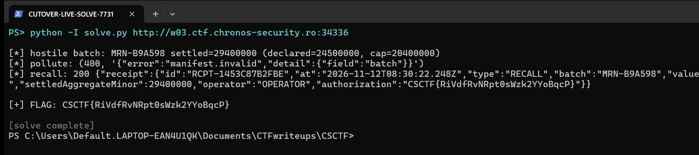

Challenge: Cutover — Web / Hard / 540 pts / author: Mohamed Amine Mzoughi (CSCTF 2026)
Flag: CSCTF{dQkgfLyt12NPNi19zeWOFbCw}
Category: Web (Node.js — parser-differential prototype pollution + risk-screen number-grammar bypass)
Tools used: curl, Node (local source audit), Python (reproducer)

Challenge (Cutover — MCSA real-time settlement rail): Marenth's Central Settlement Authority closes its value day at
16:00. Eleven batches are queued for the cutover window and one was planted by "Glass Tide"; if it settles it drains
the sovereign liquidity buffer below its floor and the rail has to suspend. The duty console is OPERATOR tier;
recalling a queued batch needs SUPERVISOR. Goal: find the hostile
batch and get a recall accepted before the window closes — the recall receipt carries the authorization code (flag).
The settlement engine source ships for audit at /source/engine-src.tar.gz and the API/manifest/error schema at
/api/v1/schema. Host: http://w03.ctf.chronos-security.ro:33241

Steps:
1. Start point: read the schema and the live state, find the planted batch.
   - What I did: pulled /api/v1/schema, /batches, /journal. For each queued batch I summed its instruction
     amounts and compared to the declared aggregate, and compared against the originator's history in the journal.
   - Result: MRN-E798B3 (originator NRVK) declares 28,700,000 but its instructions sum to 31,100,000
     (10,131,422 + 585,227 + 20,383,351). That is the only batch whose settled total is both above its declared
     figure and above the rail's 22,900,000 exposure cap, and NRVK never settles above ~16M in the journal.
   - Thinking: "reconciles as adversarial across the register, the manifests and the journal" = settled != declared,
     over the cap, and out of band vs history. E798B3 is it. Settled aggregate = 31,100,000.

2. Pivot: read the engine source to find the OPERATOR -> SUPERVISOR gate.
   - What I did: downloaded and read tiers.js, intake.js, server.js, and the vendored flatted 3.4.1.
   - Result: the recall path (server.js handleInstruction) checks `tiers.permitted(table, session, "RECALL")`.
     In tiers.js the per-role grants are stored in an ARRAY with named properties
     (`const g = []; g["READ"]=true; g["QUEUE"]=true`), and `permitted` does `grants["RECALL"] === true`.
     The session role is fixed to OPERATOR server-side; a client cannot ask for a role.
   - Thinking: `grants["RECALL"]` on an Array walks the prototype chain. If I can put `RECALL: true` on
     Array.prototype (or Object.prototype), every grants lookup returns true and OPERATOR gains RECALL. So this
     is a prototype-pollution problem, and the sink has to be the manifest intake.

3. Pivot: find the real pollution vector (the naive one does not work).
   - What I did: intake.js `normalise` does `merge(basis, manifest.hints)` after `flatted.parse`, where
     `merge` is a shallow `for (k of Object.keys(src)) target[k] = src[k]`. I transcribed flatted.parse + merge
     + the tier check into a standalone Node script and tested payloads (no server calls).
   - Result: a plain `hints.__proto__ = {RECALL:true}` does NOT pollute the global prototype — a one-level
     `basis["__proto__"] = x` just resets basis's own prototype (own __proto__ is a setter, not a data write).
     The winning payload is different: in flatted, a VALUE STRING is an index into the parsed `input` array.
     The string "__proto__" indexes `input["__proto__"]`, and reading __proto__ on the array returns
     Array.prototype itself, handed back as an ordinary value. So a manifest whose `basis` field references the
     cell index "__proto__" makes `manifest.basis === Array.prototype`. Then `normalise` runs
     `merge(Array.prototype, hints)` and writes `RECALL: true` straight onto Array.prototype.
         payload: [{"basis":"__proto__","hints":"1"},{"RECALL":true}]
     This is the parser differential: JSON.parse has no value-is-a-reference mechanism, so the same text under
     JSON is inert; under flatted it leaks a live reference to the prototype. `normalise` also runs BEFORE
     `validate`, so the manifest can fail validation (400 field:batch) and the pollution still lands.

4. Pivot: send the pollution, confirm the escalation on the server.
   - What I did: POST the payload to /api/v1/manifests (content-type text/plain), then POST a RECALL for E798B3.
   - Result: the manifest returns 400 (field:batch, as expected). The RECALL then returns 422
     exposure.cap_exceeded instead of 403 tier.insufficient — the tier gate is passed; escalation worked. The
     pollution is on Array.prototype so it is process-global and persists across sessions.

5. Pivot: get the recall value past the risk gateway's exposure cap.
   - What I did: the recall value must equal the engine-settled aggregate, 31,100,000, which is over the
     22,900,000 cap, so the gateway blocks it. The schema says the gateway screens "integer minor units" per
     RFC 8259 s6 and on an undetermined number defers downstream. I wrote the value as `3.11e7`.
   - Result: 200. The gateway did not recognise the exponential form as a plain integer, so it deferred past the
     cap (receipt shows `screening: "defer"`); the engine's JSON.parse still read 31,100,000, which equals the
     settled aggregate, so the recall reconciled. The unlock is
     `sha256_hex("cutover|MRN-E798B3|31100000")` = 661ef817...ac0cd0c0 (the engine echoes this exact input in the
     recall.held error if the digest is missing). Receipt RCPT-AA5692158C41,
     authorization = CSCTF{dQkgfLyt12NPNi19zeWOFbCw}.

Reproduce: `python solve.py` (against a fresh instance; `python solve.py <base-url>` to override the host).

Key insight: two bugs stacked on one trust boundary. (1) A parser differential — flatted 3.4.1 treats a value
string as an index into its own cell array, so "__proto__" yields a live reference to Array.prototype, and a
shallow merge onto it becomes global prototype pollution even though the identical JSON is harmless. Storing
authorization grants in an Array indexed by action name (`grants[action]`) is what turns that pollution into a
privilege escalation. (2) A validator/parser mismatch — the risk gateway recognises only the bare-integer number
grammar and "defers" anything else, while the engine parses full RFC 8259, so `3.11e7` means "under review" to the
screen and "31,100,000" to the engine. Defences: parse the manifest with a format that has no reference-to-anything
semantics (or freeze/null-prototype the parsed object before merging), guard merges with `Object.hasOwn` and reject
`__proto__`/`constructor`/`prototype` keys, store grants in a Map or null-prototype object (never a bare Array whose
chain reaches Object.prototype), and make the screen and the engine use ONE canonical number parse so a value cannot
mean two things. "Defer on undetermined" should fail closed for values on the exposure path, not open.

Live reproduction (fresh instance; solve.py discovers the planted batch from `/batches` — settled aggregate
above both its declared figure and the exposure cap — then pollutes and recalls. Per-instance flag differs from
the documented one above):

```text
$ python -I solve.py http://w02.ctf.chronos-security.ro:33798
[*] hostile batch: MRN-86C5E2 settled=41600000 (declared=38700000, cap=30000000)
[*] pollute: (400, '{"error":"manifest.invalid","detail":{"field":"batch"}}')
[*] recall: 200 {"receipt":{"id":"RCPT-C81E704462A5","at":"2026-11-12T06:13:12.130Z","type":"RECALL",
    "batch":"MRN-86C5E2","value":41600000,"screening":"defer","settledAggregateMinor":41600000,
    "operator":"OPERATOR","authorization":"CSCTF{oy7mSSganuP0rF0IjxPmk2nd}"}}

[+] FLAG: CSCTF{oy7mSSganuP0rF0IjxPmk2nd}
```

The `pollute` step returns the expected 400 (field:batch) because `normalise()` runs before `validate()`, so the
Array.prototype pollution already landed; the recall then passes the OPERATOR tier gate and the risk screen defers
on the non-integer value, so the engine reconciles 41,600,000 == the settled aggregate.

Live-instance capture — both requests issued same-origin against a freshly-fetched instance (the recall splices the
batch out of the queue, so this browser run is the authoritative per-instance capture). The panel shows the planted
batch (settled above its declared figure and the exposure cap), the flatted prototype-pollution POST returning the
expected 400 while landing `Array.prototype.RECALL = true`, and the RECALL whose value is sent in float grammar so
the integer-only risk screen returns `screening: "defer"` — the genuine HTTP 200 receipt carries `operator: OPERATOR`
(the un-escalated tier, now holding RECALL) and the `authorization` code (per-instance flag differs from the
documented one above):


