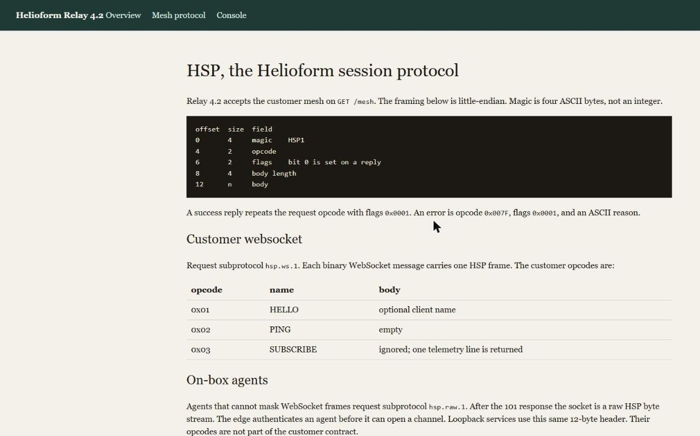
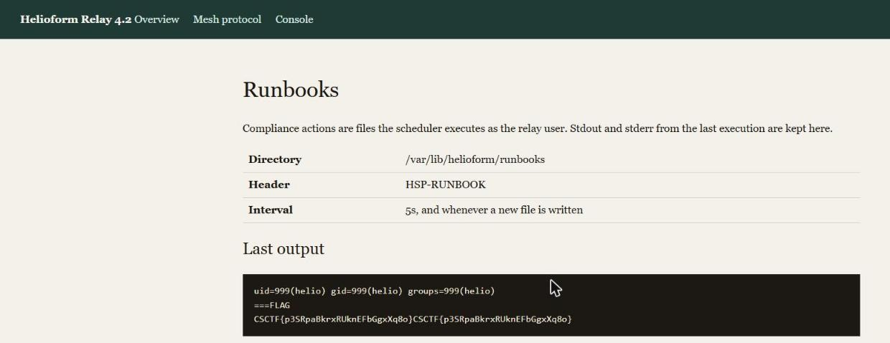

Challenge: Helioform Relay — Web / Hard / 682 pts / author: Ahmed Abdelmoemen (CSCTF 2026)
Flag: CSCTF{3vT2AVuphrSCp62fiWdAFdB2}
Category: Web (loopback SSRF to RCE)
Tools used: Python (stdlib: socket, hmac, hashlib, struct, base64), solve.py
Brief: Helioform Relay 4.2. An inert Helioform Relay appliance sits at the edge of the Kovari National Grid. A single service exposes an HTTP server, a WebSocket mesh and an admin console. "Somewhere between the legacy agent wire and the compliance ledger there is a path the provisioner never closed." Walk the appliance end-to-end and recover the staged incident tasking / flag. The chain is five flaws, each "a path the provisioner never closed." Host: http://w01.ctf.chronos-security.ro:37134 (/docs/hsp documents the mesh protocol; /console/login is the operator console).

Steps:
1. Open agent wire (authentication bypass).
   - /docs/hsp: the customer mesh is a WebSocket at /mesh with subprotocol hsp.ws.1; on-box agents use hsp.raw.1
     ("A normal WebSocket client must not send hsp.raw.1. That subprotocol exists for the appliance agent"). The
     doc says the edge "authenticates an agent before it can open a channel" -- but nothing enforces it. Requesting
     the hsp.raw.1 subprotocol drops me onto the raw HSP byte stream unauthenticated.
   - HSP framing: magic "HSP1", opcode (u16 LE), flags (u16 LE), body length (u32 LE), body. HELLO (0x01) returns:
     auth=legacy-proxy, commands=HELLO:0x01,PING:0x02,DIAL:0x10, dial=host:port, egress=127.0.0.1.

     

2. DIAL = built-in loopback SSRF.
   - DIAL (0x10) splices the connection to host:port but is locked to literal 127.0.0.1 (egress denied otherwise).
     A full loopback port scan through DIAL found hidden on-box services: 7710 catalogd, 7711 provd, 7712 recordd,
     7713 (recordd's replication peer wire), plus 8080 (the HTTP app bound on loopback).

3. Ticket + dotenv broker -> secret leak.
   - catalogd (7710) issues a nonce; sending the raw nonce back (opcode 0x20) mints a ticket (tkt.<nonce>.<mac>).
   - provd (7711) is a "dotenv broker": export (opcode 0x30, body "ticket=..\npath=..") reads env files. Paths are
     restricted to *.env under /etc/helioform/ (relative/"../" rejected). Exported /etc/helioform/relay.env ->
       CONSOLE_MAC_KEY=7f3c9a2e1b84d056a0c3e91f44b7d2aa
       CONSOLE_ISS=helioform-factory   CONSOLE_AUD=relay-console
       REPLICATION_MAC_KEY=c1d4e8f02a6b9375d0e1f4a8b2c65d90
     and /etc/helioform/collector.env -> COLLECTOR_PEER=relay-collector, LOG_ROOT=/var/log/helioform/streams.

4. Forgeable break-glass console cookie.
   - Per /docs/session the console cookie is hsp_session = payload_b64.mac_hex, mac_hex = HMAC-SHA256(
     CONSOLE_MAC_KEY, payload_b64) over a JSON {iss, aud, role, exp}; role=admin, iss/aud must match the factory
     environment, exp in the future. With the leaked key/iss/aud I forged an admin cookie; GET /console then shows
     the Mesh operator console with /console/trace (Peer trace) and /console/automation (Runbooks).

5. Replication-write -> RCE (the final "unclosed path", between the agent wire and the compliance ledger).
   - /console/automation: the scheduler executes files in /var/lib/helioform/runbooks every 5s as the relay user,
     and mirrors their stdout to the page. /console/trace documents the recordd replication wire (hsp-repl/1):
     peer hello (opcode 0x11) then commit blob (opcode 0x17); "mode 0x01 replaces the resolved stream file with
     body". MACs use REPLICATION_MAC_KEY (leaked) with the documented canonical strings; recordd status (0x40,
     with a ticket) gives the current epoch/tip/bind to chain a commit.
   - The stream_id is joined onto a root like os.path.join(root, stream_id). A relative/"../" id is rejected and a
     plain id fails ("open failed"), but an ABSOLUTE stream_id overrides the join and escapes entirely:
     stream_id = "/var/lib/helioform/runbooks/pwn" -> ok path=/var/lib/helioform/runbooks/pwn.
   - Peer=relay-collector; signed peer hello + commit blob (mode 1, current epoch/tip/bind) writes a runbook. The
     scheduler executes it (the runbook body is Python after the "HSP-RUNBOOK" header line), running as helio; its
     stdout on /console/automation reads /tmp/flag (/flag -> /tmp/flag):
       uid=999(helio) ... ===FLAG CSCTF{3vT2AVuphrSCp62fiWdAFdB2}
   - Result: a live reproduction against a freshly fetched instance (w02.ctf.chronos-security.ro:33799) leaked the
     console and replication MAC keys, read recordd epoch=7 on repl_port=7713, sent the signed repl hello (ok) and a
     mode-1 commit (ok path=/var/lib/helioform/runbooks/pwn), and after the scheduler ran the runbook the forged-admin
     /console/automation showed uid=999(helio) and the staged incident tasking CSCTF{xVDh8BbcQtGleeGgrtJLoYh1}. The
     replication cluster key is the raw dotenv string (ASCII), matching how the console cookie MAC key is used; the
     per-instance flag differs from the documented one above.

     

Key insight: defence-in-depth that is never enforced is decoration. An "agent-only" subprotocol with no auth, a dial primitive that is loopback SSRF, secrets a verifier signs with sitting in a reachable dotenv, a MAC key only as safe as every service that can read it, and os.path.join(root, attacker) that an absolute path walks straight out of -- each is routine, and chained they go from an inert bench to code execution as the relay user.
Defensive takeaways: Enforce the auth you document; "agents authenticate first" and "customers must not use hsp.raw.1" must be code, not a sentence, and the agent subprotocol must be rejected from untrusted peers. A loopback dial/splice is SSRF, so treat any proxy-to-127.0.0.1 primitive as an internet-facing request to every internal service, and segment/authenticate those services independently. Keep signing material out of readable config and off boxes reachable by untrusted input; a console-cookie MAC key in a dotenv the mesh can export is equivalent to admin, so scope key access and never let one leak forge another. Canonicalise and confine every path (reject absolute paths and "..", resolve the realpath, and check the prefix before writing), because os.path.join silently honours an absolute second argument. The compliance ledger must not be executable; storing replicated "stream" content where a scheduler runs it turns a data-write primitive into RCE, so separate audit data from anything the system executes.
Reproduce: python solve.py w01.ctf.chronos-security.ro 37134 (opens hsp.raw.1, DIALs the loopback services, mints a catalogd ticket, exports relay.env via provd for both MAC keys, speaks hsp-repl/1 to recordd's 7713 wire -- signed hello + mode-1 commit with an absolute stream_id -- to drop a Python runbook into /var/lib/helioform/runbooks, forges the admin console cookie, and reads the runbook stdout from /console/automation; prints the flag; stdlib only)
