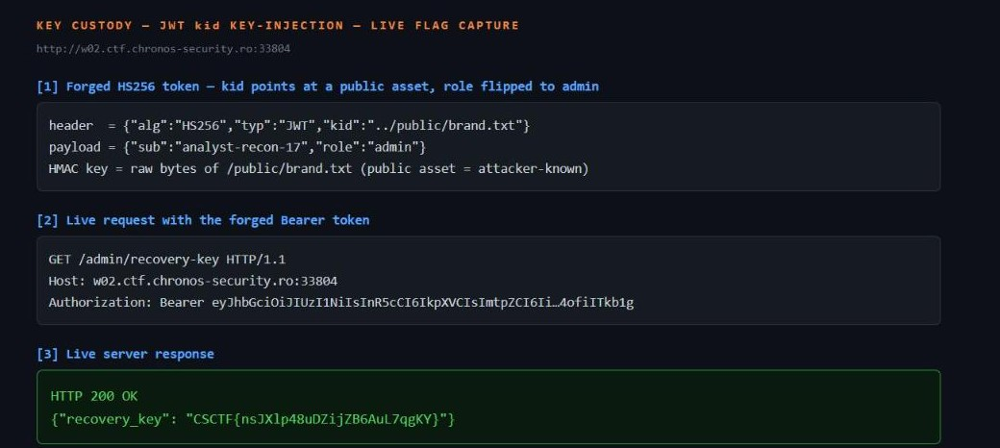

Challenge: Key Custody — Web / Easy / 120 pts / author: Chronos Security (CSCTF 2026)
Flag: CSCTF{Dk8U89uHR2NppHDtQNKcpR8h}
Category: Web (JWT HS256 kid key-injection)
Tools used: curl, Python (stdlib: hmac, hashlib, base64, urllib), solve.py
Brief: Key Custody. Vardanne Command's operations console signs each session with a JWT (HS256). You hold an analyst session; the objective (the custody recovery key) is on an admin-only route. GET /token issues your session, GET /schema is self-describing, and the console's public brand assets are served under /public/. Elevate to an admin session and read the flag. Host: http://w03.ctf.chronos-security.ro:33157 (per-launch instance; values below are for that case).

Steps:
1. Start point: read the self-describing schema and your issued token.
   - GET /schema: "Bearer JWT (HS256)"; the key line is verify = "the console loads each token's signing key by
     its `kid` (key id) header"; admin_only = "GET /admin/recovery-key requires the issued analyst subject and
     role=admin". Routes: GET /token, GET /public/{name} (public brand assets), GET /admin/recovery-key.
   - GET /token: {"sub":"analyst-recon-17","role":"analyst","token":"<JWT>"} whose header decodes to
     {"alg":"HS256","typ":"JWT","kid":"session"} and body {"sub":"analyst-recon-17","role":"analyst"}.

2. Pivot: the token chooses its own verification key.
   - "loads each token's signing key by its `kid`" means the HMAC secret is selected by an attacker-controlled
     header. The secret only has to be SECRET — but a public brand asset isn't: I can download its exact bytes.
     So if I point `kid` at a public asset and HMAC-sign with that asset's content, the console verifies against
     the same bytes and the forged token is valid.
   - Confirmed the admin route needs BOTH role=admin AND the issued subject: the issued analyst token on
     /admin/recovery-key returns 403 "issued analyst subject with role=admin required". So keep sub unchanged,
     flip role to admin.

3. Pivot: find the public asset that serves as a readable key.
   - Enumerated /public/. Hit: GET /public/brand.txt (200, 201 bytes) — a plain banner, the "public bytes" I can
     use as the HMAC key.

4. Exploit: forge an admin JWT keyed by the public asset.
   - Header {"alg":"HS256","typ":"JWT","kid":"../public/brand.txt"}, body {"sub":"analyst-recon-17","role":"admin"}.
   - key = the exact bytes of /public/brand.txt (including the trailing newline). sig = HMAC-SHA256(key,
     b64url(header)+"."+b64url(body)), base64url, no padding.
   - The `kid` needed a traversal prefix: the key loader resolves `kid` under a keystore directory, so a bare
     "brand.txt" failed to resolve; "../public/brand.txt" (relative to that dir) reaches the served asset. That
     the loader follows `..` at all is a second bug (no path sanitisation).
   - GET /admin/recovery-key with the forged Bearer token -> 200
     {"recovery_key":"CSCTF{Dk8U89uHR2NppHDtQNKcpR8h}"}.
   - Result: a live reproduction against a freshly fetched instance (w02.ctf.chronos-security.ro:33796) read the
     issued subject analyst-recon-17, used /public/brand.txt (201 bytes) as the HMAC key, and the forged-token GET
     /admin/recovery-key returned 200 with recovery_key CSCTF{KbqmZ0n37WXJ8TmTFcOWNgqM}. The flag is minted per
     instance, so the value differs from the documented one above.

     

Key insight: never let attacker-controlled token metadata select the verification key. `kid` picked the HMAC secret, and the secret was a publicly downloadable file — so the attacker holds the key and can mint any token. Two failures had to line up: a `kid` resolved as a filesystem path (with `..` traversal), and a key source that is not actually secret. Either alone is bad; together they are a full admin forge.
Defensive takeaways: Pin the algorithm AND resolve `kid` against a strict allow-list of key IDs mapped to secrets you control; never treat `kid` as a path, URL, or filename, and never fall through to the filesystem. Signing keys must be secret and stored outside any web-served directory — a key that can be fetched over /public is not a key, so separate "brand assets" and "signing material" into different trust zones. Sanitise every externally supplied identifier used for lookup (reject `..`, absolute paths, and separators) even when you think it only indexes a map. Bind sessions to immutable, server-issued claims and verify them server-side; here the admin route's extra "issued subject" check was good practice, but it is moot once the attacker can sign arbitrary claims.
Reproduce: python -I solve.py http://HOST:PORT (reads the issued subject from /token, downloads /public/brand.txt, forges an HS256 token with role=admin and kid=../public/brand.txt signed by the asset's bytes, requests /admin/recovery-key, prints recovery_key)
