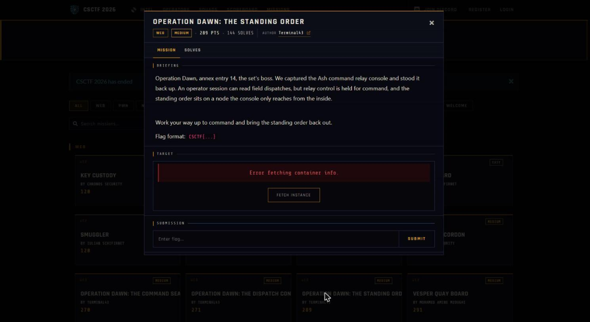
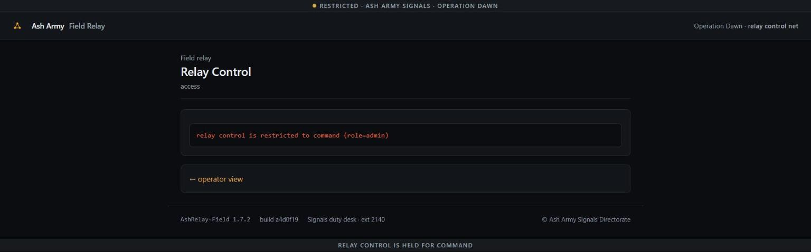

Challenge: Operation Dawn - The Standing Order — Web / Medium / 289 pts / author: Terminal43 (CSCTF 2026)
Flag: CSCTF{8UPCyUsVYt2lA2gnNVwD2Wqd}
Category: Web (signed-cookie forgery via SHA-1 hash length extension -> privilege escalation, then SSRF filter bypass)
Tools used: curl, Python (pure-stdlib SHA-1 length-extension, no deps), solve.py

This is "annex entry 14, the set's boss" of the Operation Dawn web set. (Its sibling, "Operation Dawn: The Command
Seal" / annex 18 / 270 pts, is a different, harder challenge — RSA-sealed orders + XXE — which I did not solve.)

Challenge briefing (captured from the CSCTF 2026 scoreboard):


Brief: the coalition recaptured the Ash command relay console and stood it back up. An operator session can read field
dispatches, but relay control (role=admin) lives at /relay, and the standing order sits on a node the console only
reaches "from the inside." Goal: escalate operator -> command and pull the standing order out.
Host: http://w01.ctf.chronos-security.ro:42300 (per-instance).

Steps:
1. Start point: look at the session cookie.
   - What I did: GET /; decode the Set-Cookie.
   - Result: session = <hexpayload>.<40-hex-sig>. The hex decodes to `user=guest&role=operator`; the 40-hex trailer
     is a SHA-1. /relay returns 403 for operator and says command relay control needs role=admin.
   - Thinking: a 40-hex (SHA-1) tag over `user=guest&role=operator`. It is not plain SHA-1 of the payload and not
     any guessable HMAC key, so it is a secret-PREFIX MAC: sig = SHA1(secret || "user=guest&role=operator"). That
     construction is the textbook hash length-extension setup.

2. Escalate: SHA-1 hash length extension to forge role=admin.
   - What I did: without knowing the secret, append "&role=admin" to the signed message using a length-extension
     attack, brute-forcing the unknown secret length 0..64. The payload is hex(original || glue-padding ||
     "&role=admin"); the new SHA-1 is computed by resuming the hash state from the known digest. (pure-Python SHA-1
     in solve.py.) The query parser takes the LAST `role`, so `operator` -> `admin`.
   - Result: secret length = 16 bytes. The forged cookie opened /relay with HTTP 200 (Command Relay Control). Forged
     payload bytes: `user=guest&role=operator` + 0x80 + zero pad + length(0x140 bits) + `&role=admin`.

3. Enumerate: the admin relay page.
   - What I did: read /relay with the forged cookie.
   - Result: an internal node map (node1-3.relay.internal), a provisioning service at
     http://127.0.0.1:9091/order, and a node-status probe: GET /relay/probe?target=<node-url>.
   - Thinking: the "standing order on a node the console only reaches from the inside" is the provisioning service.
     The probe is a server-side fetcher -> SSRF to 127.0.0.1:9091.

4. Exploit: SSRF to the internal provisioning node, bypassing the IP filter.
   - What I did: probe target=http://127.0.0.1:9091/order -> "relay target refused: 127.0.0.1". The filter also
     refuses `localhost`, `0.0.0.0`, `[::1]`. I re-encoded 127.0.0.1 as its 32-bit integer: 2130706433.
   - Result: target=http://2130706433:9091/order sailed past the string blacklist (the socket layer parses the
     integer back to 127.0.0.1), and the probe returned the standing order:
         CSCTF{8UPCyUsVYt2lA2gnNVwD2Wqd}

Live reproduction against a freshly-fetched instance (per-instance flag differs from the documented one above):

```text
$ python -I solve.py http://w02.ctf.chronos-security.ro:33806
[*] payload: b'user=guest&role=operator' sig: 099e7a979ccf933c0965b0287bfef720f80bc3d5
[+] secret length = 16; /relay unlocked (admin)
[+] flag: CSCTF{ChcexQIutFR2z7RLSlutlXjk}
```

Live-instance evidence — the relay control gate the chain defeats. The console issues an `HttpOnly` operator
session, so the forged `role=admin` cookie must be replayed by a raw HTTP client (solve.py above); a browser
cannot overwrite an `HttpOnly` cookie, so the in-browser view shows the live command-only gate that the SHA-1
length-extension forgery bypasses before the decimal-encoded SSRF pulls the standing order:



Reproduce: python -I solve.py http://w01.ctf.chronos-security.ro:42300
  (decodes the cookie, length-extends to role=admin brute-forcing secret length, confirms /relay=200, then SSRFs
  http://2130706433:9091/order through /relay/probe and prints the flag. Instances are per-launch.)

Key insight: two classic bugs chained. (1) A secret-prefix SHA-1 MAC (SHA1(secret||data)) is forgeable via length
extension without the secret — you can append attacker data and still produce a valid tag; here that flips
role=operator to role=admin. (2) The SSRF guard was a string blacklist of loopback spellings, so an alternate
encoding of the same address (decimal 2130706433) reaches 127.0.0.1 anyway.

Defensive takeaways (API security / GRC angle):
- Sign cookies with HMAC-SHA-256, not SHA1(secret||data). HMAC is immune to length extension. Better still, sign a
  canonical serialization and reject duplicate/trailing keys so a second `role=` can't override the first.
- Don't carry authorization state (role) in a client-held, string-concatenated blob; keep it server-side keyed by an
  opaque session id, or at least bind the whole structured claim set, not a flat query string.
- SSRF defense is not a string blacklist. Resolve the host to an IP, then allow/deny-list the PARSED address against
  loopback/link-local/private ranges (decimal, hex, octal, IPv6-mapped all normalize to the same in_addr), and
  re-check after DNS resolution. Prefer an explicit allowlist of the exact internal hosts the probe may reach.
