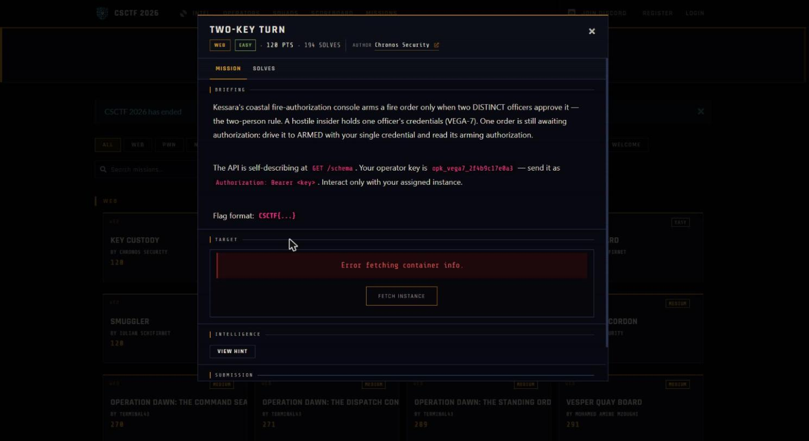

Challenge: Two-Key Turn — Web / Easy / 120 pts / author: Chronos Security (CSCTF 2026)
Flag: CSCTF{ZAO7IqUwGlXKuxr9mxR4uBkC}
Category: Web (TOCTOU approval-rule race)
Tools used: curl, Python (threading, stdlib only), solve.py
Brief: Kessara's coastal fire-authorization console arms a fire order only when TWO DISTINCT officers each cast APPROVE — the "two-person rule" (required_approvals = 2). A hostile insider holds ONE officer's credential (VEGA-7, operator key opk_vega7_2f4b9c17e0a3, sent as `Authorization: Bearer <key>`). One order is still awaiting authorization. Goal: drive it to ARMED with the single credential and read its arming authorization (the flag). Host: http://w01.ctf.chronos-security.ro:42296 (per-instance). The API self-describes at GET /schema.

Steps:
1. Start point: read the self-describing schema.
   - What I did: GET /schema with the bearer key.
   - Result: the authorization model spelled out its own weakness:
       two_person_rule: "an order arms only when TWO DISTINCT officers have each cast APPROVE (required_approvals = 2)"
       approve:         "idempotent per officer while an approval window is pending"
       pending_ttl_seconds: 8.0
       concurrent_action:  "an ordinary 6-8 separate-connection approval burst is supported"
     Routes: GET /orders, GET /orders/{id}, POST /orders/{id}/approve (Bearer required, empty body).
     arming_authorization appears on the order detail only AFTER it reaches ARMED.
   - Thinking: "distinct officers" + "idempotent per officer" + an 8s pending window + an explicit hint that a
     6-8 connection burst "is supported" screams a check-then-act race. The distinctness test is almost certainly
     non-atomic: read current approvals -> verify the caller is a NEW officer -> append. Fire enough approvals from
     the one credential simultaneously and two of them land inside the same window, each seeing 0 prior VEGA-7
     approvals, each passing the distinctness test before either commits.

     

2. Find the target order.
   - What I did: GET /orders.
   - Result: AO-7D31C9 (Coastal Battery 3 / Saltmarsh) is PENDING_AUTH with approvals 0, required 2. The others
     are REJECTED / EXECUTED / DRAFT. AO-7D31C9 is the only one still awaiting authorization.

3. Exploit: concurrent approval burst from the single credential.
   - What I did: 8 threads, each holding its own connection, all released at once with a threading.Barrier, each
     POSTing /orders/AO-7D31C9/approve with the VEGA-7 bearer key. (solve.py.)
   - Result: on the first burst the order armed. 7 of the 8 responses came back:
         status ARMED, approvals 2, approval_records = [ {officer:"VEGA-7",epoch:1}, {officer:"VEGA-7",epoch:1} ]
     i.e. TWO approval records BOTH belonging to VEGA-7, same epoch — the distinctness check was bypassed. The 8th
     thread lost the race (202, PENDING_AUTH, approvals 1, retry_after_ms 7869). The armed detail carried:
         arming_authorization: CSCTF{ZAO7IqUwGlXKuxr9mxR4uBkC}

Key insight: the two-person rule is an invariant ("2 distinct officers"), and the server enforced it with a read-check-write sequence that was not atomic. Under concurrency the gap between "check the caller is a new officer" and "commit the approval record" lets a single officer's parallel requests each pass the check before any of them writes, so one credential satisfies a rule that requires two. The 8-second pending window just made the race wide and comfortable.
Defensive takeaways: Enforce the distinctness invariant in the data layer, atomically — a UNIQUE(order_id, officer_id) constraint plus a single transactional INSERT-then-count, or a row lock (SELECT ... FOR UPDATE) around the count-and-insert, makes duplicate concurrent approvals from one officer collapse to one. Never gate a security invariant on an application-level "have I seen this officer yet?" read that is separate from the write; check and commit in one atomic step. Idempotency keys per (officer, order, window) close the replay/duplicate path, and a check-constraint on count(distinct officer) >= 2 makes the arm transition impossible to reach with one identity. Separation-of-duties controls (maker/checker, two-person release, four-eyes) are exactly the controls most often defeated by races, so test them explicitly under parallel load, not just sequentially.
Reproduce: python -I solve.py http://w01.ctf.chronos-security.ro:42296 opk_vega7_2f4b9c17e0a3 AO-7D31C9 (GETs /orders to find the PENDING_AUTH order if the id is omitted, fires an 8-way barrier-synced approve burst, and prints arming_authorization; instances are per-launch, and the run that captured the flag armed on the first burst)
