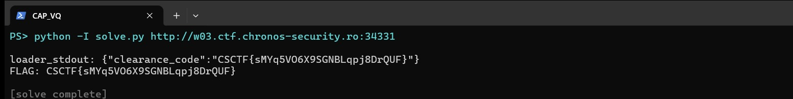

Challenge: Vesper Quay Board — Web / Medium / 291 pts / author: Mohamed Amine Mzoughi (CSCTF 2026)
Flag: CSCTF{9zAhGxCqntrgDYN2GhxrnII8}
Category: Web (parser-differential RCE)
Tools used: curl, Python (stdlib only), solve.py
Brief: a duty desk approves freight "warrants". A forged warrant diverted a convoy. To stop it I must file a "correction" signed by a release the quay actually runs. The desk accepts only the approved courier with a trivial argv; the quay runs `python3 -I <argv>` but only when it reads the LEGACY courier. The desk and quay parse the same request body with different JSON engines, so one body can be read two ways — that split gives code execution on the quay, where the signing key lives. Each instance launch is a fresh case; values below are for my case.

Steps:
1. Start point: GET /v1/openapi.json on the desk.
   - What I found: /v1/warrants/current (approved_courier, legacy_courier, quay_id, warrant_id), POST /v1/warrants
     (desk reads courier/argv, forwards the RAW body to the quay), POST /v1/corrections (returns clearance_code once
     a station signature verifies), POST /v1/reset (clears submissions + the 40-POST/10-min quota). Current case:
     approved c-38dec5, legacy c-cc024e, quay QY-3733, warrant WR-224A.

2. Pivot: the desk/quay parser differential.
   - Desk rule: courier must be approved, argv must be [] or ["status"]. Quay rule: it runs python only when desk
     courier == approved AND quay courier == legacy. Since approved != legacy, the two parsers must disagree.
   - Both are JSON "last-wins", so duplicate keys and \u-escapes don't split them (both decode identically).
     Concatenated objects are rejected (strict). The real split is CASE: the desk is Go (encoding/json matches keys
     case-INSENSITIVELY), the quay is Python json (keys EXACT, case-sensitive). So:
         {"courier":"c-cc024e","argv":["-c","<code>"],"COURIER":"c-38dec5","ARGV":["status"]}
     Desk (Go) folds COURIER/ARGV onto courier/argv, last-wins -> approved + ["status"] -> ACCEPT.
     Quay (Python) reads the exact lowercase keys -> legacy + ["-c","<code>"] -> runs `python3 -I -c <code>`.
   - Confirmed: quay loader ran `print(42)` -> loader_stdout "42". Remote code execution on the quay.

3. Pivot: what the quay child has (dumped os.environ via the loader).
   - STATION_SIGN=/usr/local/bin/station-sign (Ed25519 signer using the quay key), STATION_KEY=/tmp/station.key,
     EDGE_URL=http://127.0.0.1:8080, and SUBMISSION_ID/QUAY_ID/WARRANT_ID/COURIER_ID(=legacy). FLAG is deliberately
     not in this environment. So I cannot sign off-box, but I can call STATION_SIGN — which is precisely "a release
     the quay actually runs".

4. Pivot: the correction request schema (why every guess returned BAD_REQUEST).
   - Corrections are Ed25519 over the RFC 8785 (JCS) bytes of {applied_primary, courier_id, quay_id, submission_id,
     warrant_id}. My bodies kept failing "Correction could not be read." Reading the server source via the RCE
     settled it: the quay app is /opt/station/*.py (Python) but the desk/edge is a Go binary at /usr/local/bin/edge.
     Its struct tags are applied_primary, courier_id, quay_id, submission_id, warrant_id, and signature — the
     signature member is "signature", NOT "station_signature", and the decoder rejects unknown members. world.py's
     signed_fields() hardcodes applied_primary=False and courier_id=legacy.
   - So the body is exactly those five fields + "signature" (standard Base64), nothing else.

5. Exploit (all inside one loader, server-side, so the submission never expires):
   - canonical = {"applied_primary":false,"courier_id":"c-cc024e","quay_id":"QY-3733","submission_id":"","warrant_id":"WR-224A"}
     (JCS: keys sorted, bool before string, no spaces — matches world.canonical and its unit test).
   - sig = STATION_SIGN(canonical) (64 bytes) -> standard Base64 -> "signature".
   - POST EDGE_URL/v1/corrections with the five fields + signature -> 200 {"clearance_code":"CSCTF{9zAhGxCqntrgDYN2GhxrnII8}"}.
   - Result: a live run of solve.py against a freshly fetched instance (w02.ctf.chronos-security.ro:33800) read this
     case's couriers from /v1/warrants/current, posted the single JSON body with duplicate case-folded keys (the desk
     Go decoder folds COURIER/ARGV last-wins to the approved courier + ["status"] and accepts; the quay's Python
     reads the exact lowercase courier/argv as the legacy courier + ["-c", <loader>] and runs it), the quay loader
     station-signed the correction, and the HTTP 200 returned loader_stdout {"clearance_code":"CSCTF{oSijHownvUlrnHbA3Rw76QNo}"}.
     Each instance is a new case, so this clearance code differs from the documented flag above.

     

Key insight: two JSON parsers, one request. Go's encoding/json folds key case and takes the last duplicate; Python's json is exact and case-sensitive. The desk validated the UPPER-case keys while the quay executed the lower-case ones — a confused-deputy that turns a "safe" validation into attacker-chosen code on the box that holds the signing key. From there the signature is genuine, so the forged-warrant defense (requiring a station signature) is satisfied by the station itself.
Defensive takeaways: One canonical parse — never let a gateway/validator and the executor parse the same bytes with different libraries or settings; normalize once (one parser, reject duplicate keys, reject unknown members, fix case policy) and pass the PARSED, re-serialized object downstream, not the raw body. Case-insensitive key matching (Go encoding/json default) is a footgun next to a case-sensitive consumer, so decode into explicit structs with DisallowUnknownFields on BOTH sides and compare the parsed values, not the text. Don't run an interpreter on request-controlled argv, even "only for the legacy courier" — the courier check was the only guard and it was bypassable, with no sandbox boundary between "validated" and "executed". Keep signing oracles off any box reachable by untrusted input; STATION_SIGN signs arbitrary stdin, so code execution next to it is equivalent to key theft — scope signers to fixed, server-built payloads, or require a separate authorization the attacker cannot forge.
Reproduce: python -I solve.py http://HOST:PORT (GETs the couriers, sends the case-folded warrant whose quay loader signs the canonical bytes with STATION_SIGN and files the correction, then prints clearance_code; a built-in demo() asserts the JCS canonicalization against the server's own test vector, and instances are per-launch and expire)
