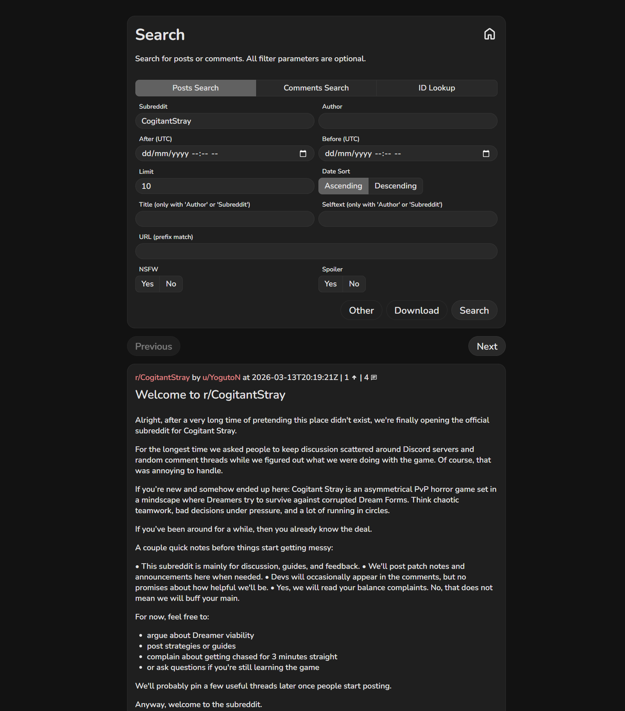
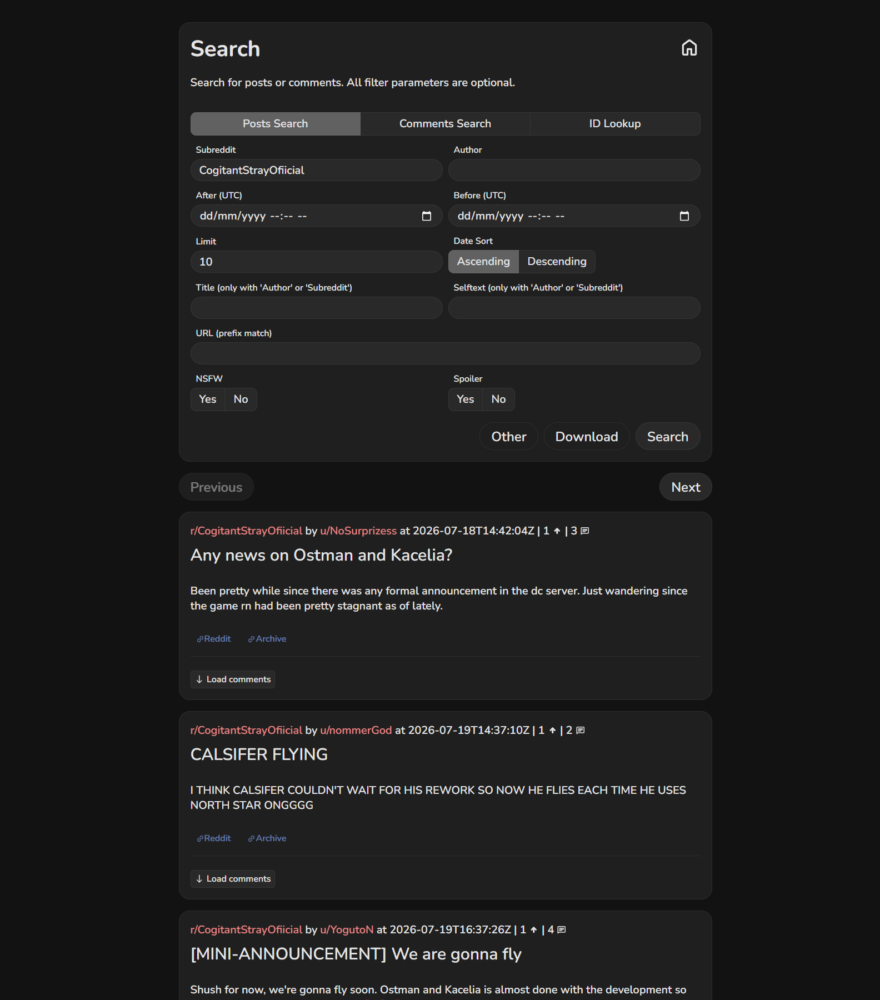
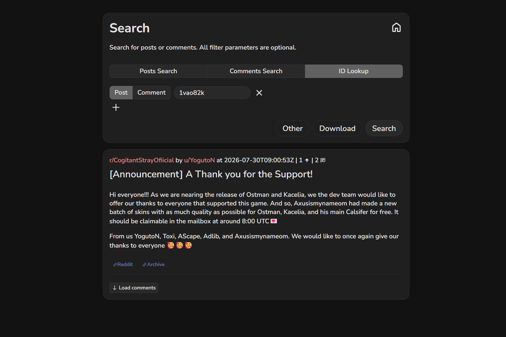
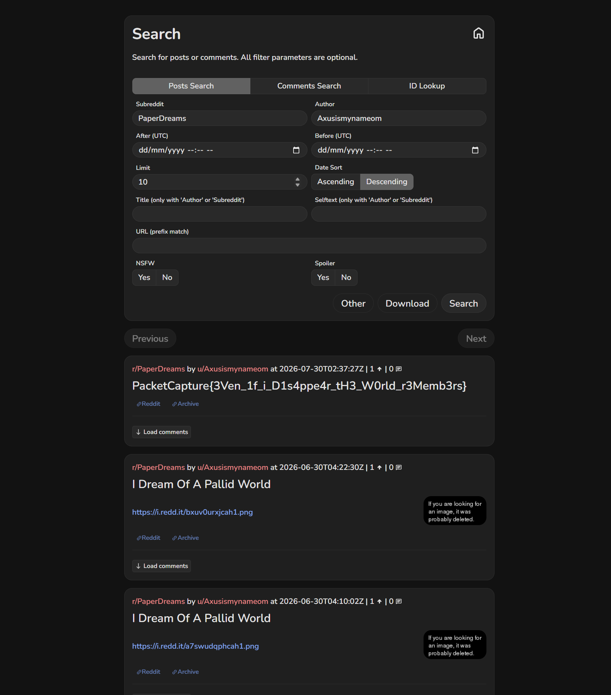

Flag: PacketCapture{3Ven_1f_i_D1s4ppe4r_tH3_W0rld_r3Memb3rs}
Category: OSINT
Tools used: curl, Arctic Shift Reddit archive (API and web search), Python, grep

Steps:
1. Start point: the subreddit r/CogitantStray.
   - What I found: the subreddit is banned, so Reddit shows nothing.
   - Thinking: a ban hides content from the live site but doesn't erase it. Third-party archives such as Arctic Shift
     keep a copy of every post and comment as it was made, so the "deleted" community is still readable there.

2. Pivot: the archive of r/CogitantStray.
   - What I did: pulled all of its posts and comments from Arctic Shift and searched them for "PacketCapture{".
   - Result: no flag inside the banned subreddit itself, but a full list of who was active (YogutoN, the game's dev,
     opened the sub on 2026-03-13).
   - Thinking: the content wasn't there, but the archive gives me the people. When a community is banned, its
     members usually regroup somewhere else, so the people are the trail, not the subreddit.

     

3. Pivot: the authors, and where they moved.
   - What I did: listed every author from the archive and looked up which other subreddits each of them posts in.
   - Result: the same names (YogutoN, nommerGod, pin-needles, Wasaboomm19...) reappear in r/CogitantStrayOfiicial,
     a misspelled "official" migration sub. A dev announcement there by YogutoN credits "Axusismynameom" as part of
     the dev team.
   - Thinking: overlap between several members is the signal that this is the new home. The announcement turns one
     username into a named insider, which makes that account worth following on its own.

     

     

4. Pivot: u/Axusismynameom's other posts.
   - What I did: searched the archive for that author's posts and grepped for "PacketCapture{".
   - Result: in r/PaperDreams, a post titled with the flag (2026-07-30), next to two "I Dream Of A Pallid World" posts.
   - Thinking: the flag text itself ("even if I disappear, the world remembers") confirms the intended lesson.

     

Note: live Reddit pages block automated browsers (reCAPTCHA / network block), so all screenshots come from the
Arctic Shift archive, which is also the tool that solved the challenge.

Key insight: Bans and deletions remove content from the live site, not from the internet. Archives keep it, and
following the people instead of the place shows where a community moved.
